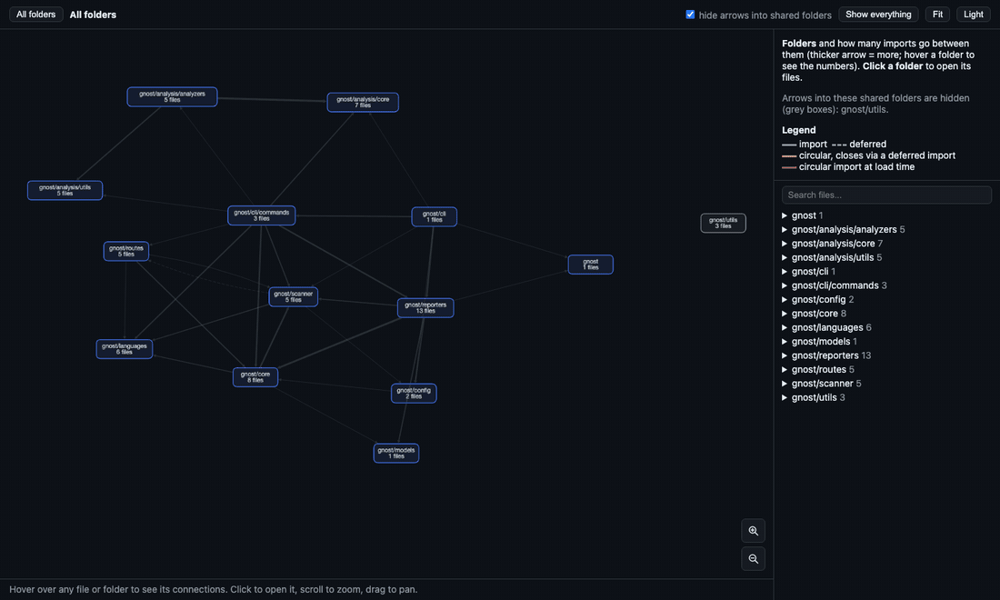
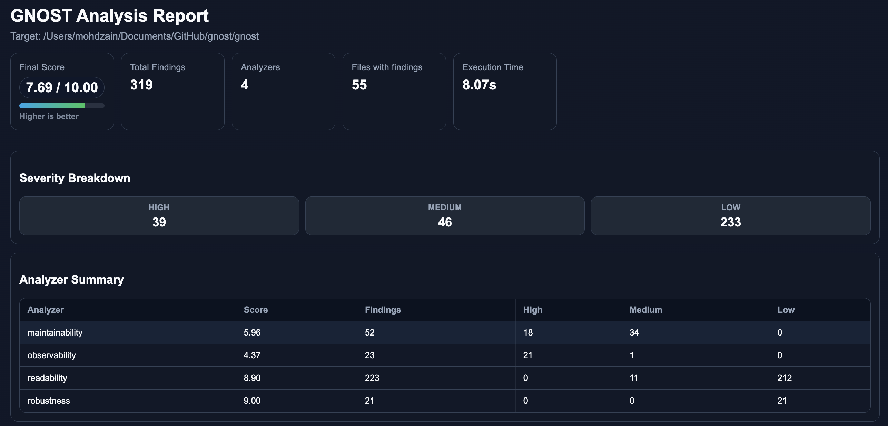

# GNOST: Codebase Knowledge

[](https://pypi.org/project/gnost/)
[](https://pypi.org/project/gnost/)
[](https://github.com/mohdzain98/gnost/blob/main/LICENSE)

GNOST is a lightweight static analysis CLI that helps you understand an unfamiliar codebase in minutes. It finds where execution starts, maps how it flows, points out the files that matter most, and writes onboarding documentation and Mermaid diagrams. `gnost analyze` adds a quality score with prioritized findings.

Good for first-day onboarding, audits and exploring code you did not write.

## What you get

- **Entry points and routes:** where execution starts, and HTTP endpoints for Flask, FastAPI, Django, Express, NestJS and Spring.
- **Execution flow:** Mermaid diagrams of imports, plus function-level flow for Python.
- **Hotspot files and caution areas:** the files most worth reading first, and the risky ones to read carefully.
- **Circular imports**, listed and drawn.
- **`ONBOARD.md`:** a written guide to the repository, plus the same facts as JSON for tools and AI, all saved in a `.gnost/` folder.
- **Quality analysis:** maintainability, robustness, observability and readability, with a score and prioritized findings (Python projects).
- **Any repository by address:** `gnost onboard https://github.com/owner/repo` clones it read only, writes the results to your current folder and deletes the clone. Nothing in the repository is run.
- **Languages:** Python, JavaScript, TypeScript and Java.

## Install

```bash
pip install gnost
```

Or install it as an isolated tool:

```bash
pipx install gnost
```

Or run it once without installing:

```bash
pipx run gnost onboard .
uvx gnost onboard .
```

Requires Python 3.9 or newer.

## Usage

```bash
gnost onboard .                  # writes the .gnost/ folder: guide, diagrams, JSON, explorer
gnost onboard . --layered --depth 3
gnost summary .                  # languages, files and lines of code
gnost stats .                    # detailed stats per language
gnost folders .                  # lines of code by folder
gnost files .                    # largest files
gnost analyze .                  # quality report
gnost analyze . --parallel -o    # run analyzers in parallel and open the report
gnost open flow                  # interactive flow explorer in your browser
gnost changes origin/main        # what your change touches: blast radius, risk, new cycles
gnost onboard https://github.com/owner/repo   # any public repository (read only)
gnost init                       # write a complete .gnost.toml
```

Add an optional `.gnost.toml` at the repository root for excludes, weights and thresholds. Command-line flags win over the file.

## Explore the flow in your browser

`gnost open flow` opens the diagrams as an interactive explorer: a folder overview first, click a folder to see its files, click a file to see what it imports and what imports it. It works offline.



## The analysis report



## Links

- Documentation: https://gnost.readthedocs.io
- Source: https://github.com/mohdzain98/gnost
- Issues: https://github.com/mohdzain98/gnost/issues
- Changelog: https://github.com/mohdzain98/gnost/blob/main/CHANGELOG.md

MIT licensed.
