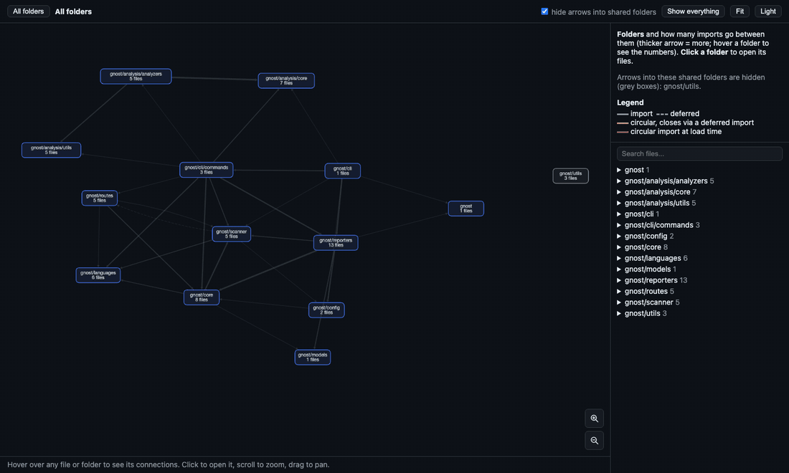
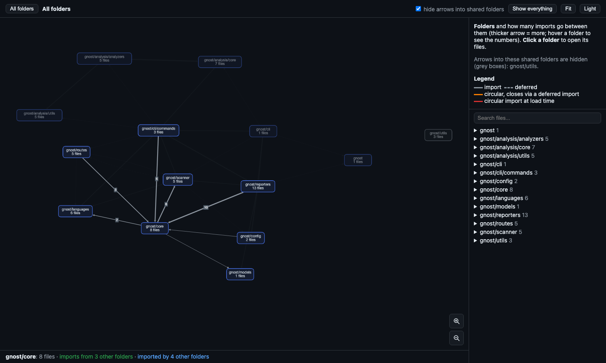
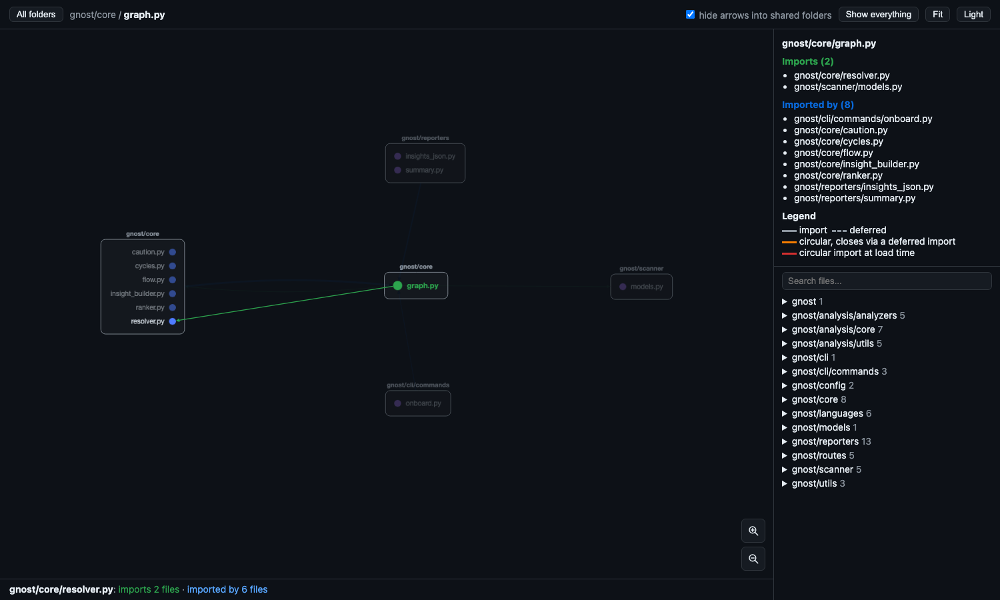
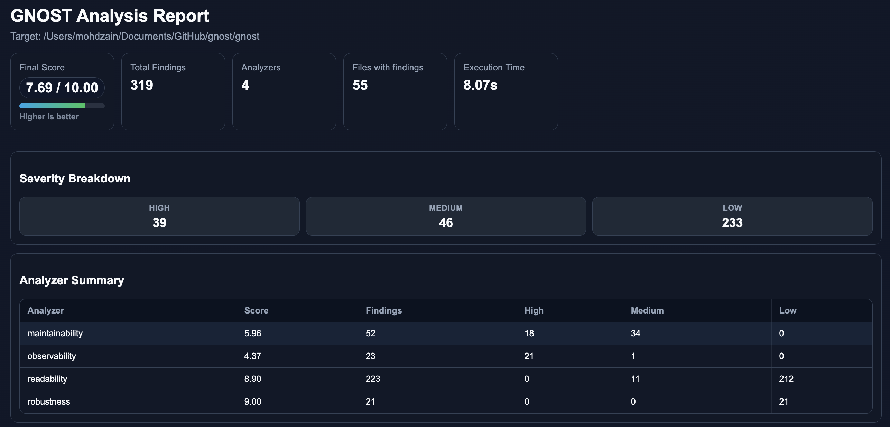

# GNOST — Codebase Knowledge


[](https://github.com/mohdzain98/gnost/actions/workflows/tests.yml)


GNOST is a lightweight static analysis CLI tool that helps developers understand unfamiliar codebases in minutes.<br>
It automatically detects entry points, maps execution flow, identifies critical files, and generates onboarding documentation and Mermaid diagrams.  

It also performs quality analysis (`gnost analyze`) for maintainability, robustness, observability, and readability to provide a fast quality score and prioritized findings.

Perfect for first-day onboarding, audits, and codebase exploration.

## 🚀 Why GNOST?
- Quickly build a mental model of a new codebase
- See how execution flows without reading everything
- Generate onboarding docs and Mermaid diagrams with one command

## 🧠 What GNOST Does
- Detects **where execution starts**
- Infers **high-level execution flow**
- Identifies **hotspot files** (most important code)
- Generates **onboarding documentation**
- Produces **Mermaid flow diagrams**, plus an interactive **browser explorer** (`gnost open flow`)
- Finds **HTTP routes** (Flask, FastAPI, Django, Express, NestJS, Spring), **circular imports** and **caution areas** (risky files to read carefully)
- Traces **function-level flows** for Python, and exports everything as **JSON** for tools and AI
- Reads an optional **`.gnost.toml`** for excludes, weights and thresholds
- Runs code **quality analysis** for maintainability, robustness, observability, and readability

## Install

```bash
pip install gnost
# or without installing into a project:
uvx gnost onboard .
pipx run gnost onboard .
```

No Python? Use `npx gnost-cli onboard .` or the Docker image
`ghcr.io/mohdzain98/gnost`. See the [install guide](https://gnost.readthedocs.io/en/latest/install.html).

Run the onboarding scan:

```bash
gnost onboard .
```

## Explore the flow in your browser (since 0.4.0)

`gnost onboard .` writes Mermaid diagrams to `docs/flow/`. For big projects,
`gnost open` opens them as an interactive explorer instead of one tangled picture:

```bash
gnost open flow
# or any file: gnost open docs/flow/flow-complete.mmd   (gnost show FILE does the same)
```



- **Folder overview first.** Each outlined box is a folder; arrows show how many imports go between them.
- **Click a folder** to see its files and the files it touches, with one arrow per neighbouring folder.
- **Click a file** (or pick it from the list) to see what it imports and what imports it.
- **Hover anything** and everything not connected to it fades, so its boxes and arrows stand out; the line at the bottom
  tells you its connections (for example `gnost/core/resolver.py: imports 2 files · imported by 6 files`).
- **Zoom** with the magnifier `+` / `-` buttons, the mouse wheel, or the Fit button.
- Dark by default, with a light theme button. Circular imports are red and orange.

| Folder overview (hovering a folder) | A file and what connects to it |
| --- | --- |
|  |  |

The example above is GNOST analysing its own source code.

## Minimal usage examples

```bash
gnost summary .
gnost stats .
```

## Analysis (since 0.3.0)

```bash
gnost analyze .
gnost analyze . --parallel -o
gnost open report
```

### Analysis report preview



### Analysis scope

- `gnost analyze` currently supports Python codebases only.
- JavaScript/TypeScript/Java analysis is planned for future releases.

## 🌍 Supported Languages


## 🎯 Who Is This For?
- Developers joining a new team
- Engineers reviewing legacy code
- Startup founders auditing repos
- Tech leads onboarding new hires
- Open-source contributors

## 📊 Example Use Cases
- First-day onboarding automation
- Codebase documentation generation
- Architecture visualization
- Legacy system analysis
- Rapid technical due diligence


## 📚 Documentation:
[](https://gnost.readthedocs.io)

## 📜 Changelog:
[](./CHANGELOG.md)

## 🧩 Philosophy
GNOST prioritizes:
- Fast insights over deep AST complexity
- Practical developer onboarding
- Clear summaries over raw metrics
- Zero-config usage

It is designed to be simple, fast, and immediately useful.

## License

MIT License
