# express — Project Onboarding Guide

_Generated automatically by <a href='https://gnost.readthedocs.io'>GNOST</a>._

## Project Overview

- **Root:** `https://github.com/expressjs/express`
- **Languages:** javascript (50)
- **Framework:** Express

## Summary Table

| Language | Files | LOC |
|---|---:|---:|
| JavaScript | 142 | 22046 |

## Stats Table

| Language | Files | Code | Comments | Blanks | LOC |
|---|---:|---:|---:|---:|---:|
| JavaScript | 142 | 17543 | 461 | 4042 | 22046 |

## Entry Points

- `examples/auth/index.js` — Server listen() call
- `examples/content-negotiation/index.js` — Server listen() call
- `examples/cookie-sessions/index.js` — Server listen() call
- `examples/cookies/index.js` — Server listen() call
- `examples/downloads/index.js` — Server listen() call
- `examples/ejs/index.js` — Server listen() call
- `examples/error-pages/index.js` — Server listen() call
- `examples/error/index.js` — Server listen() call
- `examples/hello-world/index.js` — Server listen() call
- `examples/markdown/index.js` — Server listen() call
- `examples/multi-router/index.js` — Server listen() call
- `examples/mvc/index.js` — Server listen() call
- `examples/online/index.js` — Server listen() call
- `examples/params/index.js` — Server listen() call
- `examples/resource/index.js` — Server listen() call
- `examples/route-map/index.js` — Server listen() call
- `examples/route-middleware/index.js` — Server listen() call
- `examples/route-separation/index.js` — Server listen() call
- `examples/search/index.js` — Server listen() call
- `examples/session/index.js` — Server listen() call
- `examples/session/redis.js` — Server listen() call
- `examples/static-files/index.js` — Server listen() call
- `examples/vhost/index.js` — Server listen() call
- `examples/view-constructor/index.js` — Server listen() call
- `examples/view-locals/index.js` — Server listen() call
- `examples/web-service/index.js` — Server listen() call
- `index.js` — Common JS entry filename
- `lib/application.js` — Server listen() call

## Routes

59 endpoints found. Each row is a URL and the code that handles it.

| Method | Path | Handler | File |
|---|---|---|---|
| GET | `/` | `<inline>` | `examples/auth/index.js:84` |
| GET | `/` | `<inline>` | `examples/content-negotiation/index.js:9` |
| GET | `/` | `<inline>` | `examples/cookie-sessions/index.js:16` |
| GET | `/` | `<inline>` | `examples/cookies/index.js:24` |
| GET | `/` | `<inline>` | `examples/downloads/index.js:15` |
| GET | `/` | `<inline>` | `examples/ejs/index.js:45` |
| GET | `/` | `<inline>` | `examples/error-pages/index.js:30` |
| GET | `/` | `<inline>` | `examples/error/index.js:29` |
| GET | `/` | `<inline>` | `examples/hello-world/index.js:7` |
| GET | `/` | `<inline>` | `examples/markdown/index.js:32` |
| GET | `/` | `<inline>` | `examples/multi-router/index.js:10` |
| GET | `/` | `<inline>` | `examples/online/index.js:50` |
| GET | `/` | `<inline>` | `examples/params/index.js:47` |
| GET | `/` | `<inline>` | `examples/resource/index.js:78` |
| GET | `/` | `<inline>` | `examples/route-middleware/index.js:70` |
| GET | `/` | `site.index` | `examples/route-separation/index.js:36` |
| GET | `/` | `<inline>` | `examples/session/index.js:22` |
| GET | `/` | `<inline>` | `examples/session/redis.js:27` |
| GET | `/` | `<inline>` | `examples/vhost/index.js:25` |
| GET | `/` | `<inline>` | `examples/view-constructor/index.js:32` |
| GET | `/` | `<inline>` | `examples/view-locals/index.js:26` |
| POST | `/` | `<inline>` | `examples/cookies/index.js:39` |
| GET | `/403` | `<inline>` | `examples/error-pages/index.js:41` |
| GET | `/500` | `<inline>` | `examples/error-pages/index.js:48` |
| GET | `/:sub` | `<inline>` | `examples/vhost/index.js:29` |
| GET | `/Readme.md` | `<inline>` | `examples/view-constructor/index.js:39` |
| ANY | `/api/*` | `<inline>` | `examples/view-locals/index.js:143` |
| GET | `/api/repos` | `<inline>` | `examples/web-service/index.js:80` |
| GET | `/api/user/:name/repos` | `<inline>` | `examples/web-service/index.js:85` |
| GET | `/api/users` | `<inline>` | `examples/web-service/index.js:75` |
| GET | `/api/v1` | `<inline>` | `examples/multi-router/controllers/api_v1.js:7` |
| GET | `/api/v1/users` | `<inline>` | `examples/multi-router/controllers/api_v1.js:11` |
| GET | `/api/v2` | `<inline>` | `examples/multi-router/controllers/api_v2.js:7` |
| GET | `/api/v2/users` | `<inline>` | `examples/multi-router/controllers/api_v2.js:11` |
| GET | `/client.js` | `<inline>` | `examples/search/index.js:69` |
| GET | `/fail` | `<inline>` | `examples/markdown/index.js:36` |
| GET | `/files/*file` | `<inline>` | `examples/downloads/index.js:26` |
| GET | `/forget` | `<inline>` | `examples/cookies/index.js:34` |
| GET | `/login` | `<inline>` | `examples/auth/index.js:100` |
| GET | `/logout` | `<inline>` | `examples/auth/index.js:92` |

_...and 19 more; the full list is in the insights JSON (`--json`)._

## Execution Flow (High Level)

- `examples/auth/index.js` → `index.js` → `lib/express.js` → `lib/request.js`
- `examples/auth/index.js` → `index.js` → `lib/express.js` → `lib/response.js`
- `examples/auth/index.js` → `index.js` → `lib/express.js` → `lib/application.js` → `lib/utils.js`
- `examples/auth/index.js` → `index.js` → `lib/express.js` → `lib/application.js` → `lib/view.js`
- `examples/content-negotiation/index.js` → `examples/content-negotiation/db.js`

_(108 additional paths omitted for clarity.)_

## Execution Flow (Overview)

```mermaid
flowchart TD
  examples_auth_index_js["examples/auth/index.js"]
  examples_content_negotiation_index_js["examples/content-negotiation/index.js"]
  examples_cookie_sessions_index_js["examples/cookie-sessions/index.js"]
  examples_cookies_index_js["examples/cookies/index.js"]
  examples_downloads_index_js["examples/downloads/index.js"]
  examples_ejs_index_js["examples/ejs/index.js"]
  examples_error_pages_index_js["examples/error-pages/index.js"]
  examples_error_index_js["examples/error/index.js"]
  examples_hello_world_index_js["examples/hello-world/index.js"]
  examples_markdown_index_js["examples/markdown/index.js"]
  examples_multi_router_controllers_api_v1_js["examples/multi-router/controllers/api_v1.js"]
  examples_multi_router_controllers_api_v2_js["examples/multi-router/controllers/api_v2.js"]
  examples_multi_router_index_js["examples/multi-router/index.js"]
  examples_mvc_index_js["examples/mvc/index.js"]
  examples_mvc_lib_boot_js["examples/mvc/lib/boot.js"]
  examples_online_index_js["examples/online/index.js"]
  examples_params_index_js["examples/params/index.js"]
  examples_resource_index_js["examples/resource/index.js"]
  examples_route_map_index_js["examples/route-map/index.js"]
  examples_route_middleware_index_js["examples/route-middleware/index.js"]
  examples_route_separation_index_js["examples/route-separation/index.js"]
  examples_search_index_js["examples/search/index.js"]
  examples_session_index_js["examples/session/index.js"]
  examples_session_redis_js["examples/session/redis.js"]
  examples_static_files_index_js["examples/static-files/index.js"]
  examples_vhost_index_js["examples/vhost/index.js"]
  examples_view_constructor_index_js["examples/view-constructor/index.js"]
  examples_view_locals_index_js["examples/view-locals/index.js"]
  examples_web_service_index_js["examples/web-service/index.js"]
  index_js["index.js"]
  lib_application_js["lib/application.js"]
  lib_express_js["lib/express.js"]
  lib_response_js["lib/response.js"]
  examples_auth_index_js --> index_js
  examples_content_negotiation_index_js --> index_js
  examples_cookie_sessions_index_js --> index_js
  examples_cookies_index_js --> index_js
  examples_downloads_index_js --> index_js
  examples_ejs_index_js --> index_js
  examples_error_pages_index_js --> index_js
  examples_error_index_js --> index_js
  examples_hello_world_index_js --> index_js
  examples_markdown_index_js --> index_js
  examples_multi_router_controllers_api_v1_js --> index_js
  examples_multi_router_controllers_api_v2_js --> index_js
  examples_multi_router_index_js --> examples_multi_router_controllers_api_v1_js
  examples_multi_router_index_js --> examples_multi_router_controllers_api_v2_js
  examples_multi_router_index_js --> index_js
  examples_mvc_index_js --> examples_mvc_lib_boot_js
  examples_mvc_index_js --> index_js
  examples_mvc_lib_boot_js --> index_js
  examples_online_index_js --> index_js
  examples_params_index_js --> index_js
  examples_resource_index_js --> index_js
  examples_route_map_index_js --> lib_express_js
  examples_route_middleware_index_js --> lib_express_js
  examples_route_separation_index_js --> index_js
  examples_search_index_js --> index_js
  examples_session_index_js --> index_js
  examples_session_redis_js --> index_js
  examples_static_files_index_js --> index_js
  examples_vhost_index_js --> index_js
  examples_view_constructor_index_js --> index_js
  examples_view_locals_index_js --> index_js
  examples_web_service_index_js --> index_js
  index_js --> lib_express_js
  lib_express_js --> lib_application_js
  lib_express_js --> lib_response_js
```

> 📌 This diagram shows the high-level execution flow. For the complete flow, see [**flow/flow-full.md**](./flow/FLOW-full.md) Raw Mermaid: [flow/flow-full.mmd](./flow/FLOW-full.mmd) Every file and import, ungrouped (for tools and AI): [flow/flow-complete.mmd](./flow/flow-complete.mmd) Interactive explorer: run `gnost open flow` (the page is `flow.html` in this folder; it is rebuilt, not committed)

## Recommended Reading Order

### Start Here

- `examples/auth/index.js`
- `examples/content-negotiation/index.js`
- `examples/cookie-sessions/index.js`
- `examples/cookies/index.js`
- `examples/downloads/index.js`
- `examples/ejs/index.js`
- `examples/error-pages/index.js`
- `examples/error/index.js`
- `examples/hello-world/index.js`
- `examples/markdown/index.js`
- `examples/multi-router/index.js`
- `examples/mvc/index.js`
- `examples/online/index.js`
- `examples/params/index.js`
- `examples/resource/index.js`
- _...and 11 more (closest to an entry point listed first)_

### Core Logic

- `examples/multi-router/controllers/api_v1.js`
- `examples/multi-router/controllers/api_v2.js`
- `examples/mvc/lib/boot.js`
- `index.js`
- `lib/express.js`
- `lib/application.js`
- `lib/response.js`

### Supporting / Leaf Code

- `examples/content-negotiation/db.js`
- `examples/route-separation/post.js`
- `examples/route-separation/site.js`
- `examples/route-separation/user.js`
- `examples/view-constructor/github-view.js`
- `examples/view-locals/user.js`
- `lib/request.js`
- `lib/utils.js`
- `lib/view.js`

## 📘 First Files to Read
- **`index.js`**
  - Primary entry point into the application
- **`lib/express.js`**
  - Core logic file referenced by multiple execution paths
- **`examples/route-separation/index.js`**
  - Primary entry point into the application
- **`examples/multi-router/index.js`**
  - Primary entry point into the application
- **`examples/content-negotiation/index.js`**
  - Primary entry point into the application
- **`examples/mvc/index.js`**
  - Primary entry point into the application
- **`examples/view-constructor/index.js`**
  - Primary entry point into the application
- **`examples/view-locals/index.js`**
  - Primary entry point into the application
- **`examples/auth/index.js`**
  - Primary entry point into the application
- **`examples/cookie-sessions/index.js`**
  - Primary entry point into the application

## ⚠️ Caution Areas
### `lib/response.js`
- **Type:** large_file
- **Severity:** 4
- **Caution score:** 75/100 (partial: some checks need Python)
- 908 lines of code; about 153 branches (estimated)
### `index.js`
- **Type:** high_impact
- **Severity:** 4
- **Caution score:** 70.8/100 (partial: some checks need Python)
- Imported by 27 files

## Change Hotspots

_Not available: git log failed: fatal: could not fetch 40b73e6de1666c93b5df5c978dd22020e333d0ba from promisor remote_

## 🔁 Circular Dependencies

_No circular dependencies detected._
## Key Execution Paths

To understand specific scenarios, see the entry-based execution paths:

- 📍 [Entry-based Paths](flow/entry-paths.md)

- 🧭 [folder-based Paths](flow/folder-paths.md)

(Whole system: [flow/FLOW-full.md](flow/FLOW-full.md). For a small project it is the same as [flow/flow-complete.mmd](flow/flow-complete.mmd), every file and import; for a big one FLOW-full groups them by folder to stay readable. Interactive: `gnost open flow`.)

---

Generated by [GNOST](https://gnost.readthedocs.io) 0.6.1. Try it on your own code: `npx gnost-cli onboard .`
