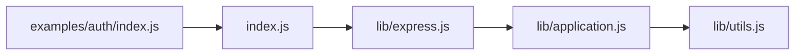
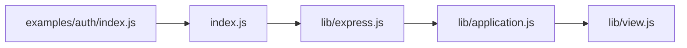
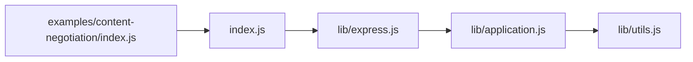

# Entry-based Execution Paths

These diagrams show individual execution paths starting from application entry points. Each path represents one possible flow through the system.

## Path 1 — `examples/auth/index.js`

**Execution chain:** examples/auth/index.js → index.js → lib/express.js → lib/application.js → lib/utils.js

## Path 2 — `examples/auth/index.js`

**Execution chain:** examples/auth/index.js → index.js → lib/express.js → lib/application.js → lib/view.js

## Path 3 — `examples/content-negotiation/index.js`

**Execution chain:** examples/content-negotiation/index.js → index.js → lib/express.js → lib/application.js → lib/utils.js

---

Generated by [GNOST](https://gnost.readthedocs.io) 0.5.3. Try it on your own code: `npx gnost-cli onboard .`
