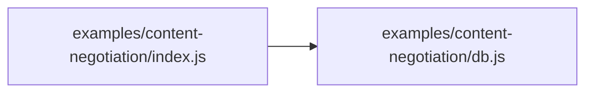
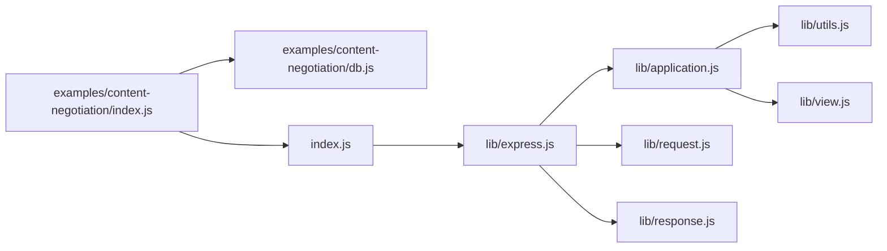
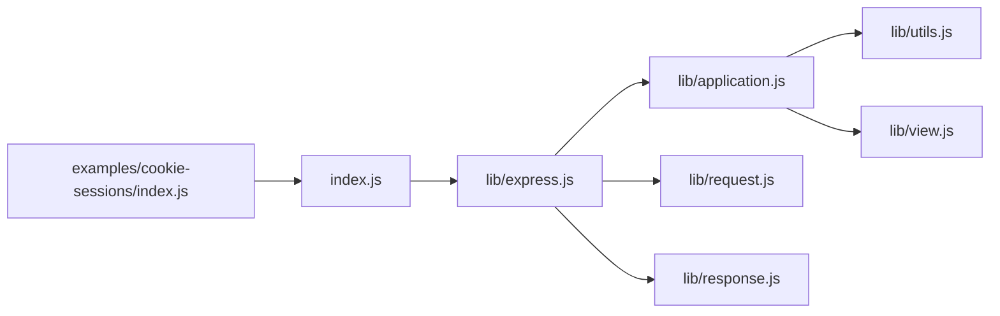
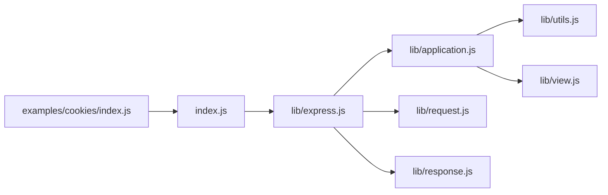
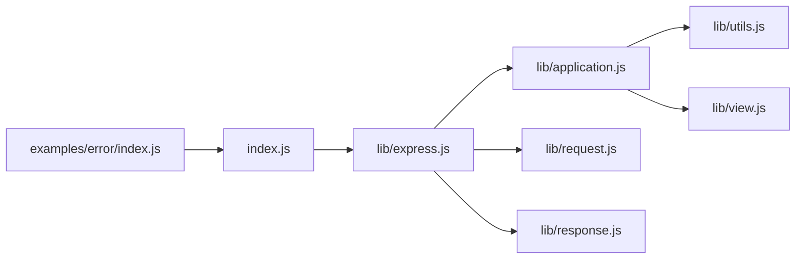
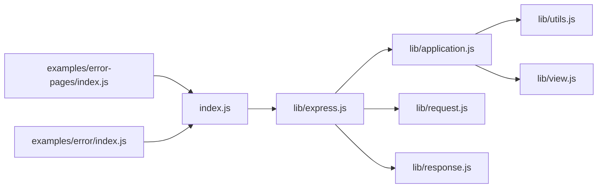
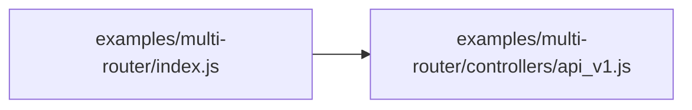
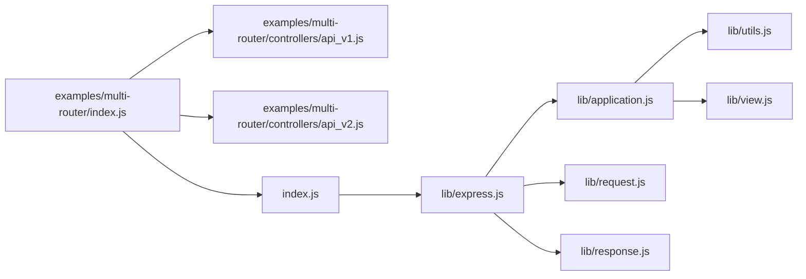
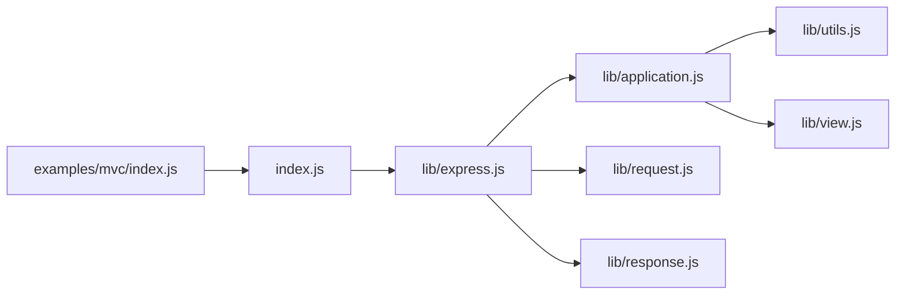
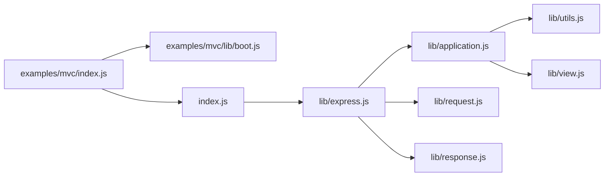

# Keyword-based Execution Paths

These diagrams show execution flows related to key features, auto-detected from the project structure.

## Feature: `auth`

### Representative Paths

#### Path Group 1


**Execution chain:** examples/auth/index.js → index.js → lib/express.js → lib/application.js → lib/utils.js

### Combined Flow (All `auth` Paths)


## Feature: `content-negotiation`

### Representative Paths

#### Path Group 1


**Execution chain:** examples/content-negotiation/index.js → index.js → lib/express.js → lib/application.js → lib/utils.js

#### Path Group 2


**Execution chain:** examples/content-negotiation/index.js → examples/content-negotiation/db.js

### Combined Flow (All `content-negotiation` Paths)



## Feature: `cookie-sessions`

### Representative Paths

#### Path Group 1


**Execution chain:** examples/cookie-sessions/index.js → index.js → lib/express.js → lib/application.js → lib/utils.js

### Combined Flow (All `cookie-sessions` Paths)


## Feature: `cookies`

### Representative Paths

#### Path Group 1


**Execution chain:** examples/cookies/index.js → index.js → lib/express.js → lib/application.js → lib/utils.js

### Combined Flow (All `cookies` Paths)


## Feature: `downloads`

### Representative Paths

#### Path Group 1


**Execution chain:** examples/downloads/index.js → index.js → lib/express.js → lib/application.js → lib/utils.js

### Combined Flow (All `downloads` Paths)


## Feature: `error`

### Representative Paths

#### Path Group 1


**Execution chain:** examples/error-pages/index.js → index.js → lib/express.js → lib/application.js → lib/utils.js

#### Path Group 2


**Execution chain:** examples/error/index.js → index.js → lib/express.js → lib/application.js → lib/utils.js

### Combined Flow (All `error` Paths)



## Feature: `multi-router`

### Representative Paths

#### Path Group 1


**Execution chain:** examples/multi-router/index.js → index.js → lib/express.js → lib/application.js → lib/utils.js

#### Path Group 2


**Execution chain:** examples/multi-router/index.js → examples/multi-router/controllers/api_v1.js

### Combined Flow (All `multi-router` Paths)



## Feature: `mvc`

### Representative Paths

#### Path Group 1


**Execution chain:** examples/mvc/index.js → index.js → lib/express.js → lib/application.js → lib/utils.js

#### Path Group 2


**Execution chain:** examples/mvc/index.js → examples/mvc/lib/boot.js

### Combined Flow (All `mvc` Paths)



## Feature: `route-separation`

### Representative Paths

#### Path Group 1

```mermaid
flowchart LR
  examples_route_separation_index_js["examples/route-separation/index.js"]
  index_js["index.js"]
  lib_application_js["lib/application.js"]
  lib_express_js["lib/express.js"]
  lib_request_js["lib/request.js"]
  lib_response_js["lib/response.js"]
  lib_utils_js["lib/utils.js"]
  lib_view_js["lib/view.js"]
  examples_route_separation_index_js --> index_js
  index_js --> lib_express_js
  lib_application_js --> lib_utils_js
  lib_application_js --> lib_view_js
  lib_express_js --> lib_application_js
  lib_express_js --> lib_request_js
  lib_express_js --> lib_response_js
```
**Execution chain:** examples/route-separation/index.js → index.js → lib/express.js → lib/application.js → lib/utils.js

#### Path Group 2

```mermaid
flowchart LR
  examples_route_separation_index_js["examples/route-separation/index.js"]
  examples_route_separation_post_js["examples/route-separation/post.js"]
  examples_route_separation_index_js --> examples_route_separation_post_js
```
**Execution chain:** examples/route-separation/index.js → examples/route-separation/post.js

### Combined Flow (All `route-separation` Paths)

```mermaid
flowchart LR
  examples_route_separation_index_js["examples/route-separation/index.js"]
  examples_route_separation_post_js["examples/route-separation/post.js"]
  examples_route_separation_site_js["examples/route-separation/site.js"]
  examples_route_separation_user_js["examples/route-separation/user.js"]
  index_js["index.js"]
  lib_application_js["lib/application.js"]
  lib_express_js["lib/express.js"]
  lib_request_js["lib/request.js"]
  lib_response_js["lib/response.js"]
  lib_utils_js["lib/utils.js"]
  lib_view_js["lib/view.js"]
  examples_route_separation_index_js --> examples_route_separation_post_js
  examples_route_separation_index_js --> examples_route_separation_site_js
  examples_route_separation_index_js --> examples_route_separation_user_js
  examples_route_separation_index_js --> index_js
  index_js --> lib_express_js
  lib_application_js --> lib_utils_js
  lib_application_js --> lib_view_js
  lib_express_js --> lib_application_js
  lib_express_js --> lib_request_js
  lib_express_js --> lib_response_js
```

## Feature: `session`

### Representative Paths

#### Path Group 1

```mermaid
flowchart LR
  examples_cookie_sessions_index_js["examples/cookie-sessions/index.js"]
  index_js["index.js"]
  lib_application_js["lib/application.js"]
  lib_express_js["lib/express.js"]
  lib_request_js["lib/request.js"]
  lib_response_js["lib/response.js"]
  lib_utils_js["lib/utils.js"]
  lib_view_js["lib/view.js"]
  examples_cookie_sessions_index_js --> index_js
  index_js --> lib_express_js
  lib_application_js --> lib_utils_js
  lib_application_js --> lib_view_js
  lib_express_js --> lib_application_js
  lib_express_js --> lib_request_js
  lib_express_js --> lib_response_js
```
**Execution chain:** examples/cookie-sessions/index.js → index.js → lib/express.js → lib/application.js → lib/utils.js

#### Path Group 2

```mermaid
flowchart LR
  examples_session_index_js["examples/session/index.js"]
  index_js["index.js"]
  lib_application_js["lib/application.js"]
  lib_express_js["lib/express.js"]
  lib_request_js["lib/request.js"]
  lib_response_js["lib/response.js"]
  lib_utils_js["lib/utils.js"]
  lib_view_js["lib/view.js"]
  examples_session_index_js --> index_js
  index_js --> lib_express_js
  lib_application_js --> lib_utils_js
  lib_application_js --> lib_view_js
  lib_express_js --> lib_application_js
  lib_express_js --> lib_request_js
  lib_express_js --> lib_response_js
```
**Execution chain:** examples/session/index.js → index.js → lib/express.js → lib/application.js → lib/utils.js

### Combined Flow (All `session` Paths)

```mermaid
flowchart LR
  examples_cookie_sessions_index_js["examples/cookie-sessions/index.js"]
  examples_session_index_js["examples/session/index.js"]
  examples_session_redis_js["examples/session/redis.js"]
  index_js["index.js"]
  lib_application_js["lib/application.js"]
  lib_express_js["lib/express.js"]
  lib_request_js["lib/request.js"]
  lib_response_js["lib/response.js"]
  lib_utils_js["lib/utils.js"]
  lib_view_js["lib/view.js"]
  examples_cookie_sessions_index_js --> index_js
  examples_session_index_js --> index_js
  examples_session_redis_js --> index_js
  index_js --> lib_express_js
  lib_application_js --> lib_utils_js
  lib_application_js --> lib_view_js
  lib_express_js --> lib_application_js
  lib_express_js --> lib_request_js
  lib_express_js --> lib_response_js
```

## Feature: `view-constructor`

### Representative Paths

#### Path Group 1

```mermaid
flowchart LR
  examples_view_constructor_index_js["examples/view-constructor/index.js"]
  index_js["index.js"]
  lib_application_js["lib/application.js"]
  lib_express_js["lib/express.js"]
  lib_request_js["lib/request.js"]
  lib_response_js["lib/response.js"]
  lib_utils_js["lib/utils.js"]
  lib_view_js["lib/view.js"]
  examples_view_constructor_index_js --> index_js
  index_js --> lib_express_js
  lib_application_js --> lib_utils_js
  lib_application_js --> lib_view_js
  lib_express_js --> lib_application_js
  lib_express_js --> lib_request_js
  lib_express_js --> lib_response_js
```
**Execution chain:** examples/view-constructor/index.js → index.js → lib/express.js → lib/application.js → lib/utils.js

#### Path Group 2

```mermaid
flowchart LR
  examples_view_constructor_github_view_js["examples/view-constructor/github-view.js"]
  examples_view_constructor_index_js["examples/view-constructor/index.js"]
  examples_view_constructor_index_js --> examples_view_constructor_github_view_js
```
**Execution chain:** examples/view-constructor/index.js → examples/view-constructor/github-view.js

### Combined Flow (All `view-constructor` Paths)

```mermaid
flowchart LR
  examples_view_constructor_github_view_js["examples/view-constructor/github-view.js"]
  examples_view_constructor_index_js["examples/view-constructor/index.js"]
  index_js["index.js"]
  lib_application_js["lib/application.js"]
  lib_express_js["lib/express.js"]
  lib_request_js["lib/request.js"]
  lib_response_js["lib/response.js"]
  lib_utils_js["lib/utils.js"]
  lib_view_js["lib/view.js"]
  examples_view_constructor_index_js --> examples_view_constructor_github_view_js
  examples_view_constructor_index_js --> index_js
  index_js --> lib_express_js
  lib_application_js --> lib_utils_js
  lib_application_js --> lib_view_js
  lib_express_js --> lib_application_js
  lib_express_js --> lib_request_js
  lib_express_js --> lib_response_js
```

## Feature: `view-locals`

### Representative Paths

#### Path Group 1

```mermaid
flowchart LR
  examples_view_locals_index_js["examples/view-locals/index.js"]
  index_js["index.js"]
  lib_application_js["lib/application.js"]
  lib_express_js["lib/express.js"]
  lib_request_js["lib/request.js"]
  lib_response_js["lib/response.js"]
  lib_utils_js["lib/utils.js"]
  lib_view_js["lib/view.js"]
  examples_view_locals_index_js --> index_js
  index_js --> lib_express_js
  lib_application_js --> lib_utils_js
  lib_application_js --> lib_view_js
  lib_express_js --> lib_application_js
  lib_express_js --> lib_request_js
  lib_express_js --> lib_response_js
```
**Execution chain:** examples/view-locals/index.js → index.js → lib/express.js → lib/application.js → lib/utils.js

#### Path Group 2

```mermaid
flowchart LR
  examples_view_locals_index_js["examples/view-locals/index.js"]
  examples_view_locals_user_js["examples/view-locals/user.js"]
  examples_view_locals_index_js --> examples_view_locals_user_js
```
**Execution chain:** examples/view-locals/index.js → examples/view-locals/user.js

### Combined Flow (All `view-locals` Paths)

```mermaid
flowchart LR
  examples_view_locals_index_js["examples/view-locals/index.js"]
  examples_view_locals_user_js["examples/view-locals/user.js"]
  index_js["index.js"]
  lib_application_js["lib/application.js"]
  lib_express_js["lib/express.js"]
  lib_request_js["lib/request.js"]
  lib_response_js["lib/response.js"]
  lib_utils_js["lib/utils.js"]
  lib_view_js["lib/view.js"]
  examples_view_locals_index_js --> examples_view_locals_user_js
  examples_view_locals_index_js --> index_js
  index_js --> lib_express_js
  lib_application_js --> lib_utils_js
  lib_application_js --> lib_view_js
  lib_express_js --> lib_application_js
  lib_express_js --> lib_request_js
  lib_express_js --> lib_response_js
```

---

<sub>Generated by [GNOST](https://gnost.readthedocs.io) 0.5.3. Try it on your own code: `npx gnost-cli onboard .`</sub>
