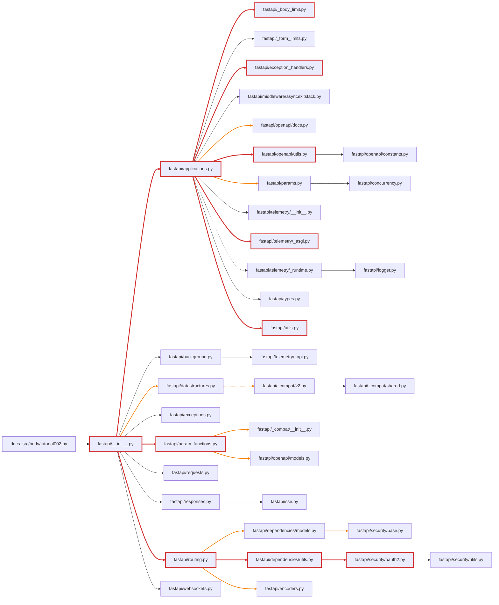
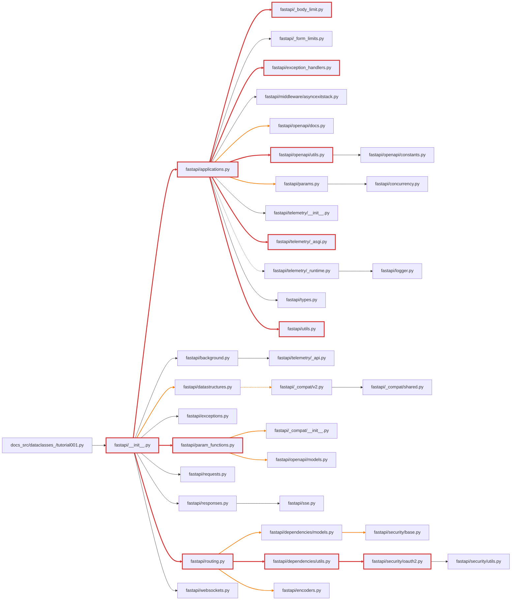
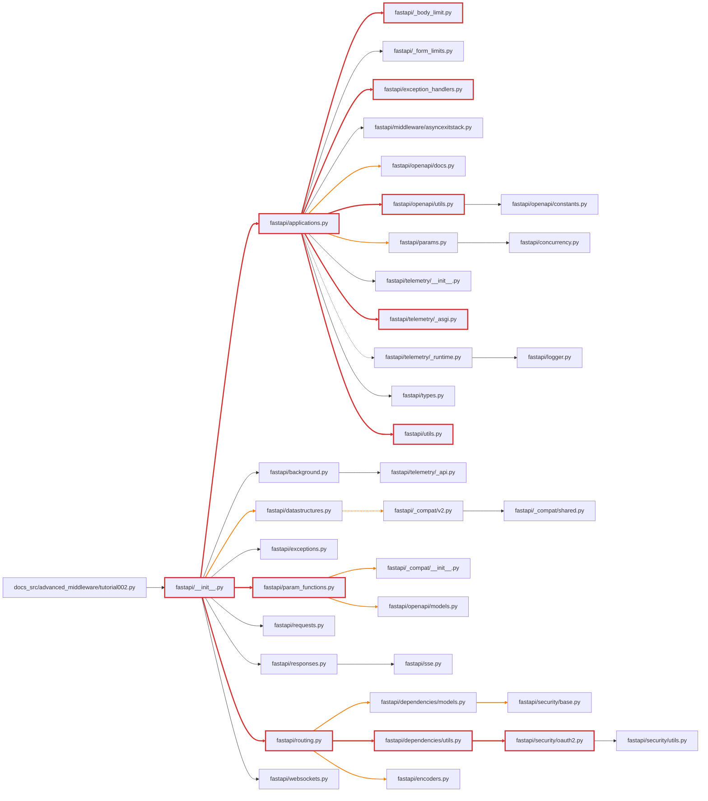
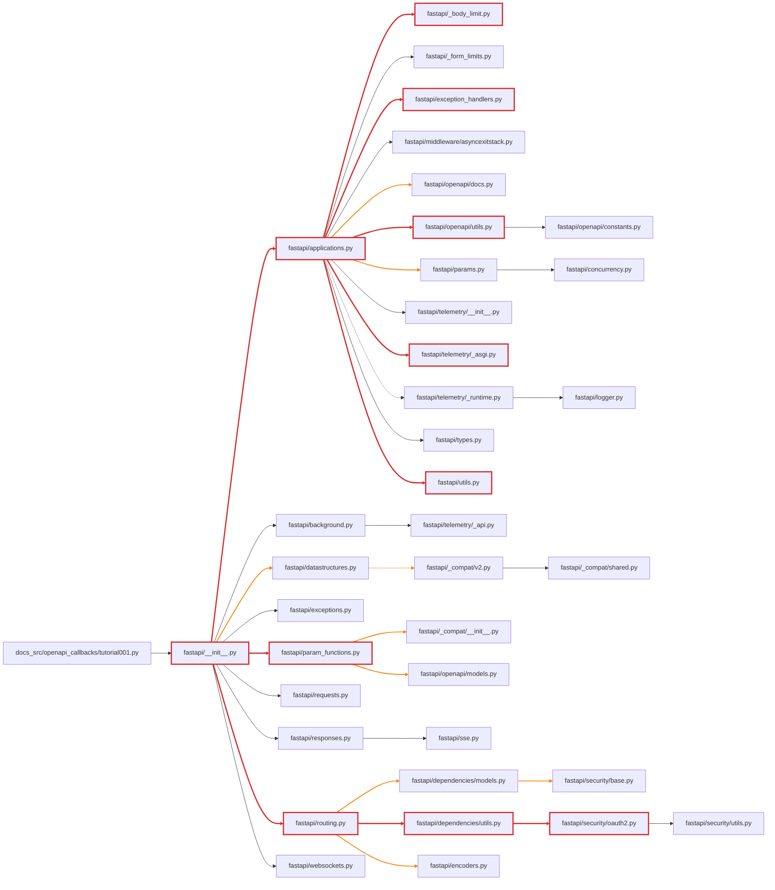

# Keyword-based Execution Paths

These diagrams show execution flows related to key features, auto-detected from the project structure.

## Feature: `_compat`

### Representative Paths

#### Path Group 1


**Execution chain:** docs_src/additional_responses/tutorial001.py → fastapi/__init__.py → fastapi/datastructures.py → fastapi/_compat/v2.py → fastapi/_compat/shared.py

#### Path Group 2


**Execution chain:** docs_src/additional_responses/tutorial002.py → fastapi/__init__.py → fastapi/datastructures.py → fastapi/_compat/v2.py → fastapi/_compat/shared.py

### Combined Flow (All `_compat` Paths)

```mermaid
flowchart LR
  dir_docs_src_request_files["docs_src/request_files<br/>10 files"]
  dir_fastapi["fastapi<br/>5 files"]
  dir_docs_src_query_params_str_validations["docs_src/query_params_str_validations<br/>30 files"]
  dir_docs_src_query_params["docs_src/query_params<br/>6 files"]
  dir_docs_src_advanced_middleware["docs_src/advanced_middleware<br/>3 files"]
  dir_docs_src_schema_extra_example["docs_src/schema_extra_example<br/>8 files"]
  dir_docs_src_dependencies["docs_src/dependencies<br/>27 files"]
  dir_docs_src_request_forms["docs_src/request_forms<br/>4 files"]
  dir_docs_src_app_testing["docs_src/app_testing<br/>4 files"]
  dir_docs_src_frontend["docs_src/frontend<br/>6 files"]
  dir_docs_src_authentication_error_status_code["docs_src/authentication_error_status_code<br/>1 file"]
  dir_docs_src_wsgi["docs_src/wsgi<br/>1 file"]
  dir_docs_src_security["docs_src/security<br/>14 files"]
  dir_fastapi__compat["fastapi/_compat<br/>3 files"]
  dir_docs_src_response_directly["docs_src/response_directly<br/>2 files"]
  dir_docs_src_path_operation_configuration["docs_src/path_operation_configuration<br/>7 files"]
  dir_docs_src_path_params_numeric_validations["docs_src/path_params_numeric_validations<br/>12 files"]
  dir_fastapi_openapi["fastapi/openapi<br/>1 file"]
  dir_docs_src_opentelemetry["docs_src/opentelemetry<br/>3 files"]
  dir_docs_src_path_operation_advanced_configuration["docs_src/path_operation_advanced_configuration<br/>7 files"]
  dir_docs_src_openapi_webhooks["docs_src/openapi_webhooks<br/>1 file"]
  dir_docs_src_query_param_models["docs_src/query_param_models<br/>8 files"]
  dir_docs_src_body_nested_models["docs_src/body_nested_models<br/>9 files"]
  dir_docs_src_cookie_params["docs_src/cookie_params<br/>2 files"]
  dir_docs_src_configure_swagger_ui["docs_src/configure_swagger_ui<br/>3 files"]
  dir_docs_src_extra_models["docs_src/extra_models<br/>5 files"]
  dir_docs_src_custom_docs_ui["docs_src/custom_docs_ui<br/>2 files"]
  dir_docs_src_websockets_["docs_src/websockets_<br/>4 files"]
  dir_docs_src_header_param_models["docs_src/header_param_models<br/>8 files"]
  dir_docs_src_strict_content_type["docs_src/strict_content_type<br/>1 file"]
  dir_docs_src_response_status_code["docs_src/response_status_code<br/>2 files"]
  dir_docs_src_sql_databases["docs_src/sql_databases<br/>4 files"]
  dir_docs_src_custom_response["docs_src/custom_response<br/>15 files"]
  dir_docs_src_request_form_models["docs_src/request_form_models<br/>14 files"]
  dir_docs_src_middleware["docs_src/middleware<br/>1 file"]
  dir_docs_src_path_params["docs_src/path_params<br/>6 files"]
  dir_docs_src_extending_openapi["docs_src/extending_openapi<br/>1 file"]
  dir_docs_src_custom_request_and_route["docs_src/custom_request_and_route<br/>5 files"]
  dir_docs_src_extra_data_types["docs_src/extra_data_types<br/>2 files"]
  dir_docs_src_cookie_param_models["docs_src/cookie_param_models<br/>6 files"]
  dir_docs_src_response_model["docs_src/response_model<br/>12 files"]
  dir_docs_src_stream_data["docs_src/stream_data<br/>2 files"]
  dir_docs_src_additional_status_codes["docs_src/additional_status_codes<br/>2 files"]
  dir_docs_src_response_change_status_code["docs_src/response_change_status_code<br/>1 file"]
  dir_docs_src_graphql_["docs_src/graphql_<br/>1 file"]
  dir_docs_src_response_headers["docs_src/response_headers<br/>2 files"]
  dir_docs_src_app_testing_app_b["docs_src/app_testing/app_b<br/>1 file"]
  dir_docs_src_behind_a_proxy["docs_src/behind_a_proxy<br/>5 files"]
  dir_docs_src_cors["docs_src/cors<br/>1 file"]
  dir_docs_src_encoder["docs_src/encoder<br/>1 file"]
  dir_docs_src_static_files["docs_src/static_files<br/>1 file"]
  dir_docs_src_generate_clients["docs_src/generate_clients<br/>3 files"]
  dir_docs_src_first_steps["docs_src/first_steps<br/>2 files"]
  dir_docs_src_additional_responses["docs_src/additional_responses<br/>4 files"]
  dir_docs_src_debugging["docs_src/debugging<br/>1 file"]
  dir_docs_src_metadata["docs_src/metadata<br/>5 files"]
  dir_docs_src_stream_json_lines["docs_src/stream_json_lines<br/>1 file"]
  dir_docs_src_body_updates["docs_src/body_updates<br/>2 files"]
  dir_docs_src_handling_errors["docs_src/handling_errors<br/>6 files"]
  dir_docs_src_sub_applications["docs_src/sub_applications<br/>1 file"]
  dir_docs_src_settings_app03["docs_src/settings/app03<br/>1 file"]
  dir_docs_src_body_multiple_params["docs_src/body_multiple_params<br/>9 files"]
  dir_docs_src_separate_openapi_schemas["docs_src/separate_openapi_schemas<br/>2 files"]
  dir_docs_src_app_testing_app_b_non_an["docs_src/app_testing/app_b_non_an<br/>1 file"]
  dir_docs_src_dependency_testing["docs_src/dependency_testing<br/>2 files"]
  dir_docs_src_request_forms_and_files["docs_src/request_forms_and_files<br/>2 files"]
  dir_docs_src_settings_app02["docs_src/settings/app02<br/>1 file"]
  dir_docs_src_body["docs_src/body<br/>4 files"]
  dir_docs_src_events["docs_src/events<br/>3 files"]
  dir_docs_src_using_request_directly["docs_src/using_request_directly<br/>1 file"]
  dir_docs_src_background_tasks["docs_src/background_tasks<br/>3 files"]
  dir_docs_src_app_testing_app_a["docs_src/app_testing/app_a<br/>1 file"]
  dir_docs_src_response_cookies["docs_src/response_cookies<br/>2 files"]
  dir_docs_src_templates["docs_src/templates<br/>2 files"]
  dir_docs_src_dataclasses_["docs_src/dataclasses_<br/>3 files"]
  dir_docs_src_server_sent_events["docs_src/server_sent_events<br/>5 files"]
  dir_docs_src_body_fields["docs_src/body_fields<br/>2 files"]
  dir_docs_src_request_body_limits["docs_src/request_body_limits<br/>2 files"]
  dir_docs_src_settings_app01["docs_src/settings/app01<br/>1 file"]
  dir_docs_src_header_params["docs_src/header_params<br/>6 files"]
  dir_docs_src_pydantic_v1_in_v2["docs_src/pydantic_v1_in_v2<br/>3 files"]
  dir_docs_src_openapi_callbacks["docs_src/openapi_callbacks<br/>1 file"]
  dir_docs_src_settings_app02_non_an["docs_src/settings/app02_non_an<br/>1 file"]
  dir_docs_src_conditional_openapi["docs_src/conditional_openapi<br/>1 file"]
  dir_docs_src_async_tests_app_a["docs_src/async_tests/app_a<br/>1 file"]
  dir_docs_src_settings_app03_non_an["docs_src/settings/app03_non_an<br/>1 file"]
  dir_docs_src_settings["docs_src/settings<br/>1 file"]
  dir_docs_src_json_base64_bytes["docs_src/json_base64_bytes<br/>1 file"]
  dir_docs_src_bigger_applications_app["docs_src/bigger_applications/app<br/>1 file"]
  dir_docs_src_extending_openapi --> dir_fastapi_openapi
  dir_fastapi -.->|4| dir_fastapi__compat
  dir_fastapi_openapi --> dir_fastapi__compat
  linkStyle 1 stroke:#f57c00,stroke-width:2px
  linkStyle 2 stroke:#f57c00,stroke-width:2px
```



## Feature: `app`

### Representative Paths

#### Path Group 1


**Execution chain:** docs_src/app_testing/app_a/main.py → fastapi/__init__.py → fastapi/routing.py → fastapi/dependencies/utils.py → fastapi/security/oauth2.py → fastapi/security/utils.py

#### Path Group 2


**Execution chain:** docs_src/app_testing/app_b/main.py → fastapi/__init__.py → fastapi/routing.py → fastapi/dependencies/utils.py → fastapi/security/oauth2.py → fastapi/security/utils.py

### Combined Flow (All `app` Paths)

```mermaid
flowchart LR
  dir_docs_src_request_files["docs_src/request_files<br/>10 files"]
  dir_fastapi["fastapi<br/>21 files"]
  dir_docs_src_query_params_str_validations["docs_src/query_params_str_validations<br/>30 files"]
  dir_docs_src_query_params["docs_src/query_params<br/>6 files"]
  dir_docs_src_advanced_middleware["docs_src/advanced_middleware<br/>3 files"]
  dir_docs_src_schema_extra_example["docs_src/schema_extra_example<br/>8 files"]
  dir_docs_src_dependencies["docs_src/dependencies<br/>27 files"]
  dir_docs_src_request_forms["docs_src/request_forms<br/>4 files"]
  dir_docs_src_app_testing["docs_src/app_testing<br/>4 files"]
  dir_docs_src_frontend["docs_src/frontend<br/>6 files"]
  dir_docs_src_authentication_error_status_code["docs_src/authentication_error_status_code<br/>1 file"]
  dir_docs_src_wsgi["docs_src/wsgi<br/>1 file"]
  dir_docs_src_security["docs_src/security<br/>14 files"]
  dir_fastapi__compat["fastapi/_compat<br/>3 files"]
  dir_docs_src_response_directly["docs_src/response_directly<br/>2 files"]
  dir_docs_src_path_operation_configuration["docs_src/path_operation_configuration<br/>7 files"]
  dir_docs_src_path_params_numeric_validations["docs_src/path_params_numeric_validations<br/>12 files"]
  dir_docs_src_opentelemetry["docs_src/opentelemetry<br/>3 files"]
  dir_docs_src_path_operation_advanced_configuration["docs_src/path_operation_advanced_configuration<br/>7 files"]
  dir_docs_src_openapi_webhooks["docs_src/openapi_webhooks<br/>1 file"]
  dir_docs_src_query_param_models["docs_src/query_param_models<br/>8 files"]
  dir_docs_src_body_nested_models["docs_src/body_nested_models<br/>9 files"]
  dir_docs_src_cookie_params["docs_src/cookie_params<br/>2 files"]
  dir_docs_src_configure_swagger_ui["docs_src/configure_swagger_ui<br/>3 files"]
  dir_docs_src_extra_models["docs_src/extra_models<br/>5 files"]
  dir_docs_src_settings_app03_non_an["docs_src/settings/app03_non_an<br/>3 files"]
  dir_docs_src_custom_docs_ui["docs_src/custom_docs_ui<br/>2 files"]
  dir_docs_src_websockets_["docs_src/websockets_<br/>4 files"]
  dir_docs_src_bigger_applications_app["docs_src/bigger_applications/app<br/>2 files"]
  dir_docs_src_bigger_applications_app_internal["docs_src/bigger_applications/app/internal<br/>2 files"]
  dir_fastapi_dependencies["fastapi/dependencies<br/>2 files"]
  dir_fastapi_security["fastapi/security<br/>3 files"]
  dir_docs_src_header_param_models["docs_src/header_param_models<br/>8 files"]
  dir_docs_src_strict_content_type["docs_src/strict_content_type<br/>1 file"]
  dir_docs_src_response_status_code["docs_src/response_status_code<br/>2 files"]
  dir_docs_src_sql_databases["docs_src/sql_databases<br/>4 files"]
  dir_docs_src_custom_response["docs_src/custom_response<br/>15 files"]
  dir_docs_src_request_form_models["docs_src/request_form_models<br/>14 files"]
  dir_docs_src_middleware["docs_src/middleware<br/>1 file"]
  dir_docs_src_path_params["docs_src/path_params<br/>6 files"]
  dir_docs_src_extending_openapi["docs_src/extending_openapi<br/>1 file"]
  dir_docs_src_bigger_applications_app_routers["docs_src/bigger_applications/app/routers<br/>3 files"]
  dir_docs_src_custom_request_and_route["docs_src/custom_request_and_route<br/>5 files"]
  dir_docs_src_extra_data_types["docs_src/extra_data_types<br/>2 files"]
  dir_docs_src_cookie_param_models["docs_src/cookie_param_models<br/>6 files"]
  dir_docs_src_response_model["docs_src/response_model<br/>12 files"]
  dir_docs_src_stream_data["docs_src/stream_data<br/>2 files"]
  dir_docs_src_additional_status_codes["docs_src/additional_status_codes<br/>2 files"]
  dir_docs_src_response_change_status_code["docs_src/response_change_status_code<br/>1 file"]
  dir_docs_src_graphql_["docs_src/graphql_<br/>1 file"]
  dir_docs_src_settings_app03["docs_src/settings/app03<br/>3 files"]
  dir_docs_src_response_headers["docs_src/response_headers<br/>2 files"]
  dir_docs_src_app_testing_app_b["docs_src/app_testing/app_b<br/>1 file"]
  dir_docs_src_behind_a_proxy["docs_src/behind_a_proxy<br/>5 files"]
  dir_docs_src_cors["docs_src/cors<br/>1 file"]
  dir_fastapi_telemetry["fastapi/telemetry<br/>4 files"]
  dir_docs_src_static_files["docs_src/static_files<br/>1 file"]
  dir_docs_src_generate_clients["docs_src/generate_clients<br/>3 files"]
  dir_docs_src_first_steps["docs_src/first_steps<br/>2 files"]
  dir_docs_src_additional_responses["docs_src/additional_responses<br/>4 files"]
  dir_docs_src_debugging["docs_src/debugging<br/>1 file"]
  dir_docs_src_metadata["docs_src/metadata<br/>5 files"]
  dir_docs_src_stream_json_lines["docs_src/stream_json_lines<br/>1 file"]
  dir_docs_src_body_updates["docs_src/body_updates<br/>2 files"]
  dir_docs_src_handling_errors["docs_src/handling_errors<br/>6 files"]
  dir_fastapi_openapi["fastapi/openapi<br/>4 files"]
  dir_docs_src_settings_app02["docs_src/settings/app02<br/>2 files"]
  dir_docs_src_sub_applications["docs_src/sub_applications<br/>1 file"]
  dir_docs_src_body_multiple_params["docs_src/body_multiple_params<br/>9 files"]
  dir_docs_src_app_testing_app_b_non_an["docs_src/app_testing/app_b_non_an<br/>1 file"]
  dir_docs_src_separate_openapi_schemas["docs_src/separate_openapi_schemas<br/>2 files"]
  dir_docs_src_dependency_testing["docs_src/dependency_testing<br/>2 files"]
  dir_docs_src_request_forms_and_files["docs_src/request_forms_and_files<br/>2 files"]
  dir_docs_src_body["docs_src/body<br/>4 files"]
  dir_docs_src_events["docs_src/events<br/>3 files"]
  dir_docs_src_using_request_directly["docs_src/using_request_directly<br/>1 file"]
  dir_docs_src_background_tasks["docs_src/background_tasks<br/>3 files"]
  dir_docs_src_app_testing_app_a["docs_src/app_testing/app_a<br/>1 file"]
  dir_docs_src_response_cookies["docs_src/response_cookies<br/>2 files"]
  dir_fastapi_middleware["fastapi/middleware<br/>1 file"]
  dir_docs_src_templates["docs_src/templates<br/>2 files"]
  dir_docs_src_dataclasses_["docs_src/dataclasses_<br/>3 files"]
  dir_docs_src_server_sent_events["docs_src/server_sent_events<br/>5 files"]
  dir_docs_src_body_fields["docs_src/body_fields<br/>2 files"]
  dir_docs_src_request_body_limits["docs_src/request_body_limits<br/>2 files"]
  dir_docs_src_encoder["docs_src/encoder<br/>1 file"]
  dir_docs_src_settings_app01["docs_src/settings/app01<br/>2 files"]
  dir_docs_src_header_params["docs_src/header_params<br/>6 files"]
  dir_docs_src_pydantic_v1_in_v2["docs_src/pydantic_v1_in_v2<br/>3 files"]
  dir_docs_src_settings_app02_non_an["docs_src/settings/app02_non_an<br/>2 files"]
  dir_docs_src_openapi_callbacks["docs_src/openapi_callbacks<br/>1 file"]
  dir_docs_src_conditional_openapi["docs_src/conditional_openapi<br/>1 file"]
  dir_docs_src_async_tests_app_a["docs_src/async_tests/app_a<br/>1 file"]
  dir_docs_src_settings["docs_src/settings<br/>1 file"]
  dir_docs_src_json_base64_bytes["docs_src/json_base64_bytes<br/>1 file"]
  dir_docs_src_bigger_applications_app -->|2| dir_docs_src_bigger_applications_app_internal
  dir_docs_src_bigger_applications_app -->|3| dir_docs_src_bigger_applications_app_routers
  dir_fastapi -.->|2| dir_fastapi__compat
  dir_fastapi ==>|2| dir_fastapi_dependencies
  dir_fastapi --> dir_fastapi_middleware
  dir_fastapi ==>|3| dir_fastapi_openapi
  dir_fastapi ==>|4| dir_fastapi_telemetry
  dir_fastapi_dependencies ==>|2| dir_fastapi_security
  linkStyle 2 stroke:#f57c00,stroke-width:2px
  linkStyle 3,5,6,7 stroke:#d32f2f,stroke-width:3px
  classDef cycle stroke:#d32f2f,stroke-width:3px
  class dir_fastapi,dir_fastapi_dependencies,dir_fastapi_security,dir_fastapi_telemetry,dir_fastapi_openapi cycle
```



## Feature: `body`

### Representative Paths

#### Path Group 1


**Execution chain:** docs_src/body/tutorial001.py → fastapi/__init__.py → fastapi/routing.py → fastapi/dependencies/utils.py → fastapi/security/oauth2.py → fastapi/security/utils.py

#### Path Group 2


**Execution chain:** docs_src/body/tutorial002.py → fastapi/__init__.py → fastapi/routing.py → fastapi/dependencies/utils.py → fastapi/security/oauth2.py → fastapi/security/utils.py

### Combined Flow (All `body` Paths)


## Feature: `data`

### Representative Paths

#### Path Group 1


**Execution chain:** docs_src/dataclasses_/tutorial001.py → fastapi/__init__.py → fastapi/routing.py → fastapi/dependencies/utils.py → fastapi/security/oauth2.py → fastapi/security/utils.py

#### Path Group 2


**Execution chain:** docs_src/dataclasses_/tutorial002.py → fastapi/__init__.py → fastapi/routing.py → fastapi/dependencies/utils.py → fastapi/security/oauth2.py → fastapi/security/utils.py

### Combined Flow (All `data` Paths)

```mermaid
flowchart LR
  dir_docs_src_request_files["docs_src/request_files<br/>10 files"]
  dir_fastapi["fastapi<br/>20 files"]
  dir_docs_src_query_params_str_validations["docs_src/query_params_str_validations<br/>30 files"]
  dir_docs_src_query_params["docs_src/query_params<br/>6 files"]
  dir_docs_src_advanced_middleware["docs_src/advanced_middleware<br/>3 files"]
  dir_docs_src_schema_extra_example["docs_src/schema_extra_example<br/>8 files"]
  dir_docs_src_dependencies["docs_src/dependencies<br/>27 files"]
  dir_docs_src_request_forms["docs_src/request_forms<br/>4 files"]
  dir_docs_src_app_testing["docs_src/app_testing<br/>4 files"]
  dir_docs_src_frontend["docs_src/frontend<br/>6 files"]
  dir_docs_src_authentication_error_status_code["docs_src/authentication_error_status_code<br/>1 file"]
  dir_docs_src_wsgi["docs_src/wsgi<br/>1 file"]
  dir_docs_src_security["docs_src/security<br/>14 files"]
  dir_fastapi__compat["fastapi/_compat<br/>3 files"]
  dir_docs_src_response_directly["docs_src/response_directly<br/>2 files"]
  dir_docs_src_path_operation_configuration["docs_src/path_operation_configuration<br/>7 files"]
  dir_docs_src_path_params_numeric_validations["docs_src/path_params_numeric_validations<br/>12 files"]
  dir_docs_src_opentelemetry["docs_src/opentelemetry<br/>3 files"]
  dir_docs_src_path_operation_advanced_configuration["docs_src/path_operation_advanced_configuration<br/>7 files"]
  dir_docs_src_openapi_webhooks["docs_src/openapi_webhooks<br/>1 file"]
  dir_docs_src_query_param_models["docs_src/query_param_models<br/>8 files"]
  dir_docs_src_body_nested_models["docs_src/body_nested_models<br/>9 files"]
  dir_docs_src_cookie_params["docs_src/cookie_params<br/>2 files"]
  dir_docs_src_configure_swagger_ui["docs_src/configure_swagger_ui<br/>3 files"]
  dir_docs_src_extra_models["docs_src/extra_models<br/>5 files"]
  dir_docs_src_custom_docs_ui["docs_src/custom_docs_ui<br/>2 files"]
  dir_docs_src_websockets_["docs_src/websockets_<br/>4 files"]
  dir_fastapi_dependencies["fastapi/dependencies<br/>2 files"]
  dir_fastapi_security["fastapi/security<br/>3 files"]
  dir_docs_src_header_param_models["docs_src/header_param_models<br/>8 files"]
  dir_docs_src_strict_content_type["docs_src/strict_content_type<br/>1 file"]
  dir_docs_src_response_status_code["docs_src/response_status_code<br/>2 files"]
  dir_docs_src_sql_databases["docs_src/sql_databases<br/>4 files"]
  dir_docs_src_custom_response["docs_src/custom_response<br/>15 files"]
  dir_docs_src_request_form_models["docs_src/request_form_models<br/>14 files"]
  dir_docs_src_middleware["docs_src/middleware<br/>1 file"]
  dir_docs_src_path_params["docs_src/path_params<br/>6 files"]
  dir_docs_src_extending_openapi["docs_src/extending_openapi<br/>1 file"]
  dir_docs_src_custom_request_and_route["docs_src/custom_request_and_route<br/>5 files"]
  dir_docs_src_extra_data_types["docs_src/extra_data_types<br/>2 files"]
  dir_docs_src_cookie_param_models["docs_src/cookie_param_models<br/>6 files"]
  dir_docs_src_response_model["docs_src/response_model<br/>12 files"]
  dir_docs_src_stream_data["docs_src/stream_data<br/>2 files"]
  dir_docs_src_additional_status_codes["docs_src/additional_status_codes<br/>2 files"]
  dir_docs_src_response_change_status_code["docs_src/response_change_status_code<br/>1 file"]
  dir_docs_src_graphql_["docs_src/graphql_<br/>1 file"]
  dir_docs_src_response_headers["docs_src/response_headers<br/>2 files"]
  dir_docs_src_app_testing_app_b["docs_src/app_testing/app_b<br/>1 file"]
  dir_docs_src_behind_a_proxy["docs_src/behind_a_proxy<br/>5 files"]
  dir_docs_src_cors["docs_src/cors<br/>1 file"]
  dir_fastapi_telemetry["fastapi/telemetry<br/>4 files"]
  dir_docs_src_static_files["docs_src/static_files<br/>1 file"]
  dir_docs_src_generate_clients["docs_src/generate_clients<br/>3 files"]
  dir_docs_src_first_steps["docs_src/first_steps<br/>2 files"]
  dir_docs_src_additional_responses["docs_src/additional_responses<br/>4 files"]
  dir_docs_src_debugging["docs_src/debugging<br/>1 file"]
  dir_docs_src_metadata["docs_src/metadata<br/>5 files"]
  dir_docs_src_stream_json_lines["docs_src/stream_json_lines<br/>1 file"]
  dir_docs_src_body_updates["docs_src/body_updates<br/>2 files"]
  dir_docs_src_handling_errors["docs_src/handling_errors<br/>6 files"]
  dir_fastapi_openapi["fastapi/openapi<br/>4 files"]
  dir_docs_src_sub_applications["docs_src/sub_applications<br/>1 file"]
  dir_docs_src_settings_app03["docs_src/settings/app03<br/>1 file"]
  dir_docs_src_body_multiple_params["docs_src/body_multiple_params<br/>9 files"]
  dir_docs_src_app_testing_app_b_non_an["docs_src/app_testing/app_b_non_an<br/>1 file"]
  dir_docs_src_separate_openapi_schemas["docs_src/separate_openapi_schemas<br/>2 files"]
  dir_docs_src_dependency_testing["docs_src/dependency_testing<br/>2 files"]
  dir_docs_src_request_forms_and_files["docs_src/request_forms_and_files<br/>2 files"]
  dir_docs_src_settings_app02["docs_src/settings/app02<br/>1 file"]
  dir_docs_src_body["docs_src/body<br/>4 files"]
  dir_docs_src_events["docs_src/events<br/>3 files"]
  dir_docs_src_using_request_directly["docs_src/using_request_directly<br/>1 file"]
  dir_docs_src_background_tasks["docs_src/background_tasks<br/>3 files"]
  dir_docs_src_app_testing_app_a["docs_src/app_testing/app_a<br/>1 file"]
  dir_docs_src_response_cookies["docs_src/response_cookies<br/>2 files"]
  dir_fastapi_middleware["fastapi/middleware<br/>1 file"]
  dir_docs_src_templates["docs_src/templates<br/>2 files"]
  dir_docs_src_dataclasses_["docs_src/dataclasses_<br/>3 files"]
  dir_docs_src_server_sent_events["docs_src/server_sent_events<br/>5 files"]
  dir_docs_src_body_fields["docs_src/body_fields<br/>2 files"]
  dir_docs_src_request_body_limits["docs_src/request_body_limits<br/>2 files"]
  dir_docs_src_encoder["docs_src/encoder<br/>1 file"]
  dir_docs_src_settings_app01["docs_src/settings/app01<br/>1 file"]
  dir_docs_src_header_params["docs_src/header_params<br/>6 files"]
  dir_docs_src_pydantic_v1_in_v2["docs_src/pydantic_v1_in_v2<br/>3 files"]
  dir_docs_src_openapi_callbacks["docs_src/openapi_callbacks<br/>1 file"]
  dir_docs_src_settings_app02_non_an["docs_src/settings/app02_non_an<br/>1 file"]
  dir_docs_src_conditional_openapi["docs_src/conditional_openapi<br/>1 file"]
  dir_docs_src_async_tests_app_a["docs_src/async_tests/app_a<br/>1 file"]
  dir_docs_src_settings_app03_non_an["docs_src/settings/app03_non_an<br/>1 file"]
  dir_docs_src_settings["docs_src/settings<br/>1 file"]
  dir_docs_src_json_base64_bytes["docs_src/json_base64_bytes<br/>1 file"]
  dir_docs_src_bigger_applications_app["docs_src/bigger_applications/app<br/>1 file"]
  dir_fastapi -.->|2| dir_fastapi__compat
  dir_fastapi ==>|2| dir_fastapi_dependencies
  dir_fastapi --> dir_fastapi_middleware
  dir_fastapi ==>|3| dir_fastapi_openapi
  dir_fastapi ==>|4| dir_fastapi_telemetry
  dir_fastapi_dependencies ==>|2| dir_fastapi_security
  linkStyle 0 stroke:#f57c00,stroke-width:2px
  linkStyle 1,3,4,5 stroke:#d32f2f,stroke-width:3px
  classDef cycle stroke:#d32f2f,stroke-width:3px
  class dir_fastapi,dir_fastapi_dependencies,dir_fastapi_security,dir_fastapi_telemetry,dir_fastapi_openapi cycle
```



## Feature: `dependencies`

### Representative Paths

#### Path Group 1


**Execution chain:** docs_src/additional_responses/tutorial001.py → fastapi/__init__.py → fastapi/routing.py → fastapi/dependencies/utils.py → fastapi/security/oauth2.py → fastapi/security/utils.py

#### Path Group 2


**Execution chain:** docs_src/additional_responses/tutorial002.py → fastapi/__init__.py → fastapi/routing.py → fastapi/dependencies/utils.py → fastapi/security/oauth2.py → fastapi/security/utils.py

### Combined Flow (All `dependencies` Paths)

```mermaid
flowchart LR
  dir_docs_src_request_files["docs_src/request_files<br/>10 files"]
  dir_fastapi["fastapi<br/>20 files"]
  dir_docs_src_query_params_str_validations["docs_src/query_params_str_validations<br/>30 files"]
  dir_docs_src_query_params["docs_src/query_params<br/>6 files"]
  dir_docs_src_advanced_middleware["docs_src/advanced_middleware<br/>3 files"]
  dir_docs_src_schema_extra_example["docs_src/schema_extra_example<br/>8 files"]
  dir_docs_src_dependencies["docs_src/dependencies<br/>27 files"]
  dir_docs_src_request_forms["docs_src/request_forms<br/>4 files"]
  dir_docs_src_app_testing["docs_src/app_testing<br/>4 files"]
  dir_docs_src_frontend["docs_src/frontend<br/>6 files"]
  dir_docs_src_wsgi["docs_src/wsgi<br/>1 file"]
  dir_docs_src_authentication_error_status_code["docs_src/authentication_error_status_code<br/>1 file"]
  dir_docs_src_security["docs_src/security<br/>14 files"]
  dir_fastapi__compat["fastapi/_compat<br/>3 files"]
  dir_docs_src_response_directly["docs_src/response_directly<br/>2 files"]
  dir_docs_src_path_operation_configuration["docs_src/path_operation_configuration<br/>7 files"]
  dir_docs_src_path_params_numeric_validations["docs_src/path_params_numeric_validations<br/>12 files"]
  dir_docs_src_opentelemetry["docs_src/opentelemetry<br/>3 files"]
  dir_docs_src_path_operation_advanced_configuration["docs_src/path_operation_advanced_configuration<br/>7 files"]
  dir_docs_src_openapi_webhooks["docs_src/openapi_webhooks<br/>1 file"]
  dir_docs_src_query_param_models["docs_src/query_param_models<br/>8 files"]
  dir_docs_src_body_nested_models["docs_src/body_nested_models<br/>9 files"]
  dir_docs_src_cookie_params["docs_src/cookie_params<br/>2 files"]
  dir_docs_src_configure_swagger_ui["docs_src/configure_swagger_ui<br/>3 files"]
  dir_docs_src_extra_models["docs_src/extra_models<br/>5 files"]
  dir_docs_src_custom_docs_ui["docs_src/custom_docs_ui<br/>2 files"]
  dir_docs_src_websockets_["docs_src/websockets_<br/>4 files"]
  dir_fastapi_dependencies["fastapi/dependencies<br/>2 files"]
  dir_fastapi_security["fastapi/security<br/>3 files"]
  dir_docs_src_header_param_models["docs_src/header_param_models<br/>8 files"]
  dir_docs_src_strict_content_type["docs_src/strict_content_type<br/>1 file"]
  dir_docs_src_response_status_code["docs_src/response_status_code<br/>2 files"]
  dir_docs_src_sql_databases["docs_src/sql_databases<br/>4 files"]
  dir_docs_src_custom_response["docs_src/custom_response<br/>15 files"]
  dir_docs_src_request_form_models["docs_src/request_form_models<br/>14 files"]
  dir_docs_src_middleware["docs_src/middleware<br/>1 file"]
  dir_docs_src_path_params["docs_src/path_params<br/>6 files"]
  dir_fastapi_openapi["fastapi/openapi<br/>4 files"]
  dir_docs_src_extra_data_types["docs_src/extra_data_types<br/>2 files"]
  dir_docs_src_cookie_param_models["docs_src/cookie_param_models<br/>6 files"]
  dir_docs_src_response_model["docs_src/response_model<br/>12 files"]
  dir_docs_src_stream_data["docs_src/stream_data<br/>2 files"]
  dir_docs_src_additional_status_codes["docs_src/additional_status_codes<br/>2 files"]
  dir_docs_src_response_change_status_code["docs_src/response_change_status_code<br/>1 file"]
  dir_docs_src_graphql_["docs_src/graphql_<br/>1 file"]
  dir_docs_src_response_headers["docs_src/response_headers<br/>2 files"]
  dir_docs_src_app_testing_app_b["docs_src/app_testing/app_b<br/>1 file"]
  dir_docs_src_behind_a_proxy["docs_src/behind_a_proxy<br/>5 files"]
  dir_docs_src_cors["docs_src/cors<br/>1 file"]
  dir_fastapi_telemetry["fastapi/telemetry<br/>4 files"]
  dir_docs_src_static_files["docs_src/static_files<br/>1 file"]
  dir_docs_src_generate_clients["docs_src/generate_clients<br/>3 files"]
  dir_docs_src_first_steps["docs_src/first_steps<br/>2 files"]
  dir_docs_src_additional_responses["docs_src/additional_responses<br/>4 files"]
  dir_docs_src_debugging["docs_src/debugging<br/>1 file"]
  dir_docs_src_metadata["docs_src/metadata<br/>5 files"]
  dir_docs_src_stream_json_lines["docs_src/stream_json_lines<br/>1 file"]
  dir_docs_src_body_updates["docs_src/body_updates<br/>2 files"]
  dir_docs_src_handling_errors["docs_src/handling_errors<br/>6 files"]
  dir_docs_src_custom_request_and_route["docs_src/custom_request_and_route<br/>5 files"]
  dir_docs_src_sub_applications["docs_src/sub_applications<br/>1 file"]
  dir_docs_src_settings_app03["docs_src/settings/app03<br/>1 file"]
  dir_docs_src_body_multiple_params["docs_src/body_multiple_params<br/>9 files"]
  dir_docs_src_separate_openapi_schemas["docs_src/separate_openapi_schemas<br/>2 files"]
  dir_docs_src_app_testing_app_b_non_an["docs_src/app_testing/app_b_non_an<br/>1 file"]
  dir_docs_src_dependency_testing["docs_src/dependency_testing<br/>2 files"]
  dir_docs_src_request_forms_and_files["docs_src/request_forms_and_files<br/>2 files"]
  dir_docs_src_settings_app02["docs_src/settings/app02<br/>1 file"]
  dir_docs_src_body["docs_src/body<br/>4 files"]
  dir_docs_src_events["docs_src/events<br/>3 files"]
  dir_docs_src_extending_openapi["docs_src/extending_openapi<br/>1 file"]
  dir_docs_src_using_request_directly["docs_src/using_request_directly<br/>1 file"]
  dir_docs_src_background_tasks["docs_src/background_tasks<br/>3 files"]
  dir_docs_src_app_testing_app_a["docs_src/app_testing/app_a<br/>1 file"]
  dir_docs_src_response_cookies["docs_src/response_cookies<br/>2 files"]
  dir_fastapi_middleware["fastapi/middleware<br/>1 file"]
  dir_docs_src_templates["docs_src/templates<br/>2 files"]
  dir_docs_src_dataclasses_["docs_src/dataclasses_<br/>3 files"]
  dir_docs_src_server_sent_events["docs_src/server_sent_events<br/>5 files"]
  dir_docs_src_body_fields["docs_src/body_fields<br/>2 files"]
  dir_docs_src_bigger_applications_app["docs_src/bigger_applications/app<br/>2 files"]
  dir_docs_src_request_body_limits["docs_src/request_body_limits<br/>2 files"]
  dir_docs_src_encoder["docs_src/encoder<br/>1 file"]
  dir_docs_src_settings_app01["docs_src/settings/app01<br/>1 file"]
  dir_docs_src_header_params["docs_src/header_params<br/>6 files"]
  dir_docs_src_pydantic_v1_in_v2["docs_src/pydantic_v1_in_v2<br/>3 files"]
  dir_docs_src_openapi_callbacks["docs_src/openapi_callbacks<br/>1 file"]
  dir_docs_src_settings_app02_non_an["docs_src/settings/app02_non_an<br/>1 file"]
  dir_docs_src_conditional_openapi["docs_src/conditional_openapi<br/>1 file"]
  dir_docs_src_async_tests_app_a["docs_src/async_tests/app_a<br/>1 file"]
  dir_docs_src_settings_app03_non_an["docs_src/settings/app03_non_an<br/>1 file"]
  dir_docs_src_settings["docs_src/settings<br/>1 file"]
  dir_docs_src_json_base64_bytes["docs_src/json_base64_bytes<br/>1 file"]
  dir_docs_src_extending_openapi --> dir_fastapi_openapi
  dir_fastapi -.->|2| dir_fastapi__compat
  dir_fastapi ==>|2| dir_fastapi_dependencies
  dir_fastapi --> dir_fastapi_middleware
  dir_fastapi ==>|3| dir_fastapi_openapi
  dir_fastapi ==>|4| dir_fastapi_telemetry
  dir_fastapi_dependencies ==>|2| dir_fastapi_security
  dir_fastapi_openapi ==>|2| dir_fastapi_dependencies
  linkStyle 1 stroke:#f57c00,stroke-width:2px
  linkStyle 2,4,5,6,7 stroke:#d32f2f,stroke-width:3px
  classDef cycle stroke:#d32f2f,stroke-width:3px
  class dir_fastapi,dir_fastapi_dependencies,dir_fastapi_security,dir_fastapi_openapi,dir_fastapi_telemetry cycle
```



## Feature: `middleware`

### Representative Paths

#### Path Group 1


**Execution chain:** docs_src/advanced_middleware/tutorial001.py → fastapi/__init__.py → fastapi/routing.py → fastapi/dependencies/utils.py → fastapi/security/oauth2.py → fastapi/security/utils.py

#### Path Group 2


**Execution chain:** docs_src/advanced_middleware/tutorial002.py → fastapi/__init__.py → fastapi/routing.py → fastapi/dependencies/utils.py → fastapi/security/oauth2.py → fastapi/security/utils.py

### Combined Flow (All `middleware` Paths)

```mermaid
flowchart LR
  dir_docs_src_request_files["docs_src/request_files<br/>10 files"]
  dir_fastapi["fastapi<br/>20 files"]
  dir_docs_src_query_params_str_validations["docs_src/query_params_str_validations<br/>30 files"]
  dir_docs_src_query_params["docs_src/query_params<br/>6 files"]
  dir_docs_src_advanced_middleware["docs_src/advanced_middleware<br/>3 files"]
  dir_docs_src_schema_extra_example["docs_src/schema_extra_example<br/>8 files"]
  dir_docs_src_dependencies["docs_src/dependencies<br/>27 files"]
  dir_docs_src_request_forms["docs_src/request_forms<br/>4 files"]
  dir_docs_src_app_testing["docs_src/app_testing<br/>4 files"]
  dir_docs_src_frontend["docs_src/frontend<br/>6 files"]
  dir_docs_src_authentication_error_status_code["docs_src/authentication_error_status_code<br/>1 file"]
  dir_docs_src_wsgi["docs_src/wsgi<br/>1 file"]
  dir_docs_src_security["docs_src/security<br/>14 files"]
  dir_fastapi__compat["fastapi/_compat<br/>3 files"]
  dir_docs_src_response_directly["docs_src/response_directly<br/>2 files"]
  dir_docs_src_path_operation_configuration["docs_src/path_operation_configuration<br/>7 files"]
  dir_docs_src_path_params_numeric_validations["docs_src/path_params_numeric_validations<br/>12 files"]
  dir_docs_src_opentelemetry["docs_src/opentelemetry<br/>3 files"]
  dir_docs_src_path_operation_advanced_configuration["docs_src/path_operation_advanced_configuration<br/>7 files"]
  dir_docs_src_openapi_webhooks["docs_src/openapi_webhooks<br/>1 file"]
  dir_docs_src_query_param_models["docs_src/query_param_models<br/>8 files"]
  dir_docs_src_body_nested_models["docs_src/body_nested_models<br/>9 files"]
  dir_docs_src_cookie_params["docs_src/cookie_params<br/>2 files"]
  dir_docs_src_configure_swagger_ui["docs_src/configure_swagger_ui<br/>3 files"]
  dir_docs_src_extra_models["docs_src/extra_models<br/>5 files"]
  dir_docs_src_custom_docs_ui["docs_src/custom_docs_ui<br/>2 files"]
  dir_docs_src_websockets_["docs_src/websockets_<br/>4 files"]
  dir_fastapi_dependencies["fastapi/dependencies<br/>2 files"]
  dir_fastapi_security["fastapi/security<br/>3 files"]
  dir_docs_src_header_param_models["docs_src/header_param_models<br/>8 files"]
  dir_docs_src_strict_content_type["docs_src/strict_content_type<br/>1 file"]
  dir_docs_src_response_status_code["docs_src/response_status_code<br/>2 files"]
  dir_docs_src_sql_databases["docs_src/sql_databases<br/>4 files"]
  dir_docs_src_custom_response["docs_src/custom_response<br/>15 files"]
  dir_docs_src_request_form_models["docs_src/request_form_models<br/>14 files"]
  dir_docs_src_middleware["docs_src/middleware<br/>1 file"]
  dir_docs_src_path_params["docs_src/path_params<br/>6 files"]
  dir_docs_src_extending_openapi["docs_src/extending_openapi<br/>1 file"]
  dir_docs_src_custom_request_and_route["docs_src/custom_request_and_route<br/>5 files"]
  dir_docs_src_extra_data_types["docs_src/extra_data_types<br/>2 files"]
  dir_docs_src_cookie_param_models["docs_src/cookie_param_models<br/>6 files"]
  dir_docs_src_response_model["docs_src/response_model<br/>12 files"]
  dir_docs_src_stream_data["docs_src/stream_data<br/>2 files"]
  dir_docs_src_additional_status_codes["docs_src/additional_status_codes<br/>2 files"]
  dir_docs_src_response_change_status_code["docs_src/response_change_status_code<br/>1 file"]
  dir_docs_src_graphql_["docs_src/graphql_<br/>1 file"]
  dir_docs_src_response_headers["docs_src/response_headers<br/>2 files"]
  dir_docs_src_app_testing_app_b["docs_src/app_testing/app_b<br/>1 file"]
  dir_docs_src_behind_a_proxy["docs_src/behind_a_proxy<br/>5 files"]
  dir_docs_src_cors["docs_src/cors<br/>1 file"]
  dir_fastapi_telemetry["fastapi/telemetry<br/>4 files"]
  dir_docs_src_static_files["docs_src/static_files<br/>1 file"]
  dir_docs_src_generate_clients["docs_src/generate_clients<br/>3 files"]
  dir_docs_src_first_steps["docs_src/first_steps<br/>2 files"]
  dir_docs_src_additional_responses["docs_src/additional_responses<br/>4 files"]
  dir_docs_src_debugging["docs_src/debugging<br/>1 file"]
  dir_docs_src_metadata["docs_src/metadata<br/>5 files"]
  dir_docs_src_stream_json_lines["docs_src/stream_json_lines<br/>1 file"]
  dir_docs_src_body_updates["docs_src/body_updates<br/>2 files"]
  dir_docs_src_handling_errors["docs_src/handling_errors<br/>6 files"]
  dir_fastapi_openapi["fastapi/openapi<br/>4 files"]
  dir_docs_src_sub_applications["docs_src/sub_applications<br/>1 file"]
  dir_docs_src_settings_app03["docs_src/settings/app03<br/>1 file"]
  dir_docs_src_body_multiple_params["docs_src/body_multiple_params<br/>9 files"]
  dir_docs_src_app_testing_app_b_non_an["docs_src/app_testing/app_b_non_an<br/>1 file"]
  dir_docs_src_separate_openapi_schemas["docs_src/separate_openapi_schemas<br/>2 files"]
  dir_docs_src_dependency_testing["docs_src/dependency_testing<br/>2 files"]
  dir_fastapi_middleware["fastapi/middleware<br/>5 files"]
  dir_docs_src_request_forms_and_files["docs_src/request_forms_and_files<br/>2 files"]
  dir_docs_src_settings_app02["docs_src/settings/app02<br/>1 file"]
  dir_docs_src_body["docs_src/body<br/>4 files"]
  dir_docs_src_events["docs_src/events<br/>3 files"]
  dir_docs_src_using_request_directly["docs_src/using_request_directly<br/>1 file"]
  dir_docs_src_background_tasks["docs_src/background_tasks<br/>3 files"]
  dir_docs_src_app_testing_app_a["docs_src/app_testing/app_a<br/>1 file"]
  dir_docs_src_response_cookies["docs_src/response_cookies<br/>2 files"]
  dir_docs_src_templates["docs_src/templates<br/>2 files"]
  dir_docs_src_dataclasses_["docs_src/dataclasses_<br/>3 files"]
  dir_docs_src_server_sent_events["docs_src/server_sent_events<br/>5 files"]
  dir_docs_src_body_fields["docs_src/body_fields<br/>2 files"]
  dir_docs_src_request_body_limits["docs_src/request_body_limits<br/>2 files"]
  dir_docs_src_encoder["docs_src/encoder<br/>1 file"]
  dir_docs_src_settings_app01["docs_src/settings/app01<br/>1 file"]
  dir_docs_src_header_params["docs_src/header_params<br/>6 files"]
  dir_docs_src_pydantic_v1_in_v2["docs_src/pydantic_v1_in_v2<br/>3 files"]
  dir_docs_src_openapi_callbacks["docs_src/openapi_callbacks<br/>1 file"]
  dir_docs_src_settings_app02_non_an["docs_src/settings/app02_non_an<br/>1 file"]
  dir_docs_src_conditional_openapi["docs_src/conditional_openapi<br/>1 file"]
  dir_docs_src_async_tests_app_a["docs_src/async_tests/app_a<br/>1 file"]
  dir_docs_src_settings_app03_non_an["docs_src/settings/app03_non_an<br/>1 file"]
  dir_docs_src_settings["docs_src/settings<br/>1 file"]
  dir_docs_src_json_base64_bytes["docs_src/json_base64_bytes<br/>1 file"]
  dir_docs_src_bigger_applications_app["docs_src/bigger_applications/app<br/>1 file"]
  dir_docs_src_advanced_middleware -->|3| dir_fastapi_middleware
  dir_docs_src_cors --> dir_fastapi_middleware
  dir_fastapi -.->|2| dir_fastapi__compat
  dir_fastapi ==>|2| dir_fastapi_dependencies
  dir_fastapi --> dir_fastapi_middleware
  dir_fastapi ==>|3| dir_fastapi_openapi
  dir_fastapi ==>|4| dir_fastapi_telemetry
  dir_fastapi_dependencies ==>|2| dir_fastapi_security
  linkStyle 2 stroke:#f57c00,stroke-width:2px
  linkStyle 3,5,6,7 stroke:#d32f2f,stroke-width:3px
  classDef cycle stroke:#d32f2f,stroke-width:3px
  class dir_fastapi,dir_fastapi_dependencies,dir_fastapi_security,dir_fastapi_telemetry,dir_fastapi_openapi cycle
```



## Feature: `openapi`

### Representative Paths

#### Path Group 1


**Execution chain:** docs_src/conditional_openapi/tutorial001.py → fastapi/__init__.py → fastapi/routing.py → fastapi/dependencies/utils.py → fastapi/security/oauth2.py → fastapi/security/utils.py

#### Path Group 2


**Execution chain:** docs_src/openapi_callbacks/tutorial001.py → fastapi/__init__.py → fastapi/routing.py → fastapi/dependencies/utils.py → fastapi/security/oauth2.py → fastapi/security/utils.py

### Combined Flow (All `openapi` Paths)

```mermaid
flowchart LR
  dir_docs_src_request_files["docs_src/request_files<br/>10 files"]
  dir_fastapi["fastapi<br/>20 files"]
  dir_docs_src_custom_docs_ui["docs_src/custom_docs_ui<br/>2 files"]
  dir_fastapi_openapi["fastapi/openapi<br/>4 files"]
  dir_docs_src_query_params_str_validations["docs_src/query_params_str_validations<br/>30 files"]
  dir_docs_src_query_params["docs_src/query_params<br/>6 files"]
  dir_docs_src_advanced_middleware["docs_src/advanced_middleware<br/>3 files"]
  dir_docs_src_schema_extra_example["docs_src/schema_extra_example<br/>8 files"]
  dir_docs_src_dependencies["docs_src/dependencies<br/>27 files"]
  dir_docs_src_request_forms["docs_src/request_forms<br/>4 files"]
  dir_docs_src_app_testing["docs_src/app_testing<br/>4 files"]
  dir_docs_src_frontend["docs_src/frontend<br/>6 files"]
  dir_docs_src_authentication_error_status_code["docs_src/authentication_error_status_code<br/>1 file"]
  dir_docs_src_wsgi["docs_src/wsgi<br/>1 file"]
  dir_docs_src_security["docs_src/security<br/>14 files"]
  dir_fastapi__compat["fastapi/_compat<br/>3 files"]
  dir_docs_src_response_directly["docs_src/response_directly<br/>2 files"]
  dir_docs_src_path_operation_configuration["docs_src/path_operation_configuration<br/>7 files"]
  dir_docs_src_path_params_numeric_validations["docs_src/path_params_numeric_validations<br/>12 files"]
  dir_docs_src_opentelemetry["docs_src/opentelemetry<br/>3 files"]
  dir_docs_src_path_operation_advanced_configuration["docs_src/path_operation_advanced_configuration<br/>7 files"]
  dir_docs_src_openapi_webhooks["docs_src/openapi_webhooks<br/>1 file"]
  dir_docs_src_query_param_models["docs_src/query_param_models<br/>8 files"]
  dir_docs_src_body_nested_models["docs_src/body_nested_models<br/>9 files"]
  dir_docs_src_cookie_params["docs_src/cookie_params<br/>2 files"]
  dir_docs_src_configure_swagger_ui["docs_src/configure_swagger_ui<br/>3 files"]
  dir_docs_src_extra_models["docs_src/extra_models<br/>5 files"]
  dir_docs_src_websockets_["docs_src/websockets_<br/>4 files"]
  dir_fastapi_dependencies["fastapi/dependencies<br/>2 files"]
  dir_fastapi_security["fastapi/security<br/>3 files"]
  dir_docs_src_header_param_models["docs_src/header_param_models<br/>8 files"]
  dir_docs_src_strict_content_type["docs_src/strict_content_type<br/>1 file"]
  dir_docs_src_response_status_code["docs_src/response_status_code<br/>2 files"]
  dir_docs_src_sql_databases["docs_src/sql_databases<br/>4 files"]
  dir_docs_src_custom_response["docs_src/custom_response<br/>15 files"]
  dir_docs_src_request_form_models["docs_src/request_form_models<br/>14 files"]
  dir_docs_src_middleware["docs_src/middleware<br/>1 file"]
  dir_docs_src_path_params["docs_src/path_params<br/>6 files"]
  dir_docs_src_extending_openapi["docs_src/extending_openapi<br/>1 file"]
  dir_docs_src_custom_request_and_route["docs_src/custom_request_and_route<br/>5 files"]
  dir_docs_src_extra_data_types["docs_src/extra_data_types<br/>2 files"]
  dir_docs_src_cookie_param_models["docs_src/cookie_param_models<br/>6 files"]
  dir_docs_src_response_model["docs_src/response_model<br/>12 files"]
  dir_docs_src_stream_data["docs_src/stream_data<br/>2 files"]
  dir_docs_src_additional_status_codes["docs_src/additional_status_codes<br/>2 files"]
  dir_docs_src_response_change_status_code["docs_src/response_change_status_code<br/>1 file"]
  dir_docs_src_graphql_["docs_src/graphql_<br/>1 file"]
  dir_docs_src_response_headers["docs_src/response_headers<br/>2 files"]
  dir_docs_src_app_testing_app_b["docs_src/app_testing/app_b<br/>1 file"]
  dir_docs_src_behind_a_proxy["docs_src/behind_a_proxy<br/>5 files"]
  dir_docs_src_cors["docs_src/cors<br/>1 file"]
  dir_fastapi_telemetry["fastapi/telemetry<br/>4 files"]
  dir_docs_src_static_files["docs_src/static_files<br/>1 file"]
  dir_docs_src_generate_clients["docs_src/generate_clients<br/>3 files"]
  dir_docs_src_first_steps["docs_src/first_steps<br/>2 files"]
  dir_docs_src_additional_responses["docs_src/additional_responses<br/>4 files"]
  dir_docs_src_debugging["docs_src/debugging<br/>1 file"]
  dir_docs_src_metadata["docs_src/metadata<br/>5 files"]
  dir_docs_src_stream_json_lines["docs_src/stream_json_lines<br/>1 file"]
  dir_docs_src_body_updates["docs_src/body_updates<br/>2 files"]
  dir_docs_src_handling_errors["docs_src/handling_errors<br/>6 files"]
  dir_docs_src_sub_applications["docs_src/sub_applications<br/>1 file"]
  dir_docs_src_settings_app03["docs_src/settings/app03<br/>1 file"]
  dir_docs_src_body_multiple_params["docs_src/body_multiple_params<br/>9 files"]
  dir_docs_src_separate_openapi_schemas["docs_src/separate_openapi_schemas<br/>2 files"]
  dir_docs_src_app_testing_app_b_non_an["docs_src/app_testing/app_b_non_an<br/>1 file"]
  dir_docs_src_dependency_testing["docs_src/dependency_testing<br/>2 files"]
  dir_docs_src_request_forms_and_files["docs_src/request_forms_and_files<br/>2 files"]
  dir_docs_src_settings_app02["docs_src/settings/app02<br/>1 file"]
  dir_docs_src_body["docs_src/body<br/>4 files"]
  dir_docs_src_events["docs_src/events<br/>3 files"]
  dir_docs_src_using_request_directly["docs_src/using_request_directly<br/>1 file"]
  dir_docs_src_background_tasks["docs_src/background_tasks<br/>3 files"]
  dir_docs_src_app_testing_app_a["docs_src/app_testing/app_a<br/>1 file"]
  dir_docs_src_response_cookies["docs_src/response_cookies<br/>2 files"]
  dir_fastapi_middleware["fastapi/middleware<br/>1 file"]
  dir_docs_src_templates["docs_src/templates<br/>2 files"]
  dir_docs_src_dataclasses_["docs_src/dataclasses_<br/>3 files"]
  dir_docs_src_server_sent_events["docs_src/server_sent_events<br/>5 files"]
  dir_docs_src_body_fields["docs_src/body_fields<br/>2 files"]
  dir_docs_src_request_body_limits["docs_src/request_body_limits<br/>2 files"]
  dir_docs_src_encoder["docs_src/encoder<br/>1 file"]
  dir_docs_src_settings_app01["docs_src/settings/app01<br/>1 file"]
  dir_docs_src_header_params["docs_src/header_params<br/>6 files"]
  dir_docs_src_pydantic_v1_in_v2["docs_src/pydantic_v1_in_v2<br/>3 files"]
  dir_docs_src_openapi_callbacks["docs_src/openapi_callbacks<br/>1 file"]
  dir_docs_src_settings_app02_non_an["docs_src/settings/app02_non_an<br/>1 file"]
  dir_docs_src_conditional_openapi["docs_src/conditional_openapi<br/>1 file"]
  dir_docs_src_async_tests_app_a["docs_src/async_tests/app_a<br/>1 file"]
  dir_docs_src_settings_app03_non_an["docs_src/settings/app03_non_an<br/>1 file"]
  dir_docs_src_settings["docs_src/settings<br/>1 file"]
  dir_docs_src_json_base64_bytes["docs_src/json_base64_bytes<br/>1 file"]
  dir_docs_src_bigger_applications_app["docs_src/bigger_applications/app<br/>1 file"]
  dir_docs_src_custom_docs_ui -->|2| dir_fastapi_openapi
  dir_docs_src_extending_openapi --> dir_fastapi_openapi
  dir_fastapi -.->|2| dir_fastapi__compat
  dir_fastapi ==>|2| dir_fastapi_dependencies
  dir_fastapi --> dir_fastapi_middleware
  dir_fastapi ==>|3| dir_fastapi_openapi
  dir_fastapi ==>|4| dir_fastapi_telemetry
  dir_fastapi_dependencies ==>|2| dir_fastapi_security
  dir_fastapi_openapi ==>|6| dir_fastapi
  dir_fastapi_openapi --> dir_fastapi__compat
  dir_fastapi_openapi ==>|2| dir_fastapi_dependencies
  linkStyle 2 stroke:#f57c00,stroke-width:2px
  linkStyle 3,5,6,7,8,10 stroke:#d32f2f,stroke-width:3px
  linkStyle 9 stroke:#f57c00,stroke-width:2px
  classDef cycle stroke:#d32f2f,stroke-width:3px
  class dir_fastapi,dir_fastapi_openapi,dir_fastapi_dependencies,dir_fastapi_security,dir_fastapi_telemetry cycle
```

## Feature: `path_params`

### Representative Paths

#### Path Group 1

```mermaid
flowchart LR
  docs_src_path_params_tutorial001_py["docs_src/path_params/tutorial001.py"]
  fastapi___init___py["fastapi/__init__.py"]
  fastapi__body_limit_py["fastapi/_body_limit.py"]
  fastapi__compat___init___py["fastapi/_compat/__init__.py"]
  fastapi__compat_shared_py["fastapi/_compat/shared.py"]
  fastapi__compat_v2_py["fastapi/_compat/v2.py"]
  fastapi__form_limits_py["fastapi/_form_limits.py"]
  fastapi_applications_py["fastapi/applications.py"]
  fastapi_background_py["fastapi/background.py"]
  fastapi_concurrency_py["fastapi/concurrency.py"]
  fastapi_datastructures_py["fastapi/datastructures.py"]
  fastapi_dependencies_models_py["fastapi/dependencies/models.py"]
  fastapi_dependencies_utils_py["fastapi/dependencies/utils.py"]
  fastapi_encoders_py["fastapi/encoders.py"]
  fastapi_exception_handlers_py["fastapi/exception_handlers.py"]
  fastapi_exceptions_py["fastapi/exceptions.py"]
  fastapi_logger_py["fastapi/logger.py"]
  fastapi_middleware_asyncexitstack_py["fastapi/middleware/asyncexitstack.py"]
  fastapi_openapi_constants_py["fastapi/openapi/constants.py"]
  fastapi_openapi_docs_py["fastapi/openapi/docs.py"]
  fastapi_openapi_models_py["fastapi/openapi/models.py"]
  fastapi_openapi_utils_py["fastapi/openapi/utils.py"]
  fastapi_param_functions_py["fastapi/param_functions.py"]
  fastapi_params_py["fastapi/params.py"]
  fastapi_requests_py["fastapi/requests.py"]
  fastapi_responses_py["fastapi/responses.py"]
  fastapi_routing_py["fastapi/routing.py"]
  fastapi_security_base_py["fastapi/security/base.py"]
  fastapi_security_oauth2_py["fastapi/security/oauth2.py"]
  fastapi_security_utils_py["fastapi/security/utils.py"]
  fastapi_sse_py["fastapi/sse.py"]
  fastapi_telemetry___init___py["fastapi/telemetry/__init__.py"]
  fastapi_telemetry__api_py["fastapi/telemetry/_api.py"]
  fastapi_telemetry__asgi_py["fastapi/telemetry/_asgi.py"]
  fastapi_telemetry__runtime_py["fastapi/telemetry/_runtime.py"]
  fastapi_types_py["fastapi/types.py"]
  fastapi_utils_py["fastapi/utils.py"]
  fastapi_websockets_py["fastapi/websockets.py"]
  docs_src_path_params_tutorial001_py --> fastapi___init___py
  fastapi___init___py ==> fastapi_applications_py
  fastapi___init___py --> fastapi_background_py
  fastapi___init___py --> fastapi_datastructures_py
  fastapi___init___py --> fastapi_exceptions_py
  fastapi___init___py ==> fastapi_param_functions_py
  fastapi___init___py --> fastapi_requests_py
  fastapi___init___py --> fastapi_responses_py
  fastapi___init___py ==> fastapi_routing_py
  fastapi___init___py --> fastapi_websockets_py
  fastapi__compat_v2_py --> fastapi__compat_shared_py
  fastapi_applications_py ==> fastapi__body_limit_py
  fastapi_applications_py --> fastapi__form_limits_py
  fastapi_applications_py ==> fastapi_exception_handlers_py
  fastapi_applications_py --> fastapi_middleware_asyncexitstack_py
  fastapi_applications_py --> fastapi_openapi_docs_py
  fastapi_applications_py ==> fastapi_openapi_utils_py
  fastapi_applications_py --> fastapi_params_py
  fastapi_applications_py --> fastapi_telemetry___init___py
  fastapi_applications_py ==> fastapi_telemetry__asgi_py
  fastapi_applications_py -.-> fastapi_telemetry__runtime_py
  fastapi_applications_py --> fastapi_types_py
  fastapi_applications_py ==> fastapi_utils_py
  fastapi_background_py --> fastapi_telemetry__api_py
  fastapi_datastructures_py -.-> fastapi__compat_v2_py
  fastapi_dependencies_models_py --> fastapi_security_base_py
  fastapi_dependencies_utils_py ==> fastapi_security_oauth2_py
  fastapi_openapi_utils_py --> fastapi_openapi_constants_py
  fastapi_param_functions_py --> fastapi__compat___init___py
  fastapi_param_functions_py --> fastapi_openapi_models_py
  fastapi_params_py --> fastapi_concurrency_py
  fastapi_responses_py --> fastapi_sse_py
  fastapi_routing_py --> fastapi_dependencies_models_py
  fastapi_routing_py ==> fastapi_dependencies_utils_py
  fastapi_routing_py --> fastapi_encoders_py
  fastapi_security_oauth2_py --> fastapi_security_utils_py
  fastapi_telemetry__runtime_py --> fastapi_logger_py
  linkStyle 1,5,8,11,13,16,19,22,26,33 stroke:#d32f2f,stroke-width:3px
  linkStyle 3,15,17,25,28,29,32,34 stroke:#f57c00,stroke-width:2px
  linkStyle 24 stroke:#f57c00,stroke-width:2px
  classDef cycle stroke:#d32f2f,stroke-width:3px
  class fastapi___init___py,fastapi__body_limit_py,fastapi_applications_py,fastapi_dependencies_utils_py,fastapi_exception_handlers_py,fastapi_openapi_utils_py,fastapi_param_functions_py,fastapi_routing_py,fastapi_security_oauth2_py,fastapi_telemetry__asgi_py,fastapi_utils_py cycle
```
**Execution chain:** docs_src/path_params/tutorial001.py → fastapi/__init__.py → fastapi/routing.py → fastapi/dependencies/utils.py → fastapi/security/oauth2.py → fastapi/security/utils.py

#### Path Group 2

```mermaid
flowchart LR
  docs_src_path_params_tutorial002_py["docs_src/path_params/tutorial002.py"]
  fastapi___init___py["fastapi/__init__.py"]
  fastapi__body_limit_py["fastapi/_body_limit.py"]
  fastapi__compat___init___py["fastapi/_compat/__init__.py"]
  fastapi__compat_shared_py["fastapi/_compat/shared.py"]
  fastapi__compat_v2_py["fastapi/_compat/v2.py"]
  fastapi__form_limits_py["fastapi/_form_limits.py"]
  fastapi_applications_py["fastapi/applications.py"]
  fastapi_background_py["fastapi/background.py"]
  fastapi_concurrency_py["fastapi/concurrency.py"]
  fastapi_datastructures_py["fastapi/datastructures.py"]
  fastapi_dependencies_models_py["fastapi/dependencies/models.py"]
  fastapi_dependencies_utils_py["fastapi/dependencies/utils.py"]
  fastapi_encoders_py["fastapi/encoders.py"]
  fastapi_exception_handlers_py["fastapi/exception_handlers.py"]
  fastapi_exceptions_py["fastapi/exceptions.py"]
  fastapi_logger_py["fastapi/logger.py"]
  fastapi_middleware_asyncexitstack_py["fastapi/middleware/asyncexitstack.py"]
  fastapi_openapi_constants_py["fastapi/openapi/constants.py"]
  fastapi_openapi_docs_py["fastapi/openapi/docs.py"]
  fastapi_openapi_models_py["fastapi/openapi/models.py"]
  fastapi_openapi_utils_py["fastapi/openapi/utils.py"]
  fastapi_param_functions_py["fastapi/param_functions.py"]
  fastapi_params_py["fastapi/params.py"]
  fastapi_requests_py["fastapi/requests.py"]
  fastapi_responses_py["fastapi/responses.py"]
  fastapi_routing_py["fastapi/routing.py"]
  fastapi_security_base_py["fastapi/security/base.py"]
  fastapi_security_oauth2_py["fastapi/security/oauth2.py"]
  fastapi_security_utils_py["fastapi/security/utils.py"]
  fastapi_sse_py["fastapi/sse.py"]
  fastapi_telemetry___init___py["fastapi/telemetry/__init__.py"]
  fastapi_telemetry__api_py["fastapi/telemetry/_api.py"]
  fastapi_telemetry__asgi_py["fastapi/telemetry/_asgi.py"]
  fastapi_telemetry__runtime_py["fastapi/telemetry/_runtime.py"]
  fastapi_types_py["fastapi/types.py"]
  fastapi_utils_py["fastapi/utils.py"]
  fastapi_websockets_py["fastapi/websockets.py"]
  docs_src_path_params_tutorial002_py --> fastapi___init___py
  fastapi___init___py ==> fastapi_applications_py
  fastapi___init___py --> fastapi_background_py
  fastapi___init___py --> fastapi_datastructures_py
  fastapi___init___py --> fastapi_exceptions_py
  fastapi___init___py ==> fastapi_param_functions_py
  fastapi___init___py --> fastapi_requests_py
  fastapi___init___py --> fastapi_responses_py
  fastapi___init___py ==> fastapi_routing_py
  fastapi___init___py --> fastapi_websockets_py
  fastapi__compat_v2_py --> fastapi__compat_shared_py
  fastapi_applications_py ==> fastapi__body_limit_py
  fastapi_applications_py --> fastapi__form_limits_py
  fastapi_applications_py ==> fastapi_exception_handlers_py
  fastapi_applications_py --> fastapi_middleware_asyncexitstack_py
  fastapi_applications_py --> fastapi_openapi_docs_py
  fastapi_applications_py ==> fastapi_openapi_utils_py
  fastapi_applications_py --> fastapi_params_py
  fastapi_applications_py --> fastapi_telemetry___init___py
  fastapi_applications_py ==> fastapi_telemetry__asgi_py
  fastapi_applications_py -.-> fastapi_telemetry__runtime_py
  fastapi_applications_py --> fastapi_types_py
  fastapi_applications_py ==> fastapi_utils_py
  fastapi_background_py --> fastapi_telemetry__api_py
  fastapi_datastructures_py -.-> fastapi__compat_v2_py
  fastapi_dependencies_models_py --> fastapi_security_base_py
  fastapi_dependencies_utils_py ==> fastapi_security_oauth2_py
  fastapi_openapi_utils_py --> fastapi_openapi_constants_py
  fastapi_param_functions_py --> fastapi__compat___init___py
  fastapi_param_functions_py --> fastapi_openapi_models_py
  fastapi_params_py --> fastapi_concurrency_py
  fastapi_responses_py --> fastapi_sse_py
  fastapi_routing_py --> fastapi_dependencies_models_py
  fastapi_routing_py ==> fastapi_dependencies_utils_py
  fastapi_routing_py --> fastapi_encoders_py
  fastapi_security_oauth2_py --> fastapi_security_utils_py
  fastapi_telemetry__runtime_py --> fastapi_logger_py
  linkStyle 1,5,8,11,13,16,19,22,26,33 stroke:#d32f2f,stroke-width:3px
  linkStyle 3,15,17,25,28,29,32,34 stroke:#f57c00,stroke-width:2px
  linkStyle 24 stroke:#f57c00,stroke-width:2px
  classDef cycle stroke:#d32f2f,stroke-width:3px
  class fastapi___init___py,fastapi__body_limit_py,fastapi_applications_py,fastapi_dependencies_utils_py,fastapi_exception_handlers_py,fastapi_openapi_utils_py,fastapi_param_functions_py,fastapi_routing_py,fastapi_security_oauth2_py,fastapi_telemetry__asgi_py,fastapi_utils_py cycle
```
**Execution chain:** docs_src/path_params/tutorial002.py → fastapi/__init__.py → fastapi/routing.py → fastapi/dependencies/utils.py → fastapi/security/oauth2.py → fastapi/security/utils.py

### Combined Flow (All `path_params` Paths)

```mermaid
flowchart LR
  docs_src_path_params_tutorial001_py["docs_src/path_params/tutorial001.py"]
  docs_src_path_params_tutorial002_py["docs_src/path_params/tutorial002.py"]
  docs_src_path_params_tutorial003_py["docs_src/path_params/tutorial003.py"]
  docs_src_path_params_tutorial003b_py["docs_src/path_params/tutorial003b.py"]
  docs_src_path_params_tutorial004_py["docs_src/path_params/tutorial004.py"]
  docs_src_path_params_tutorial005_py["docs_src/path_params/tutorial005.py"]
  docs_src_path_params_numeric_validations_tutorial001_py["docs_src/path_params_numeric_validations/tutorial001.py"]
  docs_src_path_params_numeric_validations_tutorial001_non_an_py["docs_src/path_params_numeric_validations/tutorial001_non_an.py"]
  docs_src_path_params_numeric_validations_tutorial002_py["docs_src/path_params_numeric_validations/tutorial002.py"]
  docs_src_path_params_numeric_validations_tutorial002_non_an_py["docs_src/path_params_numeric_validations/tutorial002_non_an.py"]
  docs_src_path_params_numeric_validations_tutorial003_py["docs_src/path_params_numeric_validations/tutorial003.py"]
  docs_src_path_params_numeric_validations_tutorial003_non_an_py["docs_src/path_params_numeric_validations/tutorial003_non_an.py"]
  docs_src_path_params_numeric_validations_tutorial004_py["docs_src/path_params_numeric_validations/tutorial004.py"]
  docs_src_path_params_numeric_validations_tutorial004_non_an_py["docs_src/path_params_numeric_validations/tutorial004_non_an.py"]
  docs_src_path_params_numeric_validations_tutorial005_py["docs_src/path_params_numeric_validations/tutorial005.py"]
  docs_src_path_params_numeric_validations_tutorial005_non_an_py["docs_src/path_params_numeric_validations/tutorial005_non_an.py"]
  docs_src_path_params_numeric_validations_tutorial006_py["docs_src/path_params_numeric_validations/tutorial006.py"]
  docs_src_path_params_numeric_validations_tutorial006_non_an_py["docs_src/path_params_numeric_validations/tutorial006_non_an.py"]
  fastapi___init___py["fastapi/__init__.py"]
  fastapi__body_limit_py["fastapi/_body_limit.py"]
  fastapi__compat___init___py["fastapi/_compat/__init__.py"]
  fastapi__compat_shared_py["fastapi/_compat/shared.py"]
  fastapi__compat_v2_py["fastapi/_compat/v2.py"]
  fastapi__form_limits_py["fastapi/_form_limits.py"]
  fastapi_applications_py["fastapi/applications.py"]
  fastapi_background_py["fastapi/background.py"]
  fastapi_concurrency_py["fastapi/concurrency.py"]
  fastapi_datastructures_py["fastapi/datastructures.py"]
  fastapi_dependencies_models_py["fastapi/dependencies/models.py"]
  fastapi_dependencies_utils_py["fastapi/dependencies/utils.py"]
  fastapi_encoders_py["fastapi/encoders.py"]
  fastapi_exception_handlers_py["fastapi/exception_handlers.py"]
  fastapi_exceptions_py["fastapi/exceptions.py"]
  fastapi_logger_py["fastapi/logger.py"]
  fastapi_middleware_asyncexitstack_py["fastapi/middleware/asyncexitstack.py"]
  fastapi_openapi_constants_py["fastapi/openapi/constants.py"]
  fastapi_openapi_docs_py["fastapi/openapi/docs.py"]
  fastapi_openapi_models_py["fastapi/openapi/models.py"]
  fastapi_openapi_utils_py["fastapi/openapi/utils.py"]
  fastapi_param_functions_py["fastapi/param_functions.py"]
  fastapi_params_py["fastapi/params.py"]
  fastapi_requests_py["fastapi/requests.py"]
  fastapi_responses_py["fastapi/responses.py"]
  fastapi_routing_py["fastapi/routing.py"]
  fastapi_security_base_py["fastapi/security/base.py"]
  fastapi_security_oauth2_py["fastapi/security/oauth2.py"]
  fastapi_security_utils_py["fastapi/security/utils.py"]
  fastapi_sse_py["fastapi/sse.py"]
  fastapi_telemetry___init___py["fastapi/telemetry/__init__.py"]
  fastapi_telemetry__api_py["fastapi/telemetry/_api.py"]
  fastapi_telemetry__asgi_py["fastapi/telemetry/_asgi.py"]
  fastapi_telemetry__runtime_py["fastapi/telemetry/_runtime.py"]
  fastapi_types_py["fastapi/types.py"]
  fastapi_utils_py["fastapi/utils.py"]
  fastapi_websockets_py["fastapi/websockets.py"]
  docs_src_path_params_tutorial001_py --> fastapi___init___py
  docs_src_path_params_tutorial002_py --> fastapi___init___py
  docs_src_path_params_tutorial003_py --> fastapi___init___py
  docs_src_path_params_tutorial003b_py --> fastapi___init___py
  docs_src_path_params_tutorial004_py --> fastapi___init___py
  docs_src_path_params_tutorial005_py --> fastapi___init___py
  docs_src_path_params_numeric_validations_tutorial001_py --> fastapi___init___py
  docs_src_path_params_numeric_validations_tutorial001_non_an_py --> fastapi___init___py
  docs_src_path_params_numeric_validations_tutorial002_py --> fastapi___init___py
  docs_src_path_params_numeric_validations_tutorial002_non_an_py --> fastapi___init___py
  docs_src_path_params_numeric_validations_tutorial003_py --> fastapi___init___py
  docs_src_path_params_numeric_validations_tutorial003_non_an_py --> fastapi___init___py
  docs_src_path_params_numeric_validations_tutorial004_py --> fastapi___init___py
  docs_src_path_params_numeric_validations_tutorial004_non_an_py --> fastapi___init___py
  docs_src_path_params_numeric_validations_tutorial005_py --> fastapi___init___py
  docs_src_path_params_numeric_validations_tutorial005_non_an_py --> fastapi___init___py
  docs_src_path_params_numeric_validations_tutorial006_py --> fastapi___init___py
  docs_src_path_params_numeric_validations_tutorial006_non_an_py --> fastapi___init___py
  fastapi___init___py ==> fastapi_applications_py
  fastapi___init___py --> fastapi_background_py
  fastapi___init___py --> fastapi_datastructures_py
  fastapi___init___py --> fastapi_exceptions_py
  fastapi___init___py ==> fastapi_param_functions_py
  fastapi___init___py --> fastapi_requests_py
  fastapi___init___py --> fastapi_responses_py
  fastapi___init___py ==> fastapi_routing_py
  fastapi___init___py --> fastapi_websockets_py
  fastapi__compat_v2_py --> fastapi__compat_shared_py
  fastapi_applications_py ==> fastapi__body_limit_py
  fastapi_applications_py --> fastapi__form_limits_py
  fastapi_applications_py ==> fastapi_exception_handlers_py
  fastapi_applications_py --> fastapi_middleware_asyncexitstack_py
  fastapi_applications_py --> fastapi_openapi_docs_py
  fastapi_applications_py ==> fastapi_openapi_utils_py
  fastapi_applications_py --> fastapi_params_py
  fastapi_applications_py --> fastapi_telemetry___init___py
  fastapi_applications_py ==> fastapi_telemetry__asgi_py
  fastapi_applications_py -.-> fastapi_telemetry__runtime_py
  fastapi_applications_py --> fastapi_types_py
  fastapi_applications_py ==> fastapi_utils_py
  fastapi_background_py --> fastapi_telemetry__api_py
  fastapi_datastructures_py -.-> fastapi__compat_v2_py
  fastapi_dependencies_models_py --> fastapi_security_base_py
  fastapi_dependencies_utils_py ==> fastapi_security_oauth2_py
  fastapi_openapi_utils_py --> fastapi_openapi_constants_py
  fastapi_param_functions_py --> fastapi__compat___init___py
  fastapi_param_functions_py --> fastapi_openapi_models_py
  fastapi_params_py --> fastapi_concurrency_py
  fastapi_responses_py --> fastapi_sse_py
  fastapi_routing_py --> fastapi_dependencies_models_py
  fastapi_routing_py ==> fastapi_dependencies_utils_py
  fastapi_routing_py --> fastapi_encoders_py
  fastapi_security_oauth2_py --> fastapi_security_utils_py
  fastapi_telemetry__runtime_py --> fastapi_logger_py
  linkStyle 18,22,25,28,30,33,36,39,43,50 stroke:#d32f2f,stroke-width:3px
  linkStyle 20,32,34,42,45,46,49,51 stroke:#f57c00,stroke-width:2px
  linkStyle 41 stroke:#f57c00,stroke-width:2px
  classDef cycle stroke:#d32f2f,stroke-width:3px
  class fastapi___init___py,fastapi__body_limit_py,fastapi_applications_py,fastapi_dependencies_utils_py,fastapi_exception_handlers_py,fastapi_openapi_utils_py,fastapi_param_functions_py,fastapi_routing_py,fastapi_security_oauth2_py,fastapi_telemetry__asgi_py,fastapi_utils_py cycle
```

## Feature: `query_params`

### Representative Paths

#### Path Group 1

```mermaid
flowchart LR
  docs_src_query_params_tutorial001_py["docs_src/query_params/tutorial001.py"]
  fastapi___init___py["fastapi/__init__.py"]
  fastapi__body_limit_py["fastapi/_body_limit.py"]
  fastapi__compat___init___py["fastapi/_compat/__init__.py"]
  fastapi__compat_shared_py["fastapi/_compat/shared.py"]
  fastapi__compat_v2_py["fastapi/_compat/v2.py"]
  fastapi__form_limits_py["fastapi/_form_limits.py"]
  fastapi_applications_py["fastapi/applications.py"]
  fastapi_background_py["fastapi/background.py"]
  fastapi_concurrency_py["fastapi/concurrency.py"]
  fastapi_datastructures_py["fastapi/datastructures.py"]
  fastapi_dependencies_models_py["fastapi/dependencies/models.py"]
  fastapi_dependencies_utils_py["fastapi/dependencies/utils.py"]
  fastapi_encoders_py["fastapi/encoders.py"]
  fastapi_exception_handlers_py["fastapi/exception_handlers.py"]
  fastapi_exceptions_py["fastapi/exceptions.py"]
  fastapi_logger_py["fastapi/logger.py"]
  fastapi_middleware_asyncexitstack_py["fastapi/middleware/asyncexitstack.py"]
  fastapi_openapi_constants_py["fastapi/openapi/constants.py"]
  fastapi_openapi_docs_py["fastapi/openapi/docs.py"]
  fastapi_openapi_models_py["fastapi/openapi/models.py"]
  fastapi_openapi_utils_py["fastapi/openapi/utils.py"]
  fastapi_param_functions_py["fastapi/param_functions.py"]
  fastapi_params_py["fastapi/params.py"]
  fastapi_requests_py["fastapi/requests.py"]
  fastapi_responses_py["fastapi/responses.py"]
  fastapi_routing_py["fastapi/routing.py"]
  fastapi_security_base_py["fastapi/security/base.py"]
  fastapi_security_oauth2_py["fastapi/security/oauth2.py"]
  fastapi_security_utils_py["fastapi/security/utils.py"]
  fastapi_sse_py["fastapi/sse.py"]
  fastapi_telemetry___init___py["fastapi/telemetry/__init__.py"]
  fastapi_telemetry__api_py["fastapi/telemetry/_api.py"]
  fastapi_telemetry__asgi_py["fastapi/telemetry/_asgi.py"]
  fastapi_telemetry__runtime_py["fastapi/telemetry/_runtime.py"]
  fastapi_types_py["fastapi/types.py"]
  fastapi_utils_py["fastapi/utils.py"]
  fastapi_websockets_py["fastapi/websockets.py"]
  docs_src_query_params_tutorial001_py --> fastapi___init___py
  fastapi___init___py ==> fastapi_applications_py
  fastapi___init___py --> fastapi_background_py
  fastapi___init___py --> fastapi_datastructures_py
  fastapi___init___py --> fastapi_exceptions_py
  fastapi___init___py ==> fastapi_param_functions_py
  fastapi___init___py --> fastapi_requests_py
  fastapi___init___py --> fastapi_responses_py
  fastapi___init___py ==> fastapi_routing_py
  fastapi___init___py --> fastapi_websockets_py
  fastapi__compat_v2_py --> fastapi__compat_shared_py
  fastapi_applications_py ==> fastapi__body_limit_py
  fastapi_applications_py --> fastapi__form_limits_py
  fastapi_applications_py ==> fastapi_exception_handlers_py
  fastapi_applications_py --> fastapi_middleware_asyncexitstack_py
  fastapi_applications_py --> fastapi_openapi_docs_py
  fastapi_applications_py ==> fastapi_openapi_utils_py
  fastapi_applications_py --> fastapi_params_py
  fastapi_applications_py --> fastapi_telemetry___init___py
  fastapi_applications_py ==> fastapi_telemetry__asgi_py
  fastapi_applications_py -.-> fastapi_telemetry__runtime_py
  fastapi_applications_py --> fastapi_types_py
  fastapi_applications_py ==> fastapi_utils_py
  fastapi_background_py --> fastapi_telemetry__api_py
  fastapi_datastructures_py -.-> fastapi__compat_v2_py
  fastapi_dependencies_models_py --> fastapi_security_base_py
  fastapi_dependencies_utils_py ==> fastapi_security_oauth2_py
  fastapi_openapi_utils_py --> fastapi_openapi_constants_py
  fastapi_param_functions_py --> fastapi__compat___init___py
  fastapi_param_functions_py --> fastapi_openapi_models_py
  fastapi_params_py --> fastapi_concurrency_py
  fastapi_responses_py --> fastapi_sse_py
  fastapi_routing_py --> fastapi_dependencies_models_py
  fastapi_routing_py ==> fastapi_dependencies_utils_py
  fastapi_routing_py --> fastapi_encoders_py
  fastapi_security_oauth2_py --> fastapi_security_utils_py
  fastapi_telemetry__runtime_py --> fastapi_logger_py
  linkStyle 1,5,8,11,13,16,19,22,26,33 stroke:#d32f2f,stroke-width:3px
  linkStyle 3,15,17,25,28,29,32,34 stroke:#f57c00,stroke-width:2px
  linkStyle 24 stroke:#f57c00,stroke-width:2px
  classDef cycle stroke:#d32f2f,stroke-width:3px
  class fastapi___init___py,fastapi__body_limit_py,fastapi_applications_py,fastapi_dependencies_utils_py,fastapi_exception_handlers_py,fastapi_openapi_utils_py,fastapi_param_functions_py,fastapi_routing_py,fastapi_security_oauth2_py,fastapi_telemetry__asgi_py,fastapi_utils_py cycle
```
**Execution chain:** docs_src/query_params/tutorial001.py → fastapi/__init__.py → fastapi/routing.py → fastapi/dependencies/utils.py → fastapi/security/oauth2.py → fastapi/security/utils.py

#### Path Group 2

```mermaid
flowchart LR
  docs_src_query_params_tutorial002_py["docs_src/query_params/tutorial002.py"]
  fastapi___init___py["fastapi/__init__.py"]
  fastapi__body_limit_py["fastapi/_body_limit.py"]
  fastapi__compat___init___py["fastapi/_compat/__init__.py"]
  fastapi__compat_shared_py["fastapi/_compat/shared.py"]
  fastapi__compat_v2_py["fastapi/_compat/v2.py"]
  fastapi__form_limits_py["fastapi/_form_limits.py"]
  fastapi_applications_py["fastapi/applications.py"]
  fastapi_background_py["fastapi/background.py"]
  fastapi_concurrency_py["fastapi/concurrency.py"]
  fastapi_datastructures_py["fastapi/datastructures.py"]
  fastapi_dependencies_models_py["fastapi/dependencies/models.py"]
  fastapi_dependencies_utils_py["fastapi/dependencies/utils.py"]
  fastapi_encoders_py["fastapi/encoders.py"]
  fastapi_exception_handlers_py["fastapi/exception_handlers.py"]
  fastapi_exceptions_py["fastapi/exceptions.py"]
  fastapi_logger_py["fastapi/logger.py"]
  fastapi_middleware_asyncexitstack_py["fastapi/middleware/asyncexitstack.py"]
  fastapi_openapi_constants_py["fastapi/openapi/constants.py"]
  fastapi_openapi_docs_py["fastapi/openapi/docs.py"]
  fastapi_openapi_models_py["fastapi/openapi/models.py"]
  fastapi_openapi_utils_py["fastapi/openapi/utils.py"]
  fastapi_param_functions_py["fastapi/param_functions.py"]
  fastapi_params_py["fastapi/params.py"]
  fastapi_requests_py["fastapi/requests.py"]
  fastapi_responses_py["fastapi/responses.py"]
  fastapi_routing_py["fastapi/routing.py"]
  fastapi_security_base_py["fastapi/security/base.py"]
  fastapi_security_oauth2_py["fastapi/security/oauth2.py"]
  fastapi_security_utils_py["fastapi/security/utils.py"]
  fastapi_sse_py["fastapi/sse.py"]
  fastapi_telemetry___init___py["fastapi/telemetry/__init__.py"]
  fastapi_telemetry__api_py["fastapi/telemetry/_api.py"]
  fastapi_telemetry__asgi_py["fastapi/telemetry/_asgi.py"]
  fastapi_telemetry__runtime_py["fastapi/telemetry/_runtime.py"]
  fastapi_types_py["fastapi/types.py"]
  fastapi_utils_py["fastapi/utils.py"]
  fastapi_websockets_py["fastapi/websockets.py"]
  docs_src_query_params_tutorial002_py --> fastapi___init___py
  fastapi___init___py ==> fastapi_applications_py
  fastapi___init___py --> fastapi_background_py
  fastapi___init___py --> fastapi_datastructures_py
  fastapi___init___py --> fastapi_exceptions_py
  fastapi___init___py ==> fastapi_param_functions_py
  fastapi___init___py --> fastapi_requests_py
  fastapi___init___py --> fastapi_responses_py
  fastapi___init___py ==> fastapi_routing_py
  fastapi___init___py --> fastapi_websockets_py
  fastapi__compat_v2_py --> fastapi__compat_shared_py
  fastapi_applications_py ==> fastapi__body_limit_py
  fastapi_applications_py --> fastapi__form_limits_py
  fastapi_applications_py ==> fastapi_exception_handlers_py
  fastapi_applications_py --> fastapi_middleware_asyncexitstack_py
  fastapi_applications_py --> fastapi_openapi_docs_py
  fastapi_applications_py ==> fastapi_openapi_utils_py
  fastapi_applications_py --> fastapi_params_py
  fastapi_applications_py --> fastapi_telemetry___init___py
  fastapi_applications_py ==> fastapi_telemetry__asgi_py
  fastapi_applications_py -.-> fastapi_telemetry__runtime_py
  fastapi_applications_py --> fastapi_types_py
  fastapi_applications_py ==> fastapi_utils_py
  fastapi_background_py --> fastapi_telemetry__api_py
  fastapi_datastructures_py -.-> fastapi__compat_v2_py
  fastapi_dependencies_models_py --> fastapi_security_base_py
  fastapi_dependencies_utils_py ==> fastapi_security_oauth2_py
  fastapi_openapi_utils_py --> fastapi_openapi_constants_py
  fastapi_param_functions_py --> fastapi__compat___init___py
  fastapi_param_functions_py --> fastapi_openapi_models_py
  fastapi_params_py --> fastapi_concurrency_py
  fastapi_responses_py --> fastapi_sse_py
  fastapi_routing_py --> fastapi_dependencies_models_py
  fastapi_routing_py ==> fastapi_dependencies_utils_py
  fastapi_routing_py --> fastapi_encoders_py
  fastapi_security_oauth2_py --> fastapi_security_utils_py
  fastapi_telemetry__runtime_py --> fastapi_logger_py
  linkStyle 1,5,8,11,13,16,19,22,26,33 stroke:#d32f2f,stroke-width:3px
  linkStyle 3,15,17,25,28,29,32,34 stroke:#f57c00,stroke-width:2px
  linkStyle 24 stroke:#f57c00,stroke-width:2px
  classDef cycle stroke:#d32f2f,stroke-width:3px
  class fastapi___init___py,fastapi__body_limit_py,fastapi_applications_py,fastapi_dependencies_utils_py,fastapi_exception_handlers_py,fastapi_openapi_utils_py,fastapi_param_functions_py,fastapi_routing_py,fastapi_security_oauth2_py,fastapi_telemetry__asgi_py,fastapi_utils_py cycle
```
**Execution chain:** docs_src/query_params/tutorial002.py → fastapi/__init__.py → fastapi/routing.py → fastapi/dependencies/utils.py → fastapi/security/oauth2.py → fastapi/security/utils.py

### Combined Flow (All `query_params` Paths)

```mermaid
flowchart LR
  dir_fastapi_telemetry["fastapi/telemetry<br/>4 files"]
  dir_fastapi["fastapi<br/>20 files"]
  dir_docs_src_query_params_str_validations["docs_src/query_params_str_validations<br/>30 files"]
  dir_fastapi_openapi["fastapi/openapi<br/>4 files"]
  dir_fastapi_dependencies["fastapi/dependencies<br/>2 files"]
  dir_docs_src_query_params["docs_src/query_params<br/>6 files"]
  dir_fastapi_middleware["fastapi/middleware<br/>1 file"]
  dir_fastapi__compat["fastapi/_compat<br/>3 files"]
  dir_fastapi_security["fastapi/security<br/>3 files"]
  dir_docs_src_query_params -->|6| dir_fastapi
  dir_docs_src_query_params_str_validations -->|30| dir_fastapi
  dir_fastapi -.->|2| dir_fastapi__compat
  dir_fastapi ==>|2| dir_fastapi_dependencies
  dir_fastapi --> dir_fastapi_middleware
  dir_fastapi ==>|3| dir_fastapi_openapi
  dir_fastapi ==>|4| dir_fastapi_telemetry
  dir_fastapi_dependencies ==>|2| dir_fastapi_security
  dir_fastapi_telemetry --> dir_fastapi
  linkStyle 2 stroke:#f57c00,stroke-width:2px
  linkStyle 3,5,6,7 stroke:#d32f2f,stroke-width:3px
  classDef cycle stroke:#d32f2f,stroke-width:3px
  class dir_fastapi_telemetry,dir_fastapi,dir_fastapi_openapi,dir_fastapi_dependencies,dir_fastapi_security cycle
```

## Feature: `query_params_str_validations`

### Representative Paths

#### Path Group 1

```mermaid
flowchart LR
  docs_src_query_params_str_validations_tutorial001_py["docs_src/query_params_str_validations/tutorial001.py"]
  fastapi___init___py["fastapi/__init__.py"]
  fastapi__body_limit_py["fastapi/_body_limit.py"]
  fastapi__compat___init___py["fastapi/_compat/__init__.py"]
  fastapi__compat_shared_py["fastapi/_compat/shared.py"]
  fastapi__compat_v2_py["fastapi/_compat/v2.py"]
  fastapi__form_limits_py["fastapi/_form_limits.py"]
  fastapi_applications_py["fastapi/applications.py"]
  fastapi_background_py["fastapi/background.py"]
  fastapi_concurrency_py["fastapi/concurrency.py"]
  fastapi_datastructures_py["fastapi/datastructures.py"]
  fastapi_dependencies_models_py["fastapi/dependencies/models.py"]
  fastapi_dependencies_utils_py["fastapi/dependencies/utils.py"]
  fastapi_encoders_py["fastapi/encoders.py"]
  fastapi_exception_handlers_py["fastapi/exception_handlers.py"]
  fastapi_exceptions_py["fastapi/exceptions.py"]
  fastapi_logger_py["fastapi/logger.py"]
  fastapi_middleware_asyncexitstack_py["fastapi/middleware/asyncexitstack.py"]
  fastapi_openapi_constants_py["fastapi/openapi/constants.py"]
  fastapi_openapi_docs_py["fastapi/openapi/docs.py"]
  fastapi_openapi_models_py["fastapi/openapi/models.py"]
  fastapi_openapi_utils_py["fastapi/openapi/utils.py"]
  fastapi_param_functions_py["fastapi/param_functions.py"]
  fastapi_params_py["fastapi/params.py"]
  fastapi_requests_py["fastapi/requests.py"]
  fastapi_responses_py["fastapi/responses.py"]
  fastapi_routing_py["fastapi/routing.py"]
  fastapi_security_base_py["fastapi/security/base.py"]
  fastapi_security_oauth2_py["fastapi/security/oauth2.py"]
  fastapi_security_utils_py["fastapi/security/utils.py"]
  fastapi_sse_py["fastapi/sse.py"]
  fastapi_telemetry___init___py["fastapi/telemetry/__init__.py"]
  fastapi_telemetry__api_py["fastapi/telemetry/_api.py"]
  fastapi_telemetry__asgi_py["fastapi/telemetry/_asgi.py"]
  fastapi_telemetry__runtime_py["fastapi/telemetry/_runtime.py"]
  fastapi_types_py["fastapi/types.py"]
  fastapi_utils_py["fastapi/utils.py"]
  fastapi_websockets_py["fastapi/websockets.py"]
  docs_src_query_params_str_validations_tutorial001_py --> fastapi___init___py
  fastapi___init___py ==> fastapi_applications_py
  fastapi___init___py --> fastapi_background_py
  fastapi___init___py --> fastapi_datastructures_py
  fastapi___init___py --> fastapi_exceptions_py
  fastapi___init___py ==> fastapi_param_functions_py
  fastapi___init___py --> fastapi_requests_py
  fastapi___init___py --> fastapi_responses_py
  fastapi___init___py ==> fastapi_routing_py
  fastapi___init___py --> fastapi_websockets_py
  fastapi__compat_v2_py --> fastapi__compat_shared_py
  fastapi_applications_py ==> fastapi__body_limit_py
  fastapi_applications_py --> fastapi__form_limits_py
  fastapi_applications_py ==> fastapi_exception_handlers_py
  fastapi_applications_py --> fastapi_middleware_asyncexitstack_py
  fastapi_applications_py --> fastapi_openapi_docs_py
  fastapi_applications_py ==> fastapi_openapi_utils_py
  fastapi_applications_py --> fastapi_params_py
  fastapi_applications_py --> fastapi_telemetry___init___py
  fastapi_applications_py ==> fastapi_telemetry__asgi_py
  fastapi_applications_py -.-> fastapi_telemetry__runtime_py
  fastapi_applications_py --> fastapi_types_py
  fastapi_applications_py ==> fastapi_utils_py
  fastapi_background_py --> fastapi_telemetry__api_py
  fastapi_datastructures_py -.-> fastapi__compat_v2_py
  fastapi_dependencies_models_py --> fastapi_security_base_py
  fastapi_dependencies_utils_py ==> fastapi_security_oauth2_py
  fastapi_openapi_utils_py --> fastapi_openapi_constants_py
  fastapi_param_functions_py --> fastapi__compat___init___py
  fastapi_param_functions_py --> fastapi_openapi_models_py
  fastapi_params_py --> fastapi_concurrency_py
  fastapi_responses_py --> fastapi_sse_py
  fastapi_routing_py --> fastapi_dependencies_models_py
  fastapi_routing_py ==> fastapi_dependencies_utils_py
  fastapi_routing_py --> fastapi_encoders_py
  fastapi_security_oauth2_py --> fastapi_security_utils_py
  fastapi_telemetry__runtime_py --> fastapi_logger_py
  linkStyle 1,5,8,11,13,16,19,22,26,33 stroke:#d32f2f,stroke-width:3px
  linkStyle 3,15,17,25,28,29,32,34 stroke:#f57c00,stroke-width:2px
  linkStyle 24 stroke:#f57c00,stroke-width:2px
  classDef cycle stroke:#d32f2f,stroke-width:3px
  class fastapi___init___py,fastapi__body_limit_py,fastapi_applications_py,fastapi_dependencies_utils_py,fastapi_exception_handlers_py,fastapi_openapi_utils_py,fastapi_param_functions_py,fastapi_routing_py,fastapi_security_oauth2_py,fastapi_telemetry__asgi_py,fastapi_utils_py cycle
```
**Execution chain:** docs_src/query_params_str_validations/tutorial001.py → fastapi/__init__.py → fastapi/routing.py → fastapi/dependencies/utils.py → fastapi/security/oauth2.py → fastapi/security/utils.py

#### Path Group 2

```mermaid
flowchart LR
  docs_src_query_params_str_validations_tutorial002_py["docs_src/query_params_str_validations/tutorial002.py"]
  fastapi___init___py["fastapi/__init__.py"]
  fastapi__body_limit_py["fastapi/_body_limit.py"]
  fastapi__compat___init___py["fastapi/_compat/__init__.py"]
  fastapi__compat_shared_py["fastapi/_compat/shared.py"]
  fastapi__compat_v2_py["fastapi/_compat/v2.py"]
  fastapi__form_limits_py["fastapi/_form_limits.py"]
  fastapi_applications_py["fastapi/applications.py"]
  fastapi_background_py["fastapi/background.py"]
  fastapi_concurrency_py["fastapi/concurrency.py"]
  fastapi_datastructures_py["fastapi/datastructures.py"]
  fastapi_dependencies_models_py["fastapi/dependencies/models.py"]
  fastapi_dependencies_utils_py["fastapi/dependencies/utils.py"]
  fastapi_encoders_py["fastapi/encoders.py"]
  fastapi_exception_handlers_py["fastapi/exception_handlers.py"]
  fastapi_exceptions_py["fastapi/exceptions.py"]
  fastapi_logger_py["fastapi/logger.py"]
  fastapi_middleware_asyncexitstack_py["fastapi/middleware/asyncexitstack.py"]
  fastapi_openapi_constants_py["fastapi/openapi/constants.py"]
  fastapi_openapi_docs_py["fastapi/openapi/docs.py"]
  fastapi_openapi_models_py["fastapi/openapi/models.py"]
  fastapi_openapi_utils_py["fastapi/openapi/utils.py"]
  fastapi_param_functions_py["fastapi/param_functions.py"]
  fastapi_params_py["fastapi/params.py"]
  fastapi_requests_py["fastapi/requests.py"]
  fastapi_responses_py["fastapi/responses.py"]
  fastapi_routing_py["fastapi/routing.py"]
  fastapi_security_base_py["fastapi/security/base.py"]
  fastapi_security_oauth2_py["fastapi/security/oauth2.py"]
  fastapi_security_utils_py["fastapi/security/utils.py"]
  fastapi_sse_py["fastapi/sse.py"]
  fastapi_telemetry___init___py["fastapi/telemetry/__init__.py"]
  fastapi_telemetry__api_py["fastapi/telemetry/_api.py"]
  fastapi_telemetry__asgi_py["fastapi/telemetry/_asgi.py"]
  fastapi_telemetry__runtime_py["fastapi/telemetry/_runtime.py"]
  fastapi_types_py["fastapi/types.py"]
  fastapi_utils_py["fastapi/utils.py"]
  fastapi_websockets_py["fastapi/websockets.py"]
  docs_src_query_params_str_validations_tutorial002_py --> fastapi___init___py
  fastapi___init___py ==> fastapi_applications_py
  fastapi___init___py --> fastapi_background_py
  fastapi___init___py --> fastapi_datastructures_py
  fastapi___init___py --> fastapi_exceptions_py
  fastapi___init___py ==> fastapi_param_functions_py
  fastapi___init___py --> fastapi_requests_py
  fastapi___init___py --> fastapi_responses_py
  fastapi___init___py ==> fastapi_routing_py
  fastapi___init___py --> fastapi_websockets_py
  fastapi__compat_v2_py --> fastapi__compat_shared_py
  fastapi_applications_py ==> fastapi__body_limit_py
  fastapi_applications_py --> fastapi__form_limits_py
  fastapi_applications_py ==> fastapi_exception_handlers_py
  fastapi_applications_py --> fastapi_middleware_asyncexitstack_py
  fastapi_applications_py --> fastapi_openapi_docs_py
  fastapi_applications_py ==> fastapi_openapi_utils_py
  fastapi_applications_py --> fastapi_params_py
  fastapi_applications_py --> fastapi_telemetry___init___py
  fastapi_applications_py ==> fastapi_telemetry__asgi_py
  fastapi_applications_py -.-> fastapi_telemetry__runtime_py
  fastapi_applications_py --> fastapi_types_py
  fastapi_applications_py ==> fastapi_utils_py
  fastapi_background_py --> fastapi_telemetry__api_py
  fastapi_datastructures_py -.-> fastapi__compat_v2_py
  fastapi_dependencies_models_py --> fastapi_security_base_py
  fastapi_dependencies_utils_py ==> fastapi_security_oauth2_py
  fastapi_openapi_utils_py --> fastapi_openapi_constants_py
  fastapi_param_functions_py --> fastapi__compat___init___py
  fastapi_param_functions_py --> fastapi_openapi_models_py
  fastapi_params_py --> fastapi_concurrency_py
  fastapi_responses_py --> fastapi_sse_py
  fastapi_routing_py --> fastapi_dependencies_models_py
  fastapi_routing_py ==> fastapi_dependencies_utils_py
  fastapi_routing_py --> fastapi_encoders_py
  fastapi_security_oauth2_py --> fastapi_security_utils_py
  fastapi_telemetry__runtime_py --> fastapi_logger_py
  linkStyle 1,5,8,11,13,16,19,22,26,33 stroke:#d32f2f,stroke-width:3px
  linkStyle 3,15,17,25,28,29,32,34 stroke:#f57c00,stroke-width:2px
  linkStyle 24 stroke:#f57c00,stroke-width:2px
  classDef cycle stroke:#d32f2f,stroke-width:3px
  class fastapi___init___py,fastapi__body_limit_py,fastapi_applications_py,fastapi_dependencies_utils_py,fastapi_exception_handlers_py,fastapi_openapi_utils_py,fastapi_param_functions_py,fastapi_routing_py,fastapi_security_oauth2_py,fastapi_telemetry__asgi_py,fastapi_utils_py cycle
```
**Execution chain:** docs_src/query_params_str_validations/tutorial002.py → fastapi/__init__.py → fastapi/routing.py → fastapi/dependencies/utils.py → fastapi/security/oauth2.py → fastapi/security/utils.py

### Combined Flow (All `query_params_str_validations` Paths)

```mermaid
flowchart LR
  dir_fastapi_telemetry["fastapi/telemetry<br/>4 files"]
  dir_fastapi["fastapi<br/>20 files"]
  dir_docs_src_query_params_str_validations["docs_src/query_params_str_validations<br/>30 files"]
  dir_fastapi_openapi["fastapi/openapi<br/>4 files"]
  dir_fastapi_dependencies["fastapi/dependencies<br/>2 files"]
  dir_fastapi_middleware["fastapi/middleware<br/>1 file"]
  dir_fastapi__compat["fastapi/_compat<br/>3 files"]
  dir_fastapi_security["fastapi/security<br/>3 files"]
  dir_docs_src_query_params_str_validations -->|30| dir_fastapi
  dir_fastapi -.->|2| dir_fastapi__compat
  dir_fastapi ==>|2| dir_fastapi_dependencies
  dir_fastapi --> dir_fastapi_middleware
  dir_fastapi ==>|3| dir_fastapi_openapi
  dir_fastapi ==>|4| dir_fastapi_telemetry
  dir_fastapi_dependencies ==>|2| dir_fastapi_security
  dir_fastapi_telemetry --> dir_fastapi
  linkStyle 1 stroke:#f57c00,stroke-width:2px
  linkStyle 2,4,5,6 stroke:#d32f2f,stroke-width:3px
  classDef cycle stroke:#d32f2f,stroke-width:3px
  class dir_fastapi_telemetry,dir_fastapi,dir_fastapi_openapi,dir_fastapi_dependencies,dir_fastapi_security cycle
```

## Feature: `security`

### Representative Paths

#### Path Group 1

```mermaid
flowchart LR
  docs_src_additional_responses_tutorial001_py["docs_src/additional_responses/tutorial001.py"]
  fastapi___init___py["fastapi/__init__.py"]
  fastapi_dependencies_models_py["fastapi/dependencies/models.py"]
  fastapi_dependencies_utils_py["fastapi/dependencies/utils.py"]
  fastapi_routing_py["fastapi/routing.py"]
  fastapi_security_base_py["fastapi/security/base.py"]
  fastapi_security_oauth2_py["fastapi/security/oauth2.py"]
  fastapi_security_utils_py["fastapi/security/utils.py"]
  docs_src_additional_responses_tutorial001_py --> fastapi___init___py
  fastapi___init___py ==> fastapi_routing_py
  fastapi_dependencies_models_py --> fastapi_security_base_py
  fastapi_dependencies_utils_py ==> fastapi_security_oauth2_py
  fastapi_routing_py --> fastapi_dependencies_models_py
  fastapi_routing_py ==> fastapi_dependencies_utils_py
  fastapi_security_oauth2_py --> fastapi_security_utils_py
  linkStyle 1,3,5 stroke:#d32f2f,stroke-width:3px
  linkStyle 2,4 stroke:#f57c00,stroke-width:2px
  classDef cycle stroke:#d32f2f,stroke-width:3px
  class fastapi___init___py,fastapi_dependencies_utils_py,fastapi_routing_py,fastapi_security_oauth2_py cycle
```
**Execution chain:** docs_src/additional_responses/tutorial001.py → fastapi/__init__.py → fastapi/routing.py → fastapi/dependencies/utils.py → fastapi/security/oauth2.py → fastapi/security/utils.py

#### Path Group 2

```mermaid
flowchart LR
  docs_src_additional_responses_tutorial002_py["docs_src/additional_responses/tutorial002.py"]
  fastapi___init___py["fastapi/__init__.py"]
  fastapi_dependencies_models_py["fastapi/dependencies/models.py"]
  fastapi_dependencies_utils_py["fastapi/dependencies/utils.py"]
  fastapi_routing_py["fastapi/routing.py"]
  fastapi_security_base_py["fastapi/security/base.py"]
  fastapi_security_oauth2_py["fastapi/security/oauth2.py"]
  fastapi_security_utils_py["fastapi/security/utils.py"]
  docs_src_additional_responses_tutorial002_py --> fastapi___init___py
  fastapi___init___py ==> fastapi_routing_py
  fastapi_dependencies_models_py --> fastapi_security_base_py
  fastapi_dependencies_utils_py ==> fastapi_security_oauth2_py
  fastapi_routing_py --> fastapi_dependencies_models_py
  fastapi_routing_py ==> fastapi_dependencies_utils_py
  fastapi_security_oauth2_py --> fastapi_security_utils_py
  linkStyle 1,3,5 stroke:#d32f2f,stroke-width:3px
  linkStyle 2,4 stroke:#f57c00,stroke-width:2px
  classDef cycle stroke:#d32f2f,stroke-width:3px
  class fastapi___init___py,fastapi_dependencies_utils_py,fastapi_routing_py,fastapi_security_oauth2_py cycle
```
**Execution chain:** docs_src/additional_responses/tutorial002.py → fastapi/__init__.py → fastapi/routing.py → fastapi/dependencies/utils.py → fastapi/security/oauth2.py → fastapi/security/utils.py

### Combined Flow (All `security` Paths)

```mermaid
flowchart LR
  dir_docs_src_request_files["docs_src/request_files<br/>10 files"]
  dir_fastapi["fastapi<br/>20 files"]
  dir_docs_src_query_params_str_validations["docs_src/query_params_str_validations<br/>30 files"]
  dir_docs_src_query_params["docs_src/query_params<br/>6 files"]
  dir_docs_src_advanced_middleware["docs_src/advanced_middleware<br/>3 files"]
  dir_docs_src_schema_extra_example["docs_src/schema_extra_example<br/>8 files"]
  dir_docs_src_dependencies["docs_src/dependencies<br/>27 files"]
  dir_docs_src_request_forms["docs_src/request_forms<br/>4 files"]
  dir_docs_src_security["docs_src/security<br/>14 files"]
  dir_fastapi_security["fastapi/security<br/>7 files"]
  dir_docs_src_app_testing["docs_src/app_testing<br/>4 files"]
  dir_docs_src_frontend["docs_src/frontend<br/>6 files"]
  dir_docs_src_wsgi["docs_src/wsgi<br/>1 file"]
  dir_fastapi__compat["fastapi/_compat<br/>3 files"]
  dir_docs_src_response_directly["docs_src/response_directly<br/>2 files"]
  dir_docs_src_path_operation_configuration["docs_src/path_operation_configuration<br/>7 files"]
  dir_docs_src_path_params_numeric_validations["docs_src/path_params_numeric_validations<br/>12 files"]
  dir_docs_src_opentelemetry["docs_src/opentelemetry<br/>3 files"]
  dir_docs_src_path_operation_advanced_configuration["docs_src/path_operation_advanced_configuration<br/>7 files"]
  dir_docs_src_openapi_webhooks["docs_src/openapi_webhooks<br/>1 file"]
  dir_docs_src_query_param_models["docs_src/query_param_models<br/>8 files"]
  dir_docs_src_body_nested_models["docs_src/body_nested_models<br/>9 files"]
  dir_docs_src_cookie_params["docs_src/cookie_params<br/>2 files"]
  dir_docs_src_configure_swagger_ui["docs_src/configure_swagger_ui<br/>3 files"]
  dir_docs_src_extra_models["docs_src/extra_models<br/>5 files"]
  dir_docs_src_custom_docs_ui["docs_src/custom_docs_ui<br/>2 files"]
  dir_docs_src_websockets_["docs_src/websockets_<br/>4 files"]
  dir_fastapi_dependencies["fastapi/dependencies<br/>2 files"]
  dir_docs_src_header_param_models["docs_src/header_param_models<br/>8 files"]
  dir_docs_src_strict_content_type["docs_src/strict_content_type<br/>1 file"]
  dir_docs_src_response_status_code["docs_src/response_status_code<br/>2 files"]
  dir_docs_src_sql_databases["docs_src/sql_databases<br/>4 files"]
  dir_docs_src_custom_response["docs_src/custom_response<br/>15 files"]
  dir_docs_src_request_form_models["docs_src/request_form_models<br/>14 files"]
  dir_docs_src_middleware["docs_src/middleware<br/>1 file"]
  dir_docs_src_path_params["docs_src/path_params<br/>6 files"]
  dir_fastapi_openapi["fastapi/openapi<br/>4 files"]
  dir_docs_src_extra_data_types["docs_src/extra_data_types<br/>2 files"]
  dir_docs_src_cookie_param_models["docs_src/cookie_param_models<br/>6 files"]
  dir_docs_src_response_model["docs_src/response_model<br/>12 files"]
  dir_docs_src_stream_data["docs_src/stream_data<br/>2 files"]
  dir_docs_src_additional_status_codes["docs_src/additional_status_codes<br/>2 files"]
  dir_docs_src_response_change_status_code["docs_src/response_change_status_code<br/>1 file"]
  dir_docs_src_graphql_["docs_src/graphql_<br/>1 file"]
  dir_docs_src_response_headers["docs_src/response_headers<br/>2 files"]
  dir_docs_src_app_testing_app_b["docs_src/app_testing/app_b<br/>1 file"]
  dir_docs_src_behind_a_proxy["docs_src/behind_a_proxy<br/>5 files"]
  dir_docs_src_cors["docs_src/cors<br/>1 file"]
  dir_fastapi_telemetry["fastapi/telemetry<br/>4 files"]
  dir_docs_src_static_files["docs_src/static_files<br/>1 file"]
  dir_docs_src_generate_clients["docs_src/generate_clients<br/>3 files"]
  dir_docs_src_first_steps["docs_src/first_steps<br/>2 files"]
  dir_docs_src_additional_responses["docs_src/additional_responses<br/>4 files"]
  dir_docs_src_debugging["docs_src/debugging<br/>1 file"]
  dir_docs_src_metadata["docs_src/metadata<br/>5 files"]
  dir_docs_src_stream_json_lines["docs_src/stream_json_lines<br/>1 file"]
  dir_docs_src_body_updates["docs_src/body_updates<br/>2 files"]
  dir_docs_src_handling_errors["docs_src/handling_errors<br/>6 files"]
  dir_docs_src_custom_request_and_route["docs_src/custom_request_and_route<br/>5 files"]
  dir_docs_src_sub_applications["docs_src/sub_applications<br/>1 file"]
  dir_docs_src_settings_app03["docs_src/settings/app03<br/>1 file"]
  dir_docs_src_body_multiple_params["docs_src/body_multiple_params<br/>9 files"]
  dir_docs_src_separate_openapi_schemas["docs_src/separate_openapi_schemas<br/>2 files"]
  dir_docs_src_app_testing_app_b_non_an["docs_src/app_testing/app_b_non_an<br/>1 file"]
  dir_docs_src_dependency_testing["docs_src/dependency_testing<br/>2 files"]
  dir_docs_src_authentication_error_status_code["docs_src/authentication_error_status_code<br/>1 file"]
  dir_docs_src_request_forms_and_files["docs_src/request_forms_and_files<br/>2 files"]
  dir_docs_src_settings_app02["docs_src/settings/app02<br/>1 file"]
  dir_docs_src_body["docs_src/body<br/>4 files"]
  dir_docs_src_events["docs_src/events<br/>3 files"]
  dir_docs_src_extending_openapi["docs_src/extending_openapi<br/>1 file"]
  dir_docs_src_using_request_directly["docs_src/using_request_directly<br/>1 file"]
  dir_docs_src_background_tasks["docs_src/background_tasks<br/>3 files"]
  dir_docs_src_app_testing_app_a["docs_src/app_testing/app_a<br/>1 file"]
  dir_docs_src_response_cookies["docs_src/response_cookies<br/>2 files"]
  dir_fastapi_middleware["fastapi/middleware<br/>1 file"]
  dir_docs_src_templates["docs_src/templates<br/>2 files"]
  dir_docs_src_dataclasses_["docs_src/dataclasses_<br/>3 files"]
  dir_docs_src_server_sent_events["docs_src/server_sent_events<br/>5 files"]
  dir_docs_src_body_fields["docs_src/body_fields<br/>2 files"]
  dir_docs_src_request_body_limits["docs_src/request_body_limits<br/>2 files"]
  dir_docs_src_encoder["docs_src/encoder<br/>1 file"]
  dir_docs_src_settings_app01["docs_src/settings/app01<br/>1 file"]
  dir_docs_src_header_params["docs_src/header_params<br/>6 files"]
  dir_docs_src_pydantic_v1_in_v2["docs_src/pydantic_v1_in_v2<br/>3 files"]
  dir_docs_src_openapi_callbacks["docs_src/openapi_callbacks<br/>1 file"]
  dir_docs_src_settings_app02_non_an["docs_src/settings/app02_non_an<br/>1 file"]
  dir_docs_src_conditional_openapi["docs_src/conditional_openapi<br/>1 file"]
  dir_docs_src_async_tests_app_a["docs_src/async_tests/app_a<br/>1 file"]
  dir_docs_src_settings_app03_non_an["docs_src/settings/app03_non_an<br/>1 file"]
  dir_docs_src_settings["docs_src/settings<br/>1 file"]
  dir_docs_src_json_base64_bytes["docs_src/json_base64_bytes<br/>1 file"]
  dir_docs_src_bigger_applications_app["docs_src/bigger_applications/app<br/>1 file"]
  dir_docs_src_authentication_error_status_code --> dir_fastapi_security
  dir_docs_src_extending_openapi --> dir_fastapi_openapi
  dir_docs_src_security -->|14| dir_fastapi_security
  dir_fastapi -.->|2| dir_fastapi__compat
  dir_fastapi ==>|2| dir_fastapi_dependencies
  dir_fastapi --> dir_fastapi_middleware
  dir_fastapi ==>|3| dir_fastapi_openapi
  dir_fastapi ==>|4| dir_fastapi_telemetry
  dir_fastapi_dependencies ==>|2| dir_fastapi_security
  dir_fastapi_openapi ==>|2| dir_fastapi_dependencies
  linkStyle 3 stroke:#f57c00,stroke-width:2px
  linkStyle 4,6,7,8,9 stroke:#d32f2f,stroke-width:3px
  classDef cycle stroke:#d32f2f,stroke-width:3px
  class dir_fastapi,dir_fastapi_security,dir_fastapi_dependencies,dir_fastapi_openapi,dir_fastapi_telemetry cycle
```

## Feature: `telemetry`

### Representative Paths

#### Path Group 1

```mermaid
flowchart LR
  docs_src_opentelemetry_tutorial001_py["docs_src/opentelemetry/tutorial001.py"]
  fastapi___init___py["fastapi/__init__.py"]
  fastapi__body_limit_py["fastapi/_body_limit.py"]
  fastapi__compat___init___py["fastapi/_compat/__init__.py"]
  fastapi__compat_shared_py["fastapi/_compat/shared.py"]
  fastapi__compat_v2_py["fastapi/_compat/v2.py"]
  fastapi__form_limits_py["fastapi/_form_limits.py"]
  fastapi_applications_py["fastapi/applications.py"]
  fastapi_background_py["fastapi/background.py"]
  fastapi_concurrency_py["fastapi/concurrency.py"]
  fastapi_datastructures_py["fastapi/datastructures.py"]
  fastapi_dependencies_models_py["fastapi/dependencies/models.py"]
  fastapi_dependencies_utils_py["fastapi/dependencies/utils.py"]
  fastapi_encoders_py["fastapi/encoders.py"]
  fastapi_exception_handlers_py["fastapi/exception_handlers.py"]
  fastapi_exceptions_py["fastapi/exceptions.py"]
  fastapi_logger_py["fastapi/logger.py"]
  fastapi_middleware_asyncexitstack_py["fastapi/middleware/asyncexitstack.py"]
  fastapi_openapi_constants_py["fastapi/openapi/constants.py"]
  fastapi_openapi_docs_py["fastapi/openapi/docs.py"]
  fastapi_openapi_models_py["fastapi/openapi/models.py"]
  fastapi_openapi_utils_py["fastapi/openapi/utils.py"]
  fastapi_param_functions_py["fastapi/param_functions.py"]
  fastapi_params_py["fastapi/params.py"]
  fastapi_requests_py["fastapi/requests.py"]
  fastapi_responses_py["fastapi/responses.py"]
  fastapi_routing_py["fastapi/routing.py"]
  fastapi_security_base_py["fastapi/security/base.py"]
  fastapi_security_oauth2_py["fastapi/security/oauth2.py"]
  fastapi_security_utils_py["fastapi/security/utils.py"]
  fastapi_sse_py["fastapi/sse.py"]
  fastapi_telemetry___init___py["fastapi/telemetry/__init__.py"]
  fastapi_telemetry__api_py["fastapi/telemetry/_api.py"]
  fastapi_telemetry__asgi_py["fastapi/telemetry/_asgi.py"]
  fastapi_telemetry__runtime_py["fastapi/telemetry/_runtime.py"]
  fastapi_types_py["fastapi/types.py"]
  fastapi_utils_py["fastapi/utils.py"]
  fastapi_websockets_py["fastapi/websockets.py"]
  docs_src_opentelemetry_tutorial001_py --> fastapi___init___py
  fastapi___init___py ==> fastapi_applications_py
  fastapi___init___py --> fastapi_background_py
  fastapi___init___py --> fastapi_datastructures_py
  fastapi___init___py --> fastapi_exceptions_py
  fastapi___init___py ==> fastapi_param_functions_py
  fastapi___init___py --> fastapi_requests_py
  fastapi___init___py --> fastapi_responses_py
  fastapi___init___py ==> fastapi_routing_py
  fastapi___init___py --> fastapi_websockets_py
  fastapi__compat_v2_py --> fastapi__compat_shared_py
  fastapi_applications_py ==> fastapi__body_limit_py
  fastapi_applications_py --> fastapi__form_limits_py
  fastapi_applications_py ==> fastapi_exception_handlers_py
  fastapi_applications_py --> fastapi_middleware_asyncexitstack_py
  fastapi_applications_py --> fastapi_openapi_docs_py
  fastapi_applications_py ==> fastapi_openapi_utils_py
  fastapi_applications_py --> fastapi_params_py
  fastapi_applications_py --> fastapi_telemetry___init___py
  fastapi_applications_py ==> fastapi_telemetry__asgi_py
  fastapi_applications_py -.-> fastapi_telemetry__runtime_py
  fastapi_applications_py --> fastapi_types_py
  fastapi_applications_py ==> fastapi_utils_py
  fastapi_background_py --> fastapi_telemetry__api_py
  fastapi_datastructures_py -.-> fastapi__compat_v2_py
  fastapi_dependencies_models_py --> fastapi_security_base_py
  fastapi_dependencies_utils_py ==> fastapi_security_oauth2_py
  fastapi_openapi_utils_py --> fastapi_openapi_constants_py
  fastapi_param_functions_py --> fastapi__compat___init___py
  fastapi_param_functions_py --> fastapi_openapi_models_py
  fastapi_params_py --> fastapi_concurrency_py
  fastapi_responses_py --> fastapi_sse_py
  fastapi_routing_py --> fastapi_dependencies_models_py
  fastapi_routing_py ==> fastapi_dependencies_utils_py
  fastapi_routing_py --> fastapi_encoders_py
  fastapi_security_oauth2_py --> fastapi_security_utils_py
  fastapi_telemetry__runtime_py --> fastapi_logger_py
  linkStyle 1,5,8,11,13,16,19,22,26,33 stroke:#d32f2f,stroke-width:3px
  linkStyle 3,15,17,25,28,29,32,34 stroke:#f57c00,stroke-width:2px
  linkStyle 24 stroke:#f57c00,stroke-width:2px
  classDef cycle stroke:#d32f2f,stroke-width:3px
  class fastapi___init___py,fastapi__body_limit_py,fastapi_applications_py,fastapi_dependencies_utils_py,fastapi_exception_handlers_py,fastapi_openapi_utils_py,fastapi_param_functions_py,fastapi_routing_py,fastapi_security_oauth2_py,fastapi_telemetry__asgi_py,fastapi_utils_py cycle
```
**Execution chain:** docs_src/opentelemetry/tutorial001.py → fastapi/__init__.py → fastapi/routing.py → fastapi/dependencies/utils.py → fastapi/security/oauth2.py → fastapi/security/utils.py

#### Path Group 2

```mermaid
flowchart LR
  docs_src_opentelemetry_tutorial002_py["docs_src/opentelemetry/tutorial002.py"]
  fastapi___init___py["fastapi/__init__.py"]
  fastapi__body_limit_py["fastapi/_body_limit.py"]
  fastapi__compat___init___py["fastapi/_compat/__init__.py"]
  fastapi__compat_shared_py["fastapi/_compat/shared.py"]
  fastapi__compat_v2_py["fastapi/_compat/v2.py"]
  fastapi__form_limits_py["fastapi/_form_limits.py"]
  fastapi_applications_py["fastapi/applications.py"]
  fastapi_background_py["fastapi/background.py"]
  fastapi_concurrency_py["fastapi/concurrency.py"]
  fastapi_datastructures_py["fastapi/datastructures.py"]
  fastapi_dependencies_models_py["fastapi/dependencies/models.py"]
  fastapi_dependencies_utils_py["fastapi/dependencies/utils.py"]
  fastapi_encoders_py["fastapi/encoders.py"]
  fastapi_exception_handlers_py["fastapi/exception_handlers.py"]
  fastapi_exceptions_py["fastapi/exceptions.py"]
  fastapi_logger_py["fastapi/logger.py"]
  fastapi_middleware_asyncexitstack_py["fastapi/middleware/asyncexitstack.py"]
  fastapi_openapi_constants_py["fastapi/openapi/constants.py"]
  fastapi_openapi_docs_py["fastapi/openapi/docs.py"]
  fastapi_openapi_models_py["fastapi/openapi/models.py"]
  fastapi_openapi_utils_py["fastapi/openapi/utils.py"]
  fastapi_param_functions_py["fastapi/param_functions.py"]
  fastapi_params_py["fastapi/params.py"]
  fastapi_requests_py["fastapi/requests.py"]
  fastapi_responses_py["fastapi/responses.py"]
  fastapi_routing_py["fastapi/routing.py"]
  fastapi_security_base_py["fastapi/security/base.py"]
  fastapi_security_oauth2_py["fastapi/security/oauth2.py"]
  fastapi_security_utils_py["fastapi/security/utils.py"]
  fastapi_sse_py["fastapi/sse.py"]
  fastapi_telemetry___init___py["fastapi/telemetry/__init__.py"]
  fastapi_telemetry__api_py["fastapi/telemetry/_api.py"]
  fastapi_telemetry__asgi_py["fastapi/telemetry/_asgi.py"]
  fastapi_telemetry__runtime_py["fastapi/telemetry/_runtime.py"]
  fastapi_types_py["fastapi/types.py"]
  fastapi_utils_py["fastapi/utils.py"]
  fastapi_websockets_py["fastapi/websockets.py"]
  docs_src_opentelemetry_tutorial002_py --> fastapi___init___py
  fastapi___init___py ==> fastapi_applications_py
  fastapi___init___py --> fastapi_background_py
  fastapi___init___py --> fastapi_datastructures_py
  fastapi___init___py --> fastapi_exceptions_py
  fastapi___init___py ==> fastapi_param_functions_py
  fastapi___init___py --> fastapi_requests_py
  fastapi___init___py --> fastapi_responses_py
  fastapi___init___py ==> fastapi_routing_py
  fastapi___init___py --> fastapi_websockets_py
  fastapi__compat_v2_py --> fastapi__compat_shared_py
  fastapi_applications_py ==> fastapi__body_limit_py
  fastapi_applications_py --> fastapi__form_limits_py
  fastapi_applications_py ==> fastapi_exception_handlers_py
  fastapi_applications_py --> fastapi_middleware_asyncexitstack_py
  fastapi_applications_py --> fastapi_openapi_docs_py
  fastapi_applications_py ==> fastapi_openapi_utils_py
  fastapi_applications_py --> fastapi_params_py
  fastapi_applications_py --> fastapi_telemetry___init___py
  fastapi_applications_py ==> fastapi_telemetry__asgi_py
  fastapi_applications_py -.-> fastapi_telemetry__runtime_py
  fastapi_applications_py --> fastapi_types_py
  fastapi_applications_py ==> fastapi_utils_py
  fastapi_background_py --> fastapi_telemetry__api_py
  fastapi_datastructures_py -.-> fastapi__compat_v2_py
  fastapi_dependencies_models_py --> fastapi_security_base_py
  fastapi_dependencies_utils_py ==> fastapi_security_oauth2_py
  fastapi_openapi_utils_py --> fastapi_openapi_constants_py
  fastapi_param_functions_py --> fastapi__compat___init___py
  fastapi_param_functions_py --> fastapi_openapi_models_py
  fastapi_params_py --> fastapi_concurrency_py
  fastapi_responses_py --> fastapi_sse_py
  fastapi_routing_py --> fastapi_dependencies_models_py
  fastapi_routing_py ==> fastapi_dependencies_utils_py
  fastapi_routing_py --> fastapi_encoders_py
  fastapi_security_oauth2_py --> fastapi_security_utils_py
  fastapi_telemetry__runtime_py --> fastapi_logger_py
  linkStyle 1,5,8,11,13,16,19,22,26,33 stroke:#d32f2f,stroke-width:3px
  linkStyle 3,15,17,25,28,29,32,34 stroke:#f57c00,stroke-width:2px
  linkStyle 24 stroke:#f57c00,stroke-width:2px
  classDef cycle stroke:#d32f2f,stroke-width:3px
  class fastapi___init___py,fastapi__body_limit_py,fastapi_applications_py,fastapi_dependencies_utils_py,fastapi_exception_handlers_py,fastapi_openapi_utils_py,fastapi_param_functions_py,fastapi_routing_py,fastapi_security_oauth2_py,fastapi_telemetry__asgi_py,fastapi_utils_py cycle
```
**Execution chain:** docs_src/opentelemetry/tutorial002.py → fastapi/__init__.py → fastapi/routing.py → fastapi/dependencies/utils.py → fastapi/security/oauth2.py → fastapi/security/utils.py

### Combined Flow (All `telemetry` Paths)

```mermaid
flowchart LR
  dir_docs_src_request_files["docs_src/request_files<br/>10 files"]
  dir_fastapi["fastapi<br/>20 files"]
  dir_docs_src_query_params_str_validations["docs_src/query_params_str_validations<br/>30 files"]
  dir_docs_src_query_params["docs_src/query_params<br/>6 files"]
  dir_docs_src_advanced_middleware["docs_src/advanced_middleware<br/>3 files"]
  dir_docs_src_schema_extra_example["docs_src/schema_extra_example<br/>8 files"]
  dir_docs_src_dependencies["docs_src/dependencies<br/>27 files"]
  dir_docs_src_request_forms["docs_src/request_forms<br/>4 files"]
  dir_docs_src_app_testing["docs_src/app_testing<br/>4 files"]
  dir_docs_src_frontend["docs_src/frontend<br/>6 files"]
  dir_docs_src_authentication_error_status_code["docs_src/authentication_error_status_code<br/>1 file"]
  dir_docs_src_wsgi["docs_src/wsgi<br/>1 file"]
  dir_docs_src_security["docs_src/security<br/>14 files"]
  dir_fastapi__compat["fastapi/_compat<br/>3 files"]
  dir_docs_src_response_directly["docs_src/response_directly<br/>2 files"]
  dir_docs_src_path_operation_configuration["docs_src/path_operation_configuration<br/>7 files"]
  dir_docs_src_path_params_numeric_validations["docs_src/path_params_numeric_validations<br/>12 files"]
  dir_docs_src_opentelemetry["docs_src/opentelemetry<br/>3 files"]
  dir_docs_src_path_operation_advanced_configuration["docs_src/path_operation_advanced_configuration<br/>7 files"]
  dir_docs_src_openapi_webhooks["docs_src/openapi_webhooks<br/>1 file"]
  dir_docs_src_query_param_models["docs_src/query_param_models<br/>8 files"]
  dir_docs_src_body_nested_models["docs_src/body_nested_models<br/>9 files"]
  dir_docs_src_cookie_params["docs_src/cookie_params<br/>2 files"]
  dir_docs_src_configure_swagger_ui["docs_src/configure_swagger_ui<br/>3 files"]
  dir_docs_src_extra_models["docs_src/extra_models<br/>5 files"]
  dir_docs_src_custom_docs_ui["docs_src/custom_docs_ui<br/>2 files"]
  dir_docs_src_websockets_["docs_src/websockets_<br/>4 files"]
  dir_fastapi_dependencies["fastapi/dependencies<br/>2 files"]
  dir_fastapi_security["fastapi/security<br/>3 files"]
  dir_docs_src_header_param_models["docs_src/header_param_models<br/>8 files"]
  dir_docs_src_strict_content_type["docs_src/strict_content_type<br/>1 file"]
  dir_docs_src_response_status_code["docs_src/response_status_code<br/>2 files"]
  dir_docs_src_sql_databases["docs_src/sql_databases<br/>4 files"]
  dir_docs_src_custom_response["docs_src/custom_response<br/>15 files"]
  dir_docs_src_request_form_models["docs_src/request_form_models<br/>14 files"]
  dir_docs_src_middleware["docs_src/middleware<br/>1 file"]
  dir_docs_src_path_params["docs_src/path_params<br/>6 files"]
  dir_docs_src_extending_openapi["docs_src/extending_openapi<br/>1 file"]
  dir_docs_src_custom_request_and_route["docs_src/custom_request_and_route<br/>5 files"]
  dir_docs_src_extra_data_types["docs_src/extra_data_types<br/>2 files"]
  dir_fastapi_telemetry["fastapi/telemetry<br/>4 files"]
  dir_docs_src_cookie_param_models["docs_src/cookie_param_models<br/>6 files"]
  dir_docs_src_response_model["docs_src/response_model<br/>12 files"]
  dir_docs_src_stream_data["docs_src/stream_data<br/>2 files"]
  dir_docs_src_additional_status_codes["docs_src/additional_status_codes<br/>2 files"]
  dir_docs_src_response_change_status_code["docs_src/response_change_status_code<br/>1 file"]
  dir_docs_src_graphql_["docs_src/graphql_<br/>1 file"]
  dir_docs_src_response_headers["docs_src/response_headers<br/>2 files"]
  dir_docs_src_app_testing_app_b["docs_src/app_testing/app_b<br/>1 file"]
  dir_docs_src_behind_a_proxy["docs_src/behind_a_proxy<br/>5 files"]
  dir_docs_src_cors["docs_src/cors<br/>1 file"]
  dir_docs_src_static_files["docs_src/static_files<br/>1 file"]
  dir_docs_src_generate_clients["docs_src/generate_clients<br/>3 files"]
  dir_docs_src_first_steps["docs_src/first_steps<br/>2 files"]
  dir_docs_src_additional_responses["docs_src/additional_responses<br/>4 files"]
  dir_docs_src_debugging["docs_src/debugging<br/>1 file"]
  dir_docs_src_metadata["docs_src/metadata<br/>5 files"]
  dir_docs_src_stream_json_lines["docs_src/stream_json_lines<br/>1 file"]
  dir_docs_src_body_updates["docs_src/body_updates<br/>2 files"]
  dir_docs_src_handling_errors["docs_src/handling_errors<br/>6 files"]
  dir_fastapi_openapi["fastapi/openapi<br/>4 files"]
  dir_docs_src_sub_applications["docs_src/sub_applications<br/>1 file"]
  dir_docs_src_settings_app03["docs_src/settings/app03<br/>1 file"]
  dir_docs_src_body_multiple_params["docs_src/body_multiple_params<br/>9 files"]
  dir_docs_src_app_testing_app_b_non_an["docs_src/app_testing/app_b_non_an<br/>1 file"]
  dir_docs_src_separate_openapi_schemas["docs_src/separate_openapi_schemas<br/>2 files"]
  dir_docs_src_dependency_testing["docs_src/dependency_testing<br/>2 files"]
  dir_docs_src_request_forms_and_files["docs_src/request_forms_and_files<br/>2 files"]
  dir_docs_src_settings_app02["docs_src/settings/app02<br/>1 file"]
  dir_docs_src_body["docs_src/body<br/>4 files"]
  dir_docs_src_events["docs_src/events<br/>3 files"]
  dir_docs_src_using_request_directly["docs_src/using_request_directly<br/>1 file"]
  dir_docs_src_background_tasks["docs_src/background_tasks<br/>3 files"]
  dir_docs_src_app_testing_app_a["docs_src/app_testing/app_a<br/>1 file"]
  dir_docs_src_response_cookies["docs_src/response_cookies<br/>2 files"]
  dir_fastapi_middleware["fastapi/middleware<br/>1 file"]
  dir_docs_src_templates["docs_src/templates<br/>2 files"]
  dir_docs_src_dataclasses_["docs_src/dataclasses_<br/>3 files"]
  dir_docs_src_server_sent_events["docs_src/server_sent_events<br/>5 files"]
  dir_docs_src_body_fields["docs_src/body_fields<br/>2 files"]
  dir_docs_src_request_body_limits["docs_src/request_body_limits<br/>2 files"]
  dir_docs_src_encoder["docs_src/encoder<br/>1 file"]
  dir_docs_src_settings_app01["docs_src/settings/app01<br/>1 file"]
  dir_docs_src_header_params["docs_src/header_params<br/>6 files"]
  dir_docs_src_pydantic_v1_in_v2["docs_src/pydantic_v1_in_v2<br/>3 files"]
  dir_docs_src_openapi_callbacks["docs_src/openapi_callbacks<br/>1 file"]
  dir_docs_src_settings_app02_non_an["docs_src/settings/app02_non_an<br/>1 file"]
  dir_docs_src_conditional_openapi["docs_src/conditional_openapi<br/>1 file"]
  dir_docs_src_async_tests_app_a["docs_src/async_tests/app_a<br/>1 file"]
  dir_docs_src_settings_app03_non_an["docs_src/settings/app03_non_an<br/>1 file"]
  dir_docs_src_settings["docs_src/settings<br/>1 file"]
  dir_docs_src_json_base64_bytes["docs_src/json_base64_bytes<br/>1 file"]
  dir_docs_src_bigger_applications_app["docs_src/bigger_applications/app<br/>1 file"]
  dir_fastapi -.->|2| dir_fastapi__compat
  dir_fastapi ==>|2| dir_fastapi_dependencies
  dir_fastapi --> dir_fastapi_middleware
  dir_fastapi ==>|3| dir_fastapi_openapi
  dir_fastapi ==>|5| dir_fastapi_telemetry
  dir_fastapi_dependencies ==>|2| dir_fastapi_security
  linkStyle 0 stroke:#f57c00,stroke-width:2px
  linkStyle 1,3,4,5 stroke:#d32f2f,stroke-width:3px
  classDef cycle stroke:#d32f2f,stroke-width:3px
  class dir_fastapi,dir_fastapi_dependencies,dir_fastapi_security,dir_fastapi_telemetry,dir_fastapi_openapi cycle
```

---

<sub>Generated by [GNOST](https://gnost.readthedocs.io) 0.8.0. Try it on your own code: `uvx gnost onboard .`</sub>
