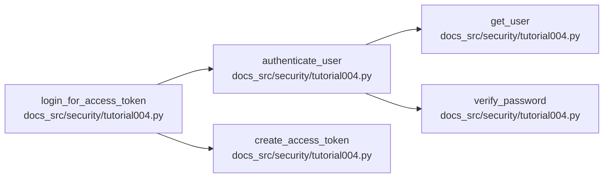
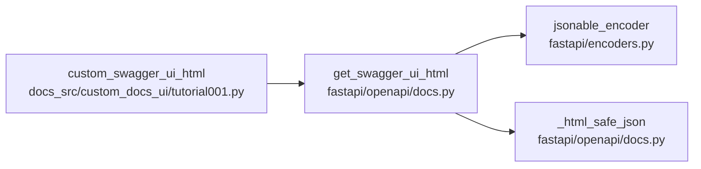
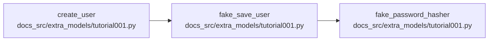
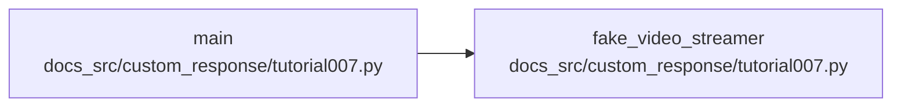
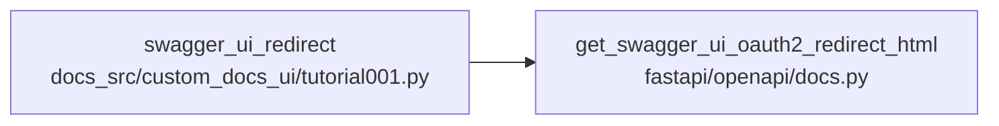

# Function-level Flow

What each entry point calls, function by function (Python only). Dotted arrows lead to a function already drawn elsewhere in the same diagram. Calls through other objects (`self.client.send()`) are not followed.

## `POST /token` → `login_for_access_token`

`docs_src/security/tutorial004.py:122` · 5 functions

## `GET /docs` → `custom_swagger_ui_html`

`docs_src/custom_docs_ui/tutorial001.py:12` · 4 functions

## `POST /user/` → `create_user`

`docs_src/extra_models/tutorial001.py:39` · 3 functions

## `GET /` → `main`

`docs_src/custom_response/tutorial007.py:15` · 2 functions

## `GET /<dynamic>` → `swagger_ui_redirect`

`docs_src/custom_docs_ui/tutorial001.py:23` · 2 functions

_...and 14 more entry points; see the insights JSON (`--json`)._

---

Generated by [GNOST](https://gnost.readthedocs.io) 0.6.1. Try it on your own code: `uvx gnost onboard .`
