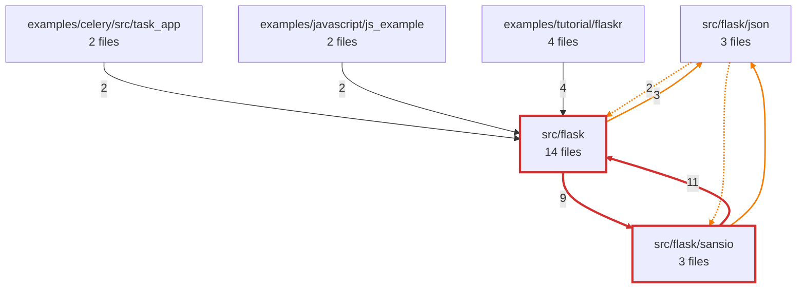

# flask — Project Onboarding Guide

_Generated automatically by <a href='https://gnost.readthedocs.io'>GNOST</a>._

## Project Overview

- **Root:** `https://github.com/pallets/flask`
- **Languages:** python (35)
- **Framework:** Flask

## Summary Table

| Language | Files | LOC |
|---|---:|---:|
| Python | 83 | 18392 |

## Stats Table

| Language | Files | Code | Comments | Blanks | LOC |
|---|---:|---:|---:|---:|---:|
| Python | 83 | 13335 | 784 | 4273 | 18392 |

## Entry Points

- `examples/celery/src/task_app/__init__.py` — Flask app initialization
- `examples/javascript/js_example/__init__.py` — Flask app initialization
- `examples/tutorial/flaskr/__init__.py` — Flask app initialization
- `src/flask/cli.py` — __main__ guard

## Routes

20 endpoints found. Each row is a URL and the code that handles it.

| Method | Path | Handler | File |
|---|---|---|---|
| GET | `/` | `index` | `examples/celery/src/task_app/__init__.py:20` |
| GET | `/` | `index` | `examples/javascript/js_example/views.py:10` |
| GET | `/` | `index` | `examples/tutorial/flaskr/blog.py:17` |
| GET | `/<any(xhr, jquery, fetch):js>` | `index` | `examples/javascript/js_example/views.py:10` |
| POST | `/<int:id>/delete` | `delete` | `examples/tutorial/flaskr/blog.py:115` |
| GET | `/<int:id>/update` | `update` | `examples/tutorial/flaskr/blog.py:88` |
| POST | `/<int:id>/update` | `update` | `examples/tutorial/flaskr/blog.py:88` |
| POST | `/add` | `add` | `examples/javascript/js_example/views.py:15` |
| GET | `/auth/login` | `login` | `examples/tutorial/flaskr/auth.py:85` |
| POST | `/auth/login` | `login` | `examples/tutorial/flaskr/auth.py:85` |
| GET | `/auth/logout` | `logout` | `examples/tutorial/flaskr/auth.py:113` |
| GET | `/auth/register` | `register` | `examples/tutorial/flaskr/auth.py:47` |
| POST | `/auth/register` | `register` | `examples/tutorial/flaskr/auth.py:47` |
| GET | `/create` | `create` | `examples/tutorial/flaskr/blog.py:62` |
| POST | `/create` | `create` | `examples/tutorial/flaskr/blog.py:62` |
| GET | `/hello` | `hello` | `examples/tutorial/flaskr/__init__.py:27` |
| POST | `/tasks/add` | `add` | `examples/celery/src/task_app/views.py:22` |
| POST | `/tasks/block` | `block` | `examples/celery/src/task_app/views.py:30` |
| POST | `/tasks/process` | `process` | `examples/celery/src/task_app/views.py:36` |
| GET | `/tasks/result/<id>` | `result` | `examples/celery/src/task_app/views.py:11` |

## Execution Flow (High Level)

- `examples/celery/src/task_app/__init__.py` → `examples/celery/src/task_app/views.py` → `examples/celery/src/task_app/tasks.py`
- `examples/celery/src/task_app/__init__.py` → `src/flask/__init__.py` → `src/flask/config.py`
- `examples/celery/src/task_app/__init__.py` → `src/flask/__init__.py` → `src/flask/ctx.py`
- `examples/celery/src/task_app/__init__.py` → `src/flask/__init__.py` → `src/flask/globals.py`
- `examples/celery/src/task_app/__init__.py` → `src/flask/__init__.py` → `src/flask/helpers.py`

_(48 additional paths omitted for clarity.)_

## Function-level Flow

What each entry point calls, function by function (Python only; calls through other objects such as `self.client.send()` are not followed). Full diagrams: [function-flow.md](flow/function-flow.md).

### `GET /<int:id>/update` → `update`

`examples/tutorial/flaskr/blog.py:88`

- `get_post` (`examples/tutorial/flaskr/blog.py:28`)
  - `get_db` (`examples/tutorial/flaskr/db.py:9`)
- `get_db` (`examples/tutorial/flaskr/db.py:9`) _(shown above)_

### `POST /<int:id>/delete` → `delete`

`examples/tutorial/flaskr/blog.py:115`

- `get_post` (`examples/tutorial/flaskr/blog.py:28`)
  - `get_db` (`examples/tutorial/flaskr/db.py:9`)
- `get_db` (`examples/tutorial/flaskr/db.py:9`) _(shown above)_

### `POST /<int:id>/update` → `update`

`examples/tutorial/flaskr/blog.py:88`

- `get_post` (`examples/tutorial/flaskr/blog.py:28`)
  - `get_db` (`examples/tutorial/flaskr/db.py:9`)
- `get_db` (`examples/tutorial/flaskr/db.py:9`) _(shown above)_

### `GET /` → `index`

`examples/tutorial/flaskr/blog.py:17`

- `get_db` (`examples/tutorial/flaskr/db.py:9`)

### `GET /auth/login` → `login`

`examples/tutorial/flaskr/auth.py:85`

- `get_db` (`examples/tutorial/flaskr/db.py:9`)

_...and 5 more entry points in the insights JSON (`--json`)._

## Execution Flow (Overview)

> Grouped by folder to stay readable: 6 folders; numbers on arrows count the file-level imports they stand for.
> Thick red arrows: circular imports that happen as modules load.
> Orange arrows (dotted when the import itself is deferred): circular dependencies that only close through an import inside a function, a type-only import or a dynamic import.

> 📌 This diagram shows the high-level execution flow. For the complete flow, see [**flow/flow-full.md**](./flow/FLOW-full.md) Raw Mermaid: [flow/flow-full.mmd](./flow/FLOW-full.mmd) Every file and import, ungrouped (for tools and AI): [flow/flow-complete.mmd](./flow/flow-complete.mmd) Interactive explorer: run `gnost open flow` (the page is `flow.html` in this folder; it is rebuilt, not committed)

## Recommended Reading Order

### Start Here

- `examples/celery/src/task_app/__init__.py`
- `examples/javascript/js_example/__init__.py`
- `examples/tutorial/flaskr/__init__.py`

### Core Logic

- `examples/celery/src/task_app/views.py`
- `examples/javascript/js_example/views.py`
- `examples/tutorial/flaskr/auth.py`
- `examples/tutorial/flaskr/blog.py`
- `examples/tutorial/flaskr/db.py`
- `src/flask/__init__.py`
- `src/flask/app.py`
- `src/flask/blueprints.py`
- `src/flask/config.py`
- `src/flask/ctx.py`
- `src/flask/globals.py`
- `src/flask/helpers.py`
- `src/flask/json/__init__.py`
- `src/flask/templating.py`
- `src/flask/wrappers.py`
- _...and 10 more (closest to an entry point listed first)_

### Supporting / Leaf Code

- `examples/celery/src/task_app/tasks.py`
- `src/flask/signals.py`
- `src/flask/typing.py`

## 📘 First Files to Read
- **`src/flask/__init__.py`**
  - Core logic file referenced by multiple execution paths
- **`examples/tutorial/flaskr/__init__.py`**
  - Primary entry point into the application
- **`examples/celery/src/task_app/__init__.py`**
  - Primary entry point into the application
- **`examples/javascript/js_example/__init__.py`**
  - Primary entry point into the application
- **`src/flask/app.py`**
  - Core logic file referenced by multiple execution paths
- **`src/flask/blueprints.py`**
  - Core logic file referenced by multiple execution paths
- **`src/flask/cli.py`**
  - Primary entry point into the application
- **`src/flask/ctx.py`**
  - Core logic file referenced by multiple execution paths
- **`src/flask/templating.py`**
  - Core logic file referenced by multiple execution paths
- **`src/flask/wrappers.py`**
  - Core logic file referenced by multiple execution paths

## ⚠️ Caution Areas
### `src/flask/app.py`
- **Type:** circular_dependency
- **Severity:** 5
- **Caution score:** 98.6/100
- Part of an import-time circular dependency; 1,371 lines of code; 4 except blocks that neither log nor re-raise
### `src/flask/cli.py`
- **Type:** circular_dependency
- **Severity:** 5
- **Caution score:** 98.3/100
- Part of an import-time circular dependency; 898 lines of code; 7 except blocks that neither log nor re-raise
### `src/flask/sansio/app.py`
- **Type:** circular_dependency
- **Severity:** 5
- **Caution score:** 96.7/100
- Part of an import-time circular dependency; 833 lines of code; a function with complexity 13
### `src/flask/sansio/blueprints.py`
- **Type:** circular_dependency
- **Severity:** 5
- **Caution score:** 96.3/100
- Part of an import-time circular dependency; a function with complexity 23; 572 lines of code
### `src/flask/helpers.py`
- **Type:** circular_dependency
- **Severity:** 5
- **Caution score:** 94.5/100
- Part of an import-time circular dependency; 531 lines of code; imported by 9 files
### `src/flask/__init__.py`
- **Type:** circular_dependency
- **Severity:** 5
- **Caution score:** 94.1/100
- Part of an import-time circular dependency; imported by 16 files; imports 10 project files
### `src/flask/sansio/scaffold.py`
- **Type:** circular_dependency
- **Severity:** 5
- **Caution score:** 94.1/100
- Part of an import-time circular dependency; 647 lines of code; imported by 5 files
### `src/flask/ctx.py`
- **Type:** circular_dependency
- **Severity:** 5
- **Caution score:** 92.7/100
- Part of an import-time circular dependency; 404 lines of code; 2 except blocks that neither log nor re-raise
### `src/flask/globals.py`
- **Type:** circular_dependency
- **Severity:** 5
- **Caution score:** 92.5/100
- Part of an import-time circular dependency; imported by 12 files
### `src/flask/wrappers.py`
- **Type:** circular_dependency
- **Severity:** 5
- **Caution score:** 91.5/100
- Part of an import-time circular dependency; imported by 9 files

## Change Hotspots

_Not available: git log failed: fatal: could not fetch 20424de48d52f1f1be432064961d8233d70925f9 from promisor remote_

## 🔁 Circular Dependencies

2 import-time, 1 deferred. Import-time cycles load as the modules start and can fail there; deferred ones go through an import inside a function, a type-only import or a dynamic `import()` and are usually intentional.

### Import-time

- `src/flask/__init__.py` → `src/flask/app.py` → `src/flask/__init__.py` _(group of 20 files)_
- `examples/javascript/js_example/__init__.py` → `examples/javascript/js_example/views.py` → `examples/javascript/js_example/__init__.py`

### Deferred

- `examples/celery/src/task_app/__init__.py` → `examples/celery/src/task_app/views.py` → `examples/celery/src/task_app/__init__.py`
## Key Execution Paths

To understand specific scenarios, see the entry-based execution paths:

- 📍 [Entry-based Paths](flow/entry-paths.md)

- 🧭 [folder-based Paths](flow/folder-paths.md)

(Whole system: [flow/FLOW-full.md](flow/FLOW-full.md). For a small project it is the same as [flow/flow-complete.mmd](flow/flow-complete.mmd), every file and import; for a big one FLOW-full groups them by folder to stay readable. Interactive: `gnost open flow`.)

---

Generated by [GNOST](https://gnost.readthedocs.io) 0.6.1. Try it on your own code: `uvx gnost onboard .`
