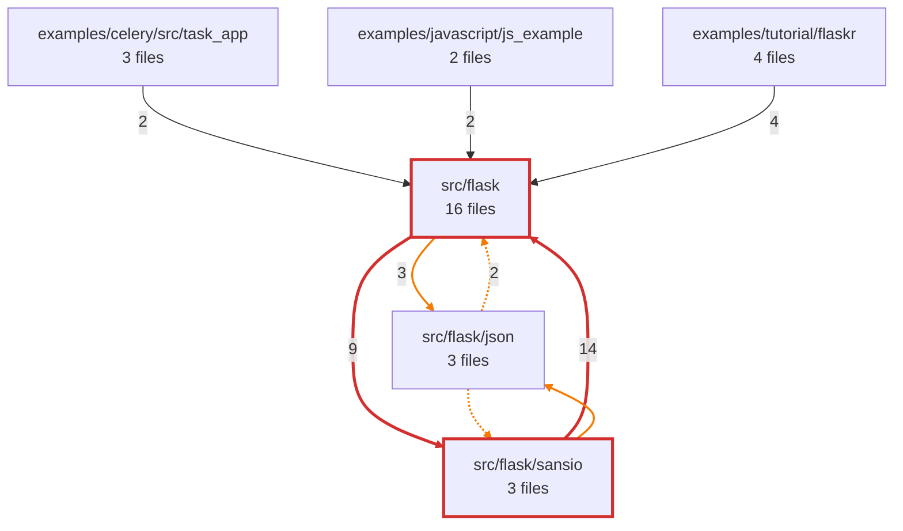
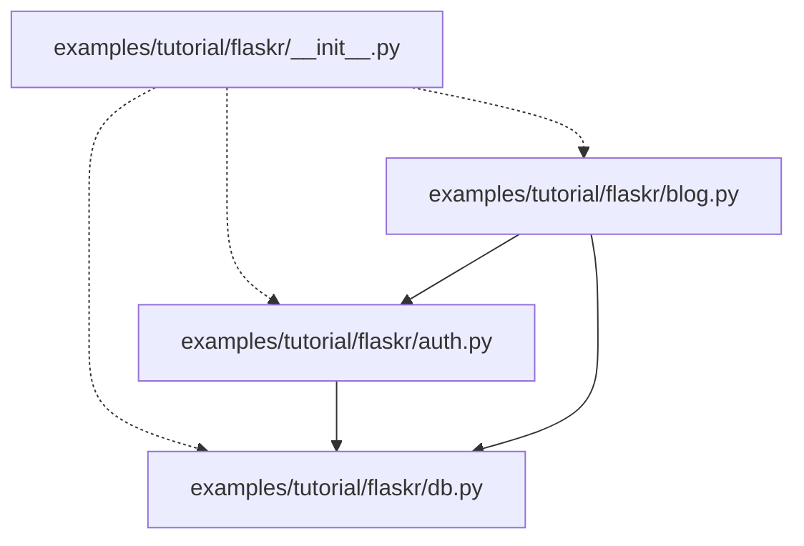
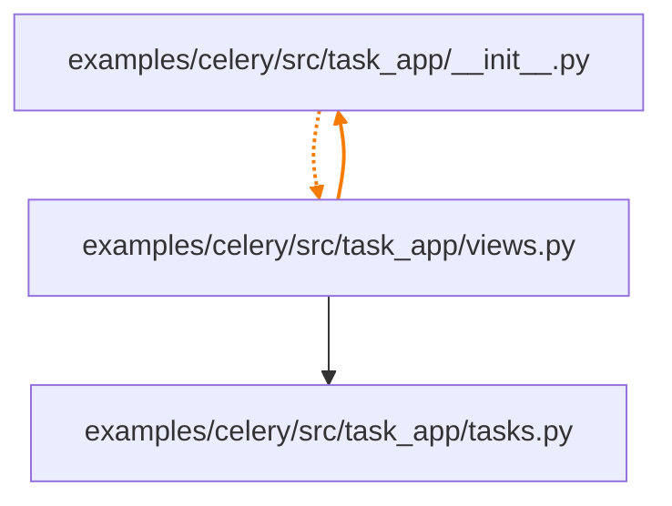
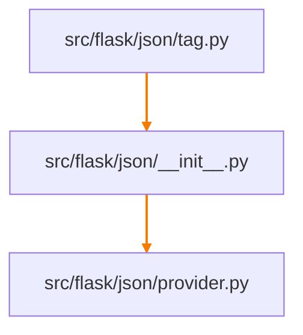
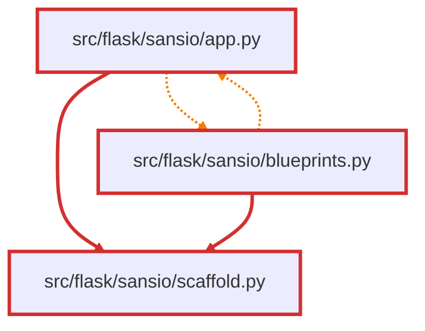
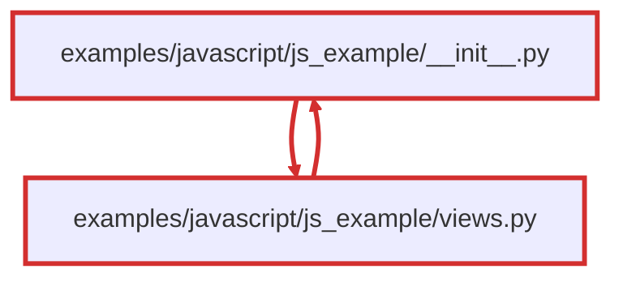

# Full Execution Flow

> Grouped by folder to stay readable: 6 folders; numbers on arrows count the file-level imports they stand for.
> Thick red arrows: circular imports that happen as modules load.
> Orange arrows (dotted when the import itself is deferred): circular dependencies that only close through an import inside a function, a type-only import or a dynamic import.

# Detail by folder

The diagram above groups files by folder. These show the files inside the biggest folders.

## `src/flask` (16 files)

```mermaid
flowchart TD
  src_flask___init___py["src/flask/__init__.py"]
  src_flask_app_py["src/flask/app.py"]
  src_flask_blueprints_py["src/flask/blueprints.py"]
  src_flask_cli_py["src/flask/cli.py"]
  src_flask_config_py["src/flask/config.py"]
  src_flask_ctx_py["src/flask/ctx.py"]
  src_flask_debughelpers_py["src/flask/debughelpers.py"]
  src_flask_globals_py["src/flask/globals.py"]
  src_flask_helpers_py["src/flask/helpers.py"]
  src_flask_logging_py["src/flask/logging.py"]
  src_flask_sessions_py["src/flask/sessions.py"]
  src_flask_signals_py["src/flask/signals.py"]
  src_flask_templating_py["src/flask/templating.py"]
  src_flask_testing_py["src/flask/testing.py"]
  src_flask_typing_py["src/flask/typing.py"]
  src_flask_wrappers_py["src/flask/wrappers.py"]
  src_flask___init___py ==> src_flask_app_py
  src_flask___init___py ==> src_flask_blueprints_py
  src_flask___init___py --> src_flask_config_py
  src_flask___init___py ==> src_flask_ctx_py
  src_flask___init___py --> src_flask_globals_py
  src_flask___init___py --> src_flask_helpers_py
  src_flask___init___py --> src_flask_signals_py
  src_flask___init___py ==> src_flask_templating_py
  src_flask___init___py ==> src_flask_wrappers_py
  src_flask_app_py ==> src_flask___init___py
  src_flask_app_py --> src_flask_cli_py
  src_flask_app_py ==> src_flask_ctx_py
  src_flask_app_py -.-> src_flask_debughelpers_py
  src_flask_app_py --> src_flask_globals_py
  src_flask_app_py --> src_flask_helpers_py
  src_flask_app_py --> src_flask_sessions_py
  src_flask_app_py --> src_flask_signals_py
  src_flask_app_py ==> src_flask_templating_py
  src_flask_app_py -.-> src_flask_testing_py
  src_flask_app_py --> src_flask_typing_py
  src_flask_app_py ==> src_flask_wrappers_py
  src_flask_blueprints_py --> src_flask_cli_py
  src_flask_blueprints_py --> src_flask_globals_py
  src_flask_blueprints_py --> src_flask_helpers_py
  src_flask_blueprints_py -.-> src_flask_wrappers_py
  src_flask_cli_py -.-> src_flask___init___py
  src_flask_cli_py -.-> src_flask_app_py
  src_flask_cli_py --> src_flask_globals_py
  src_flask_cli_py --> src_flask_helpers_py
  src_flask_ctx_py ==> src_flask___init___py
  src_flask_ctx_py -.-> src_flask_app_py
  src_flask_ctx_py --> src_flask_globals_py
  src_flask_ctx_py --> src_flask_helpers_py
  src_flask_ctx_py -.-> src_flask_sessions_py
  src_flask_ctx_py --> src_flask_signals_py
  src_flask_ctx_py --> src_flask_typing_py
  src_flask_ctx_py -.-> src_flask_wrappers_py
  src_flask_debughelpers_py --> src_flask_blueprints_py
  src_flask_debughelpers_py --> src_flask_globals_py
  src_flask_debughelpers_py -.-> src_flask_wrappers_py
  src_flask_globals_py -.-> src_flask_app_py
  src_flask_globals_py -.-> src_flask_ctx_py
  src_flask_globals_py -.-> src_flask_sessions_py
  src_flask_globals_py -.-> src_flask_wrappers_py
  src_flask_helpers_py --> src_flask_globals_py
  src_flask_helpers_py --> src_flask_signals_py
  src_flask_helpers_py -.-> src_flask_wrappers_py
  src_flask_logging_py --> src_flask_globals_py
  src_flask_sessions_py -.-> src_flask_app_py
  src_flask_sessions_py -.-> src_flask_wrappers_py
  src_flask_templating_py ==> src_flask_ctx_py
  src_flask_templating_py -.-> src_flask_debughelpers_py
  src_flask_templating_py --> src_flask_globals_py
  src_flask_templating_py --> src_flask_helpers_py
  src_flask_templating_py --> src_flask_signals_py
  src_flask_testing_py -.-> src_flask_app_py
  src_flask_testing_py --> src_flask_cli_py
  src_flask_testing_py --> src_flask_sessions_py
  src_flask_wrappers_py ==> src_flask___init___py
  src_flask_wrappers_py -.-> src_flask_debughelpers_py
  src_flask_wrappers_py --> src_flask_globals_py
  src_flask_wrappers_py --> src_flask_helpers_py
  linkStyle 0,1,3,7,8,9,11,17,20,29,50,58 stroke:#d32f2f,stroke-width:3px
  linkStyle 2,4,5,10,13,14,15,21,22,23,27,28,31,32,37,38,44,47,52,53,56,57,60,61 stroke:#f57c00,stroke-width:2px
  linkStyle 12,18,24,25,26,30,33,36,39,40,41,42,43,46,48,49,51,55,59 stroke:#f57c00,stroke-width:2px
  classDef cycle stroke:#d32f2f,stroke-width:3px
  class src_flask___init___py,src_flask_app_py,src_flask_blueprints_py,src_flask_ctx_py,src_flask_templating_py,src_flask_wrappers_py cycle
```

> Thick red arrows: circular imports that happen as modules load.
> Orange arrows (dotted when the import itself is deferred): circular dependencies that only close through an import inside a function, a type-only import or a dynamic import.

## `examples/tutorial/flaskr` (4 files)

> Dotted arrows: imports that do not run when the module loads.

## `examples/celery/src/task_app` (3 files)

> Orange arrows (dotted when the import itself is deferred): circular dependencies that only close through an import inside a function, a type-only import or a dynamic import.

## `src/flask/json` (3 files)

> Orange arrows (dotted when the import itself is deferred): circular dependencies that only close through an import inside a function, a type-only import or a dynamic import.

## `src/flask/sansio` (3 files)

> Thick red arrows: circular imports that happen as modules load.
> Orange arrows (dotted when the import itself is deferred): circular dependencies that only close through an import inside a function, a type-only import or a dynamic import.

## `examples/javascript/js_example` (2 files)

> Thick red arrows: circular imports that happen as modules load.

> ℹ️ This file renders the complete Mermaid diagram on GitHub.
> For raw Mermaid source, see [**FLOW-full.mmd**](./FLOW-full.mmd). Every file and import, ungrouped and nothing omitted: [**flow-complete.mmd**](./flow-complete.mmd)

---

Generated by [GNOST](https://gnost.readthedocs.io) 0.6.0. Try it on your own code: `uvx gnost onboard .`
