# Entry-based Execution Paths

These diagrams show individual execution paths starting from application entry points. Each path represents one possible flow through the system.

## Path 1 — `examples/celery/src/task_app/__init__.py`

```mermaid
flowchart LR
  examples_celery_src_task_app___init___py["examples/celery/src/task_app/__init__.py"]
  src_flask___init___py["src/flask/__init__.py"]
  src_flask_app_py["src/flask/app.py"]
  src_flask_logging_py["src/flask/logging.py"]
  src_flask_sansio_app_py["src/flask/sansio/app.py"]
  examples_celery_src_task_app___init___py --> src_flask___init___py
  src_flask___init___py ==> src_flask_app_py
  src_flask_app_py ==> src_flask_sansio_app_py
  src_flask_sansio_app_py --> src_flask_logging_py
  linkStyle 1,2 stroke:#d32f2f,stroke-width:3px
  linkStyle 3 stroke:#f57c00,stroke-width:2px
  classDef cycle stroke:#d32f2f,stroke-width:3px
  class src_flask___init___py,src_flask_app_py,src_flask_sansio_app_py cycle
```

**Execution chain:** examples/celery/src/task_app/__init__.py → src/flask/__init__.py → src/flask/app.py → src/flask/sansio/app.py → src/flask/logging.py

## Path 2 — `examples/celery/src/task_app/__init__.py`

```mermaid
flowchart LR
  examples_celery_src_task_app___init___py["examples/celery/src/task_app/__init__.py"]
  src_flask___init___py["src/flask/__init__.py"]
  src_flask_app_py["src/flask/app.py"]
  src_flask_json_tag_py["src/flask/json/tag.py"]
  src_flask_sessions_py["src/flask/sessions.py"]
  examples_celery_src_task_app___init___py --> src_flask___init___py
  src_flask___init___py ==> src_flask_app_py
  src_flask_app_py --> src_flask_sessions_py
  src_flask_sessions_py --> src_flask_json_tag_py
  linkStyle 1 stroke:#d32f2f,stroke-width:3px
  linkStyle 2,3 stroke:#f57c00,stroke-width:2px
  classDef cycle stroke:#d32f2f,stroke-width:3px
  class src_flask___init___py,src_flask_app_py cycle
```

**Execution chain:** examples/celery/src/task_app/__init__.py → src/flask/__init__.py → src/flask/app.py → src/flask/sessions.py → src/flask/json/tag.py

## Path 3 — `examples/javascript/js_example/__init__.py`

```mermaid
flowchart LR
  examples_javascript_js_example___init___py["examples/javascript/js_example/__init__.py"]
  src_flask___init___py["src/flask/__init__.py"]
  src_flask_app_py["src/flask/app.py"]
  src_flask_logging_py["src/flask/logging.py"]
  src_flask_sansio_app_py["src/flask/sansio/app.py"]
  examples_javascript_js_example___init___py --> src_flask___init___py
  src_flask___init___py ==> src_flask_app_py
  src_flask_app_py ==> src_flask_sansio_app_py
  src_flask_sansio_app_py --> src_flask_logging_py
  linkStyle 1,2 stroke:#d32f2f,stroke-width:3px
  linkStyle 3 stroke:#f57c00,stroke-width:2px
  classDef cycle stroke:#d32f2f,stroke-width:3px
  class src_flask___init___py,src_flask_app_py,src_flask_sansio_app_py cycle
```

**Execution chain:** examples/javascript/js_example/__init__.py → src/flask/__init__.py → src/flask/app.py → src/flask/sansio/app.py → src/flask/logging.py

---

Generated by [GNOST](https://gnost.readthedocs.io) 0.6.1. Try it on your own code: `uvx gnost onboard .`
