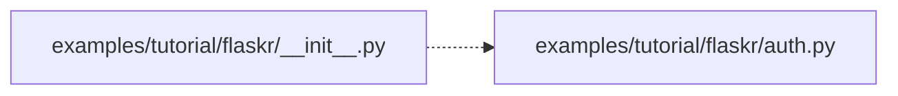
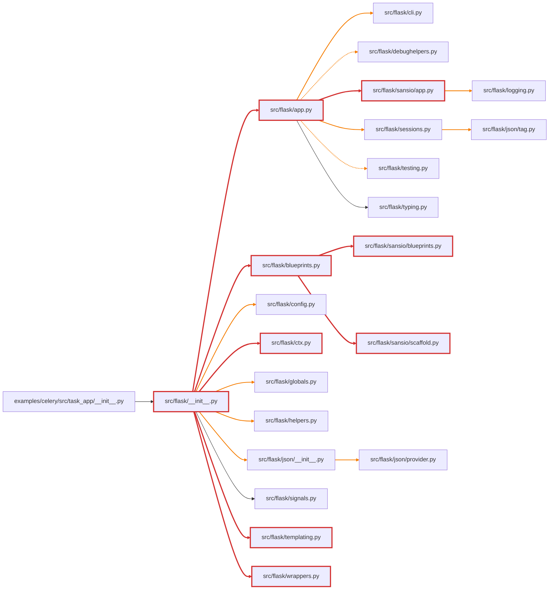
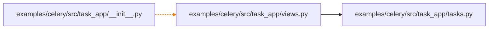
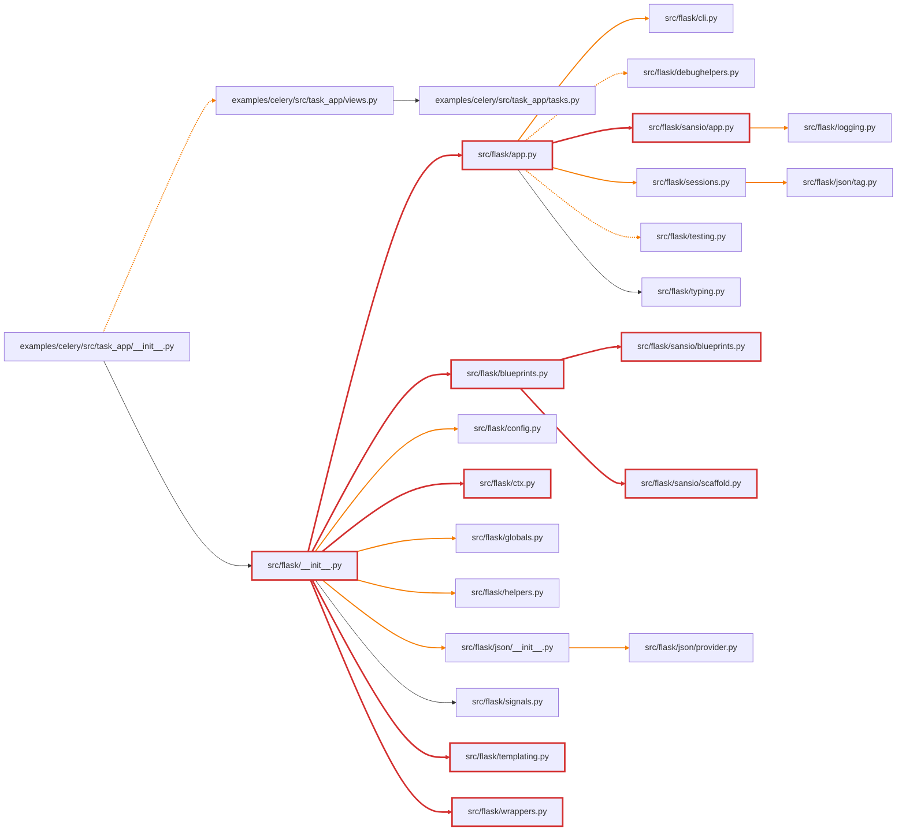
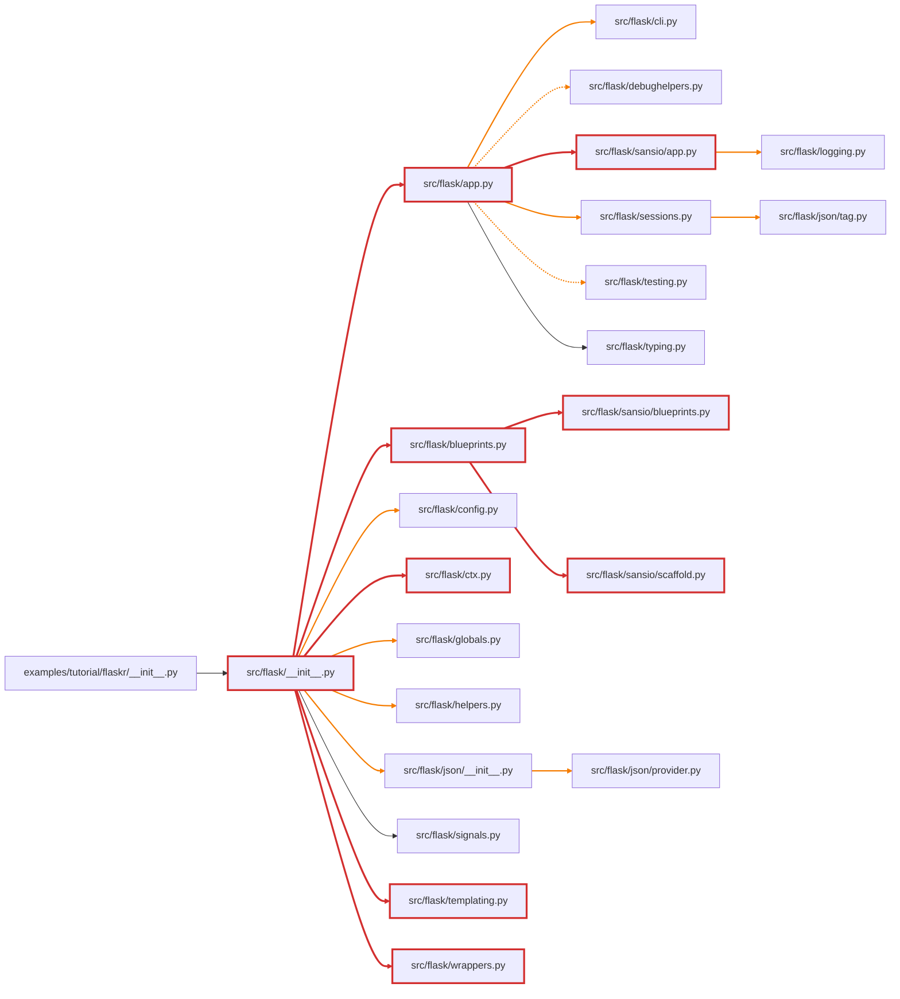
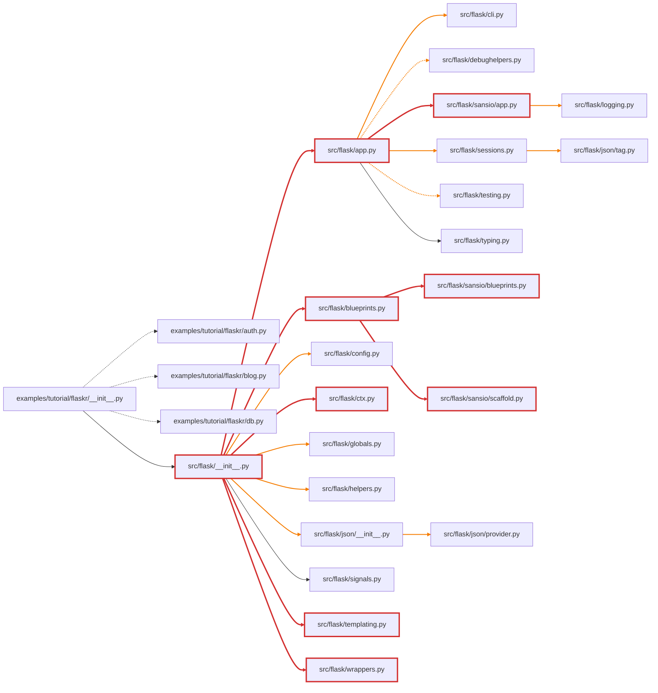
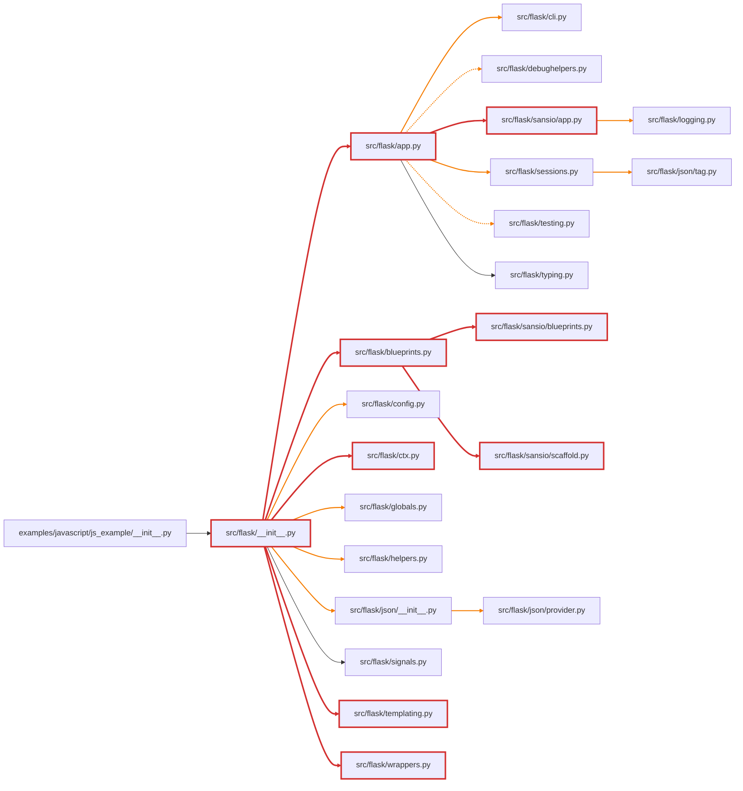
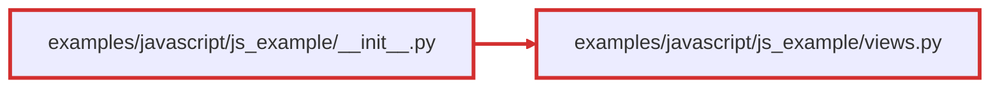
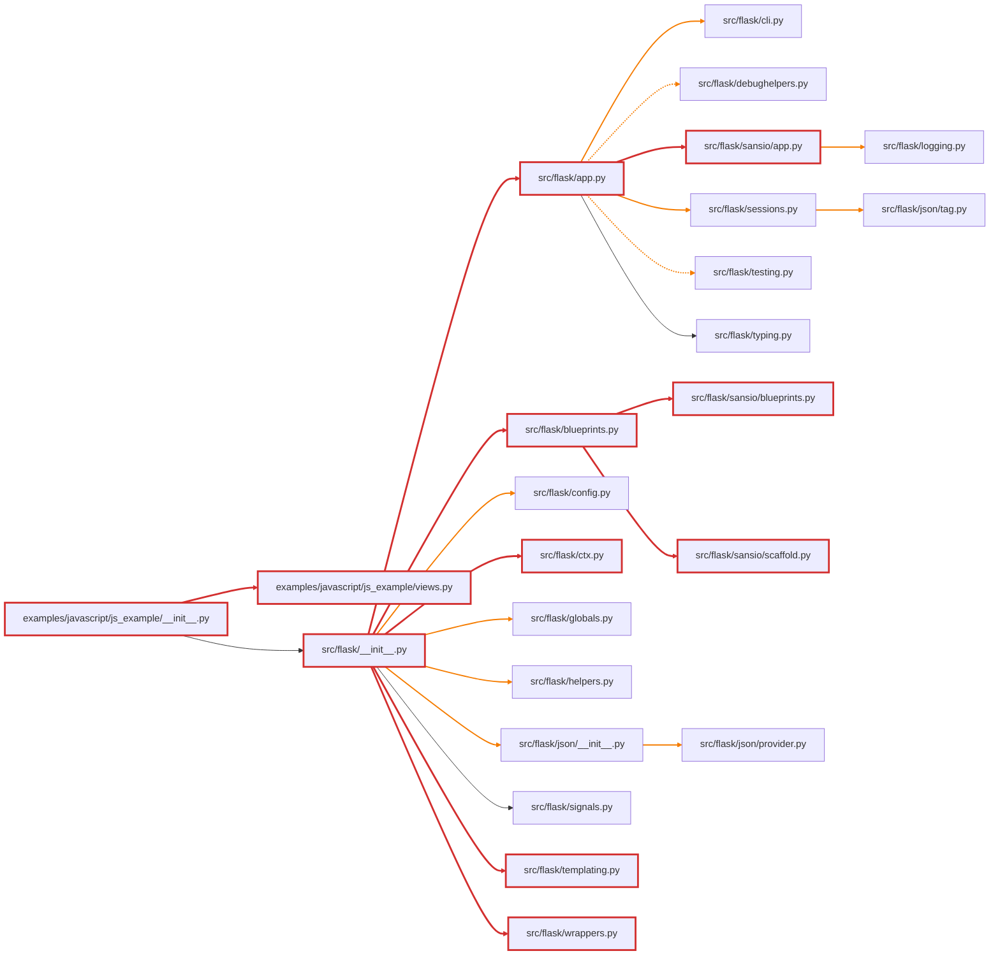

# Keyword-based Execution Paths

These diagrams show execution flows related to key features, auto-detected from the project structure.

## Feature: `auth`

### Representative Paths

#### Path Group 1

**Execution chain:** examples/tutorial/flaskr/__init__.py → examples/tutorial/flaskr/auth.py

### Combined Flow (All `auth` Paths)

## Feature: `celery`

### Representative Paths

#### Path Group 1

**Execution chain:** examples/celery/src/task_app/__init__.py → src/flask/__init__.py → src/flask/app.py → src/flask/sansio/app.py → src/flask/logging.py

#### Path Group 2

**Execution chain:** examples/celery/src/task_app/__init__.py → examples/celery/src/task_app/views.py → examples/celery/src/task_app/tasks.py

### Combined Flow (All `celery` Paths)

## Feature: `flaskr`

### Representative Paths

#### Path Group 1

**Execution chain:** examples/tutorial/flaskr/__init__.py → src/flask/__init__.py → src/flask/app.py → src/flask/sansio/app.py → src/flask/logging.py

#### Path Group 2

**Execution chain:** examples/tutorial/flaskr/__init__.py → examples/tutorial/flaskr/auth.py

### Combined Flow (All `flaskr` Paths)

## Feature: `javascript`

### Representative Paths

#### Path Group 1

**Execution chain:** examples/javascript/js_example/__init__.py → src/flask/__init__.py → src/flask/app.py → src/flask/sansio/app.py → src/flask/logging.py

#### Path Group 2

**Execution chain:** examples/javascript/js_example/__init__.py → examples/javascript/js_example/views.py

### Combined Flow (All `javascript` Paths)

## Feature: `js_example`

### Representative Paths

#### Path Group 1

**Execution chain:** examples/javascript/js_example/__init__.py → src/flask/__init__.py → src/flask/app.py → src/flask/sansio/app.py → src/flask/logging.py

#### Path Group 2

**Execution chain:** examples/javascript/js_example/__init__.py → examples/javascript/js_example/views.py

### Combined Flow (All `js_example` Paths)

## Feature: `tutorial`

### Representative Paths

#### Path Group 1

**Execution chain:** examples/tutorial/flaskr/__init__.py → src/flask/__init__.py → src/flask/app.py → src/flask/sansio/app.py → src/flask/logging.py

#### Path Group 2

**Execution chain:** examples/tutorial/flaskr/__init__.py → examples/tutorial/flaskr/auth.py

### Combined Flow (All `tutorial` Paths)

---

Generated by [GNOST](https://gnost.readthedocs.io) 0.6.0. Try it on your own code: `uvx gnost onboard .`
