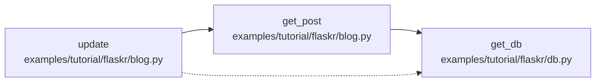
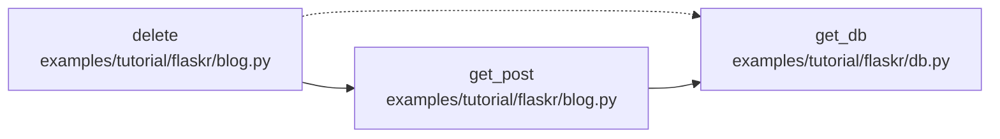
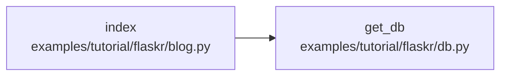
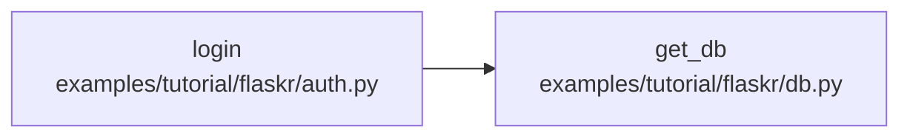

# Function-level Flow

What each entry point calls, function by function (Python only). Dotted arrows lead to a function already drawn elsewhere in the same diagram. Calls through other objects (`self.client.send()`) are not followed.

## `GET /<int:id>/update` → `update`

`examples/tutorial/flaskr/blog.py:88` · 3 functions

## `POST /<int:id>/delete` → `delete`

`examples/tutorial/flaskr/blog.py:115` · 3 functions

## `POST /<int:id>/update` → `update`

`examples/tutorial/flaskr/blog.py:88` · 3 functions

## `GET /` → `index`

`examples/tutorial/flaskr/blog.py:17` · 2 functions

## `GET /auth/login` → `login`

`examples/tutorial/flaskr/auth.py:85` · 2 functions

_...and 5 more entry points; see the insights JSON (`--json`)._

---

Generated by [GNOST](https://gnost.readthedocs.io) 0.6.1. Try it on your own code: `uvx gnost onboard .`
