# spring-petclinic — Project Onboarding Guide

_Generated automatically by <a href='https://gnost.readthedocs.io'>GNOST</a>._

## Project Overview

- **Root:** `https://github.com/spring-projects/spring-petclinic`
- **Languages:** java (30)
- **Framework:** Spring Boot

## Summary Table

| Language | Files | LOC |
|---|---:|---:|
| Java | 50 | 4297 |

## Stats Table

| Language | Files | Code | Comments | Blanks | LOC |
|---|---:|---:|---:|---:|---:|
| Java | 50 | 3629 | 38 | 630 | 4297 |

## Entry Points

- `src/main/java/org/springframework/samples/petclinic/PetClinicApplication.java` — @SpringBootApplication
- `src/main/java/org/springframework/samples/petclinic/PetClinicApplication.java` — public static void main

## Routes

18 endpoints found. Each row is a URL and the code that handles it.

| Method | Path | Handler | File |
|---|---|---|---|
| ANY | `/` | `VisitController` | `src/main/java/org/springframework/samples/petclinic/owner/VisitController.java:57` |
| GET | `/` | `WelcomeController.welcome` | `src/main/java/org/springframework/samples/petclinic/system/WelcomeController.java:25` |
| GET | `/oups` | `CrashController.triggerException` | `src/main/java/org/springframework/samples/petclinic/system/CrashController.java:31` |
| GET | `/owners` | `OwnerController.processFindForm` | `src/main/java/org/springframework/samples/petclinic/owner/OwnerController.java:94` |
| GET | `/owners/find` | `OwnerController.initFindForm` | `src/main/java/org/springframework/samples/petclinic/owner/OwnerController.java:89` |
| GET | `/owners/new` | `OwnerController.initCreationForm` | `src/main/java/org/springframework/samples/petclinic/owner/OwnerController.java:72` |
| POST | `/owners/new` | `OwnerController.processCreationForm` | `src/main/java/org/springframework/samples/petclinic/owner/OwnerController.java:77` |
| GET | `/owners/{ownerId}` | `OwnerController.showOwner` | `src/main/java/org/springframework/samples/petclinic/owner/OwnerController.java:178` |
| GET | `/owners/{ownerId}/edit` | `OwnerController.initUpdateOwnerForm` | `src/main/java/org/springframework/samples/petclinic/owner/OwnerController.java:148` |
| POST | `/owners/{ownerId}/edit` | `OwnerController.processUpdateOwnerForm` | `src/main/java/org/springframework/samples/petclinic/owner/OwnerController.java:153` |
| GET | `/owners/{ownerId}/pets/new` | `PetController.initCreationForm` | `src/main/java/org/springframework/samples/petclinic/owner/PetController.java:100` |
| POST | `/owners/{ownerId}/pets/new` | `PetController.processCreationForm` | `src/main/java/org/springframework/samples/petclinic/owner/PetController.java:107` |
| GET | `/owners/{ownerId}/pets/{petId}/edit` | `PetController.initUpdateForm` | `src/main/java/org/springframework/samples/petclinic/owner/PetController.java:139` |
| POST | `/owners/{ownerId}/pets/{petId}/edit` | `PetController.processUpdateForm` | `src/main/java/org/springframework/samples/petclinic/owner/PetController.java:144` |
| GET | `/owners/{ownerId}/pets/{petId}/visits/new` | `VisitController.initNewVisitForm` | `src/main/java/org/springframework/samples/petclinic/owner/VisitController.java:90` |
| POST | `/owners/{ownerId}/pets/{petId}/visits/new` | `VisitController.processNewVisitForm` | `src/main/java/org/springframework/samples/petclinic/owner/VisitController.java:97` |
| GET | `/vets` | `VetController` | `src/main/java/org/springframework/samples/petclinic/vet/VetController.java:72` |
| GET | `/vets.html` | `VetController.showVetList` | `src/main/java/org/springframework/samples/petclinic/vet/VetController.java:45` |

## Execution Flow (High Level)

- `src/main/java/org/springframework/samples/petclinic/PetClinicApplication.java`
- `src/main/java/org/springframework/samples/petclinic/PetClinicRuntimeHints.java` → `src/main/java/org/springframework/samples/petclinic/model/BaseEntity.java`
- `src/main/java/org/springframework/samples/petclinic/PetClinicRuntimeHints.java` → `src/main/java/org/springframework/samples/petclinic/model/Person.java`
- `src/main/java/org/springframework/samples/petclinic/PetClinicRuntimeHints.java` → `src/main/java/org/springframework/samples/petclinic/vet/Vet.java` → `src/main/java/org/springframework/samples/petclinic/model/NamedEntity.java`
- `src/main/java/org/springframework/samples/petclinic/owner/Owner.java` → `src/main/java/org/springframework/samples/petclinic/model/Person.java`

_(4 additional paths omitted for clarity.)_

## Execution Flow (Overview)

```mermaid
flowchart TD
  src_main_java_org_springframework_samples_petclinic_PetClinicRuntimeHints_java["src/main/java/org/springframework/samples/petclinic/PetClinicRuntimeHints.java"]
  src_main_java_org_springframework_samples_petclinic_model_BaseEntity_java["src/main/java/org/springframework/samples/petclinic/model/BaseEntity.java"]
  src_main_java_org_springframework_samples_petclinic_model_NamedEntity_java["src/main/java/org/springframework/samples/petclinic/model/NamedEntity.java"]
  src_main_java_org_springframework_samples_petclinic_model_Person_java["src/main/java/org/springframework/samples/petclinic/model/Person.java"]
  src_main_java_org_springframework_samples_petclinic_owner_Owner_java["src/main/java/org/springframework/samples/petclinic/owner/Owner.java"]
  src_main_java_org_springframework_samples_petclinic_owner_Pet_java["src/main/java/org/springframework/samples/petclinic/owner/Pet.java"]
  src_main_java_org_springframework_samples_petclinic_owner_PetType_java["src/main/java/org/springframework/samples/petclinic/owner/PetType.java"]
  src_main_java_org_springframework_samples_petclinic_owner_Visit_java["src/main/java/org/springframework/samples/petclinic/owner/Visit.java"]
  src_main_java_org_springframework_samples_petclinic_vet_Specialty_java["src/main/java/org/springframework/samples/petclinic/vet/Specialty.java"]
  src_main_java_org_springframework_samples_petclinic_vet_Vet_java["src/main/java/org/springframework/samples/petclinic/vet/Vet.java"]
  src_main_java_org_springframework_samples_petclinic_PetClinicRuntimeHints_java --> src_main_java_org_springframework_samples_petclinic_model_BaseEntity_java
  src_main_java_org_springframework_samples_petclinic_PetClinicRuntimeHints_java --> src_main_java_org_springframework_samples_petclinic_model_Person_java
  src_main_java_org_springframework_samples_petclinic_PetClinicRuntimeHints_java --> src_main_java_org_springframework_samples_petclinic_vet_Vet_java
  src_main_java_org_springframework_samples_petclinic_owner_Owner_java --> src_main_java_org_springframework_samples_petclinic_model_Person_java
  src_main_java_org_springframework_samples_petclinic_owner_Pet_java --> src_main_java_org_springframework_samples_petclinic_model_NamedEntity_java
  src_main_java_org_springframework_samples_petclinic_owner_PetType_java --> src_main_java_org_springframework_samples_petclinic_model_NamedEntity_java
  src_main_java_org_springframework_samples_petclinic_owner_Visit_java --> src_main_java_org_springframework_samples_petclinic_model_BaseEntity_java
  src_main_java_org_springframework_samples_petclinic_vet_Specialty_java --> src_main_java_org_springframework_samples_petclinic_model_NamedEntity_java
  src_main_java_org_springframework_samples_petclinic_vet_Vet_java --> src_main_java_org_springframework_samples_petclinic_model_NamedEntity_java
  src_main_java_org_springframework_samples_petclinic_vet_Vet_java --> src_main_java_org_springframework_samples_petclinic_model_Person_java
```

> 📌 This diagram shows the high-level execution flow. For the complete flow, see [**flow/flow-full.md**](./flow/FLOW-full.md) Raw Mermaid: [flow/flow-full.mmd](./flow/FLOW-full.mmd) Every file and import, ungrouped (for tools and AI): [flow/flow-complete.mmd](./flow/flow-complete.mmd) Interactive explorer: run `gnost open flow` (the page is `flow.html` in this folder; it is rebuilt, not committed)

## Recommended Reading Order

### Start Here

- `src/main/java/org/springframework/samples/petclinic/PetClinicApplication.java`
- `src/main/java/org/springframework/samples/petclinic/PetClinicRuntimeHints.java`
- `src/main/java/org/springframework/samples/petclinic/owner/Owner.java`
- `src/main/java/org/springframework/samples/petclinic/owner/Pet.java`
- `src/main/java/org/springframework/samples/petclinic/owner/PetType.java`
- `src/main/java/org/springframework/samples/petclinic/owner/Visit.java`
- `src/main/java/org/springframework/samples/petclinic/vet/Specialty.java`

### Core Logic

- `src/main/java/org/springframework/samples/petclinic/vet/Vet.java`

### Supporting / Leaf Code

- `src/main/java/org/springframework/samples/petclinic/PetClinicApplication.java`
- `src/main/java/org/springframework/samples/petclinic/model/BaseEntity.java`
- `src/main/java/org/springframework/samples/petclinic/model/NamedEntity.java`
- `src/main/java/org/springframework/samples/petclinic/model/Person.java`

## 📘 First Files to Read
- **`src/main/java/org/springframework/samples/petclinic/PetClinicApplication.java`**
  - Primary entry point into the application
- **`src/main/java/org/springframework/samples/petclinic/PetClinicRuntimeHints.java`**
  - Frequently involved in execution flow
- **`src/main/java/org/springframework/samples/petclinic/model/NamedEntity.java`**
  - Frequently involved in execution flow
- **`src/main/java/org/springframework/samples/petclinic/model/BaseEntity.java`**
  - Frequently involved in execution flow
- **`src/main/java/org/springframework/samples/petclinic/model/Person.java`**
  - Frequently involved in execution flow
- **`src/main/java/org/springframework/samples/petclinic/owner/Owner.java`**
  - Frequently involved in execution flow
- **`src/main/java/org/springframework/samples/petclinic/owner/Pet.java`**
  - Frequently involved in execution flow
- **`src/main/java/org/springframework/samples/petclinic/owner/PetType.java`**
  - Frequently involved in execution flow
- **`src/main/java/org/springframework/samples/petclinic/owner/Visit.java`**
  - Frequently involved in execution flow
- **`src/main/java/org/springframework/samples/petclinic/vet/Specialty.java`**
  - Frequently involved in execution flow

## ⚠️ Caution Areas

## Change Hotspots

Files that changed most in the last 365 days (44 commits). A file that changes often and is touched by many people is where merge conflicts and regressions tend to start.

| File | Commits | Authors | Last 90 days | Lines changed | Last change |
|---|---:|---:|---:|---|---|
| `src/main/java/org/springframework/samples/petclinic/owner/OwnerController.java` | 5 | 3 | 2 | +16 / -5 | 2026-09-29 |
| `src/main/java/org/springframework/samples/petclinic/owner/Owner.java` | 4 | 4 | 1 | +30 / -19 | 2026-09-28 |
| `src/main/java/org/springframework/samples/petclinic/owner/PetController.java` | 4 | 3 | 0 | +34 / -9 | 2026-07-13 |
| `src/main/java/org/springframework/samples/petclinic/owner/Visit.java` | 3 | 3 | 1 | +10 / -9 | 2026-09-18 |
| `src/main/java/org/springframework/samples/petclinic/vet/VetController.java` | 3 | 2 | 2 | +9 / -6 | 2026-09-29 |
| `src/main/java/org/springframework/samples/petclinic/PetClinicRuntimeHints.java` | 3 | 3 | 0 | +5 / -6 | 2026-06-11 |
| `src/main/java/org/springframework/samples/petclinic/model/NamedEntity.java` | 3 | 3 | 0 | +5 / -6 | 2026-03-07 |
| `src/main/java/org/springframework/samples/petclinic/model/Person.java` | 2 | 2 | 0 | +8 / -9 | 2025-12-20 |
| `src/main/java/org/springframework/samples/petclinic/owner/Pet.java` | 2 | 2 | 0 | +7 / -8 | 2025-12-20 |
| `src/main/java/org/springframework/samples/petclinic/owner/VisitController.java` | 2 | 2 | 0 | +11 / -1 | 2026-05-31 |

## Risky and Changing

_No file is both fragile to change and changing often._

## 🔁 Circular Dependencies

_No circular dependencies detected._
## Key Execution Paths

To understand specific scenarios, see the entry-based execution paths:

- 📍 [Entry-based Paths](flow/entry-paths.md)

- 🧭 [folder-based Paths](flow/folder-paths.md)

(Whole system: [flow/FLOW-full.md](flow/FLOW-full.md). For a small project it is the same as [flow/flow-complete.mmd](flow/flow-complete.mmd), every file and import; for a big one FLOW-full groups them by folder to stay readable. Interactive: `gnost open flow`.)

---

Generated by [GNOST](https://gnost.readthedocs.io) 0.6.1. Try it on your own code: `mvn io.github.mohdzain98:gnost-maven-plugin:onboard`
