# Entry-based Execution Paths

These diagrams show individual execution paths starting from application entry points. Each path represents one possible flow through the system.

## Path 1 — `src/main/java/org/springframework/samples/petclinic/PetClinicApplication.java`

```mermaid
flowchart LR
  src_main_java_org_springframework_samples_petclinic_PetClinicApplication_java["src/main/java/org/springframework/samples/petclinic/PetClinicApplication.java"]
  src_main_java_org_springframework_samples_petclinic_PetClinicRuntimeHints_java["src/main/java/org/springframework/samples/petclinic/PetClinicRuntimeHints.java"]
  src_main_java_org_springframework_samples_petclinic_model_NamedEntity_java["src/main/java/org/springframework/samples/petclinic/model/NamedEntity.java"]
  src_main_java_org_springframework_samples_petclinic_vet_Vet_java["src/main/java/org/springframework/samples/petclinic/vet/Vet.java"]
  src_main_java_org_springframework_samples_petclinic_PetClinicApplication_java --> src_main_java_org_springframework_samples_petclinic_PetClinicRuntimeHints_java
  src_main_java_org_springframework_samples_petclinic_PetClinicRuntimeHints_java --> src_main_java_org_springframework_samples_petclinic_vet_Vet_java
  src_main_java_org_springframework_samples_petclinic_vet_Vet_java --> src_main_java_org_springframework_samples_petclinic_model_NamedEntity_java
```

**Execution chain:** src/main/java/org/springframework/samples/petclinic/PetClinicApplication.java → src/main/java/org/springframework/samples/petclinic/PetClinicRuntimeHints.java → src/main/java/org/springframework/samples/petclinic/vet/Vet.java → src/main/java/org/springframework/samples/petclinic/model/NamedEntity.java

## Path 2 — `src/main/java/org/springframework/samples/petclinic/PetClinicApplication.java`

```mermaid
flowchart LR
  src_main_java_org_springframework_samples_petclinic_PetClinicApplication_java["src/main/java/org/springframework/samples/petclinic/PetClinicApplication.java"]
  src_main_java_org_springframework_samples_petclinic_PetClinicRuntimeHints_java["src/main/java/org/springframework/samples/petclinic/PetClinicRuntimeHints.java"]
  src_main_java_org_springframework_samples_petclinic_vet_Specialty_java["src/main/java/org/springframework/samples/petclinic/vet/Specialty.java"]
  src_main_java_org_springframework_samples_petclinic_vet_Vet_java["src/main/java/org/springframework/samples/petclinic/vet/Vet.java"]
  src_main_java_org_springframework_samples_petclinic_PetClinicApplication_java --> src_main_java_org_springframework_samples_petclinic_PetClinicRuntimeHints_java
  src_main_java_org_springframework_samples_petclinic_PetClinicRuntimeHints_java --> src_main_java_org_springframework_samples_petclinic_vet_Vet_java
  src_main_java_org_springframework_samples_petclinic_vet_Vet_java --> src_main_java_org_springframework_samples_petclinic_vet_Specialty_java
```

**Execution chain:** src/main/java/org/springframework/samples/petclinic/PetClinicApplication.java → src/main/java/org/springframework/samples/petclinic/PetClinicRuntimeHints.java → src/main/java/org/springframework/samples/petclinic/vet/Vet.java → src/main/java/org/springframework/samples/petclinic/vet/Specialty.java

## Path 3 — `src/main/java/org/springframework/samples/petclinic/owner/OwnerController.java`

```mermaid
flowchart LR
  src_main_java_org_springframework_samples_petclinic_model_BaseEntity_java["src/main/java/org/springframework/samples/petclinic/model/BaseEntity.java"]
  src_main_java_org_springframework_samples_petclinic_model_Person_java["src/main/java/org/springframework/samples/petclinic/model/Person.java"]
  src_main_java_org_springframework_samples_petclinic_owner_Owner_java["src/main/java/org/springframework/samples/petclinic/owner/Owner.java"]
  src_main_java_org_springframework_samples_petclinic_owner_OwnerController_java["src/main/java/org/springframework/samples/petclinic/owner/OwnerController.java"]
  src_main_java_org_springframework_samples_petclinic_model_Person_java --> src_main_java_org_springframework_samples_petclinic_model_BaseEntity_java
  src_main_java_org_springframework_samples_petclinic_owner_Owner_java --> src_main_java_org_springframework_samples_petclinic_model_Person_java
  src_main_java_org_springframework_samples_petclinic_owner_OwnerController_java --> src_main_java_org_springframework_samples_petclinic_owner_Owner_java
```

**Execution chain:** src/main/java/org/springframework/samples/petclinic/owner/OwnerController.java → src/main/java/org/springframework/samples/petclinic/owner/Owner.java → src/main/java/org/springframework/samples/petclinic/model/Person.java → src/main/java/org/springframework/samples/petclinic/model/BaseEntity.java

---

Generated by [GNOST](https://gnost.readthedocs.io) 0.7.0. Try it on your own code: `mvn io.github.mohdzain98:gnost-maven-plugin:onboard`
