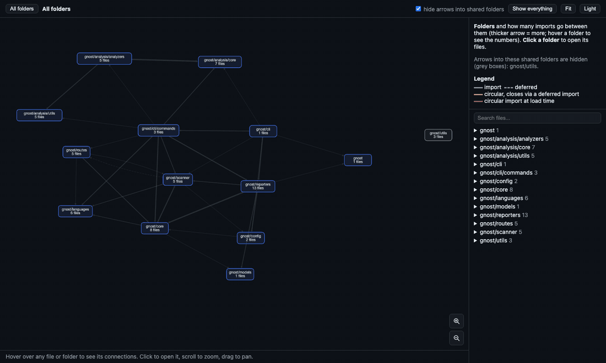
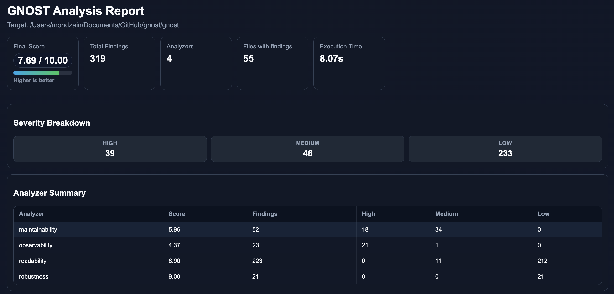

GNOST — Codebase Knowledge
=======================================

GNOST helps developers understand unfamiliar codebases by identifying
entry points, execution flow, and core logic automatically.

It works on a folder **or straight from a repository address**
(``gnost onboard https://github.com/owner/repo``): the repository is cloned read only into a temporary
folder, nothing in it is run, and the clone is deleted afterwards.

It also supports code quality analysis through ``gnost analyze`` to score and flag
maintainability, robustness, observability, and readability issues.

It is designed for **first-day onboarding** as well as code quality triage and
continuous reporting, not just code statistics.

*The interactive flow explorer that* ``gnost onboard`` *and* ``gnost open flow``
*give you, shown here on GNOST's own source code.*

Usage
-----

Complete CLI usage::

    usage: gnost [command]

    options:
    -h, --help  show this help message and exit
    --version   show program's version number and exit

    Available Commands:
    command
        summary   Show a summary table
        stats     Show detailed stats per language
        folders   Show LOC grouped by folder
        files     Show the largest files by LOC
        version   Display gnost version
        onboard   Onboard a new codebase
        analyze   Analyze the codebase
        changes   What a change touches: blast radius, risk, new cycles
        open      Open a report or diagram in the browser
        show      Same as `open FILE` (shorter name)
        init      Write a complete .gnost.toml and optionally add GNOST to your build

    Command Options:
    summary|stats|folders|files:
        --include  Comma-separated folder names to include
        --exclude  Comma-separated folder names to exclude
        --progress Show a progress bar while scanning

    onboard:
        --progress Show a progress bar while onboarding
        --mermaid  Generate only Mermaid flow diagram (FLOW.mmd)
        --inject   Inject onboarding link into README.md files
        --layered  Produce Layered mermaid as Entry -> Core -> Leaf
        --depth    Limit execution flow depth (e.g. --depth 2)
        --json FILE      Write the insights JSON to FILE instead of .gnost/insights.json
        --no-html        Do not write the flow explorer page (.gnost/flow.html)
        --insights-only  Write only the insights JSON
        --max-edges N    Largest diagram drawn file by file (default 80)
        --collapse [LEVEL]  Group diagrams by folder

    init:
        path             Project folder (default: .)
        --print          Print the default settings instead of writing .gnost.toml
        --force          Overwrite files that already exist
        --dry-run        Show what would change, write nothing
        --pom            Add gnost-maven-plugin to pom.xml
        --npm            Add a "gnost" script to package.json
        --github-action  Write .github/workflows/gnost.yml
        --agents         Write AGENTS.md pointing coding agents to the .gnost/ folder

    open|show:
        target                  report (default), flow, or a .mmd / .md / .html file
                                (`show` takes only a file)
        --path FILE             Custom report or diagram path
        --view auto|graph|mermaid  Interactive graph for big diagrams (auto), or force one
        -o, --output FILE       Where to save the HTML page (default: a temp file)
        --no-open               Write the HTML but do not open a browser

    analyze:
        path                    File or directory to analyze (default: .)
        -a, --analyzer          Enable only specific analyzers
        --parallel              Run analyzers in parallel
        -o, --out               Write JSON and HTML report to .gnost/analysis/analysis.json|html
        -v, --verbose           Show traceback on failures
        --quiet                 Reduce logs; keep warnings/errors only
        --list-analyzers        List available analyzers and exit
        --timeout SECONDS       Analyzer timeout (default: 900)
        --compact               Write compact JSON when --out is used
        --no-progress           Hide progress updates
        --max-findings N        Per-analyzer findings limit (default: 1000)
        --fail-under SCORE      Exit with code 3 when the final score (0-10) is below SCORE
        --baseline [FILE]       Report only findings that are not in the baseline
        --write-baseline [FILE] Save today's findings as the baseline
        --fail-on-new           With a baseline, exit with code 3 on new findings
        --sarif [FILE]          Write the findings as SARIF (for GitHub code scanning)

    files:
        --top      Number of files to show (default: 5)
    Use `gnost <command> --help` for full command options.

Run GNOST commands from the root of a repository::

    gnost summary [path]
    gnost stats [path]
    gnost folders [path]
    gnost files [path] --top 10
    gnost onboard [path]
    gnost analyze [path] --parallel -o
    gnost changes origin/main
    gnost onboard https://github.com/owner/repo
    gnost open report

Subcommand usage::

    gnost summary [path] [--include INCLUDE] [--exclude EXCLUDE] [--progress]
    gnost stats [path] [--include INCLUDE] [--exclude EXCLUDE] [--progress]
    gnost folders [path] [--include INCLUDE] [--exclude EXCLUDE] [--progress]
    gnost files [path] [--include INCLUDE] [--exclude EXCLUDE] [--progress] [--top TOP]
    gnost onboard [path] [--mermaid] [--progress] [--inject] [--layered] [--depth DEPTH] [--json [FILE]] [--insights-only] [--max-edges N] [--collapse [LEVEL]]
    gnost analyze [path] [--parallel] [--out] [--list-analyzers] [--no-progress]
    gnost changes BASE[..HEAD] [path] [--depth N] [--format text|markdown|json] [--findings] [--no-cycles] [--no-write]
    gnost open report|rpt
    gnost version

Key Commands
------------

``summary``
    Show a high-level project summary.

``stats``
    Show detailed language statistics.

``folders``
    Show lines of code grouped by folder.

``files``
    Show the largest files by lines of code.

``onboard``
    Generate onboarding summary and execution flow outputs.

``analyze``
    Analyze code quality and generate JSON/HTML findings report.

``changes``
    Show what a change touches: changed files, blast radius, risky files, routes, new cycles.

``open``
    Open the analysis report, the flow explorer or a diagram in the browser.

``init``
    Write a complete ``.gnost.toml`` and optionally add GNOST to your build.

``version``
    Display GNOST version.

Onboarding & Flow Analysis
--------------------------

Generate onboarding documentation::

    gnost onboard .

Onboard any public repository without cloning it yourself (read only; the results land in the
current folder, see :ref:`remote-repositories`)::

    gnost onboard https://github.com/owner/repo
    gnost analyze git@github.com:owner/repo.git --ref v1.2.0

Generate only a Mermaid flow diagram::

    gnost onboard . --mermaid

This produces:

- **.gnost/ONBOARD.md** — onboarding guide for new contributors
- **flow folder** — pure Mermaid execution flow diagrams

  - *flow-full.md* — Full Flow diagram
  - *flow-overview.mmd* — Overview Mermaid with entry and core nodes
  - *entry-paths.md* — Mermaid of different entry paths
  - *folder-paths.md* — Mermaid of all paths inside different folders

Code Analysis
-------------

Run quality analysis::

    gnost analyze .

Run with all analyzers and write report files::

    gnost analyze . --parallel -o

Available findings output:

- Terminal rich table with analyzer score and severity counts
- ``.gnost/analysis/analysis.json`` for CI or scripting
- ``.gnost/analysis/analysis.html`` for interactive inspection

Example report:

Open report::

    gnost open report

Use CLI docs
-------------

Use dedicated pages for details:

.. toctree::
   :maxdepth: 2
   :caption: Contents

   Home <self>
   install
   commands
   ci
   changes
   onboard
   folder
   analyze
   analyzer_guide
   configuration
   gallery

Options
-------

``--include``
    Comma-separated folders to include.

``--exclude``
    Comma-separated folders to exclude.

``--top``
    Number of files to show with ``files``.

``--progress``
    Show a progress bar while scanning or onboarding.

``--mermaid``
    Generate only Mermaid flow diagram (FLOW.mmd) (onboard).

``--inject``
    Inject onboarding link into README.md (onboard).

``--layered``
    Produce Layered mermaid as Entry -> Core -> Leaf (onboard).

``--depth``
    Limit execution flow depth (onboard) (e.g. ``--depth 2``).

``--analyzer``
    Select analyzer(s) by name in analyze.

``-a``
    Alias for ``--analyzer``.

``-o``
    Save analysis results in ``.gnost/analysis`` (JSON + HTML).

``--timeout``
    Time limit for analyzer runs.

``--compact``
    Use compact JSON output with ``--out``.

``--max-findings``
    Limit per-analyzer findings to keep output bounded.

``--json``
    Write onboarding insights as JSON (onboard).

``--insights-only``
    Write only the insights JSON and skip ONBOARD.md and diagrams (onboard).

``--version``
    Show version and exit.

``--help``
    Show help information.

Examples
--------

Run GNOST on the current directory::

    gnost summary .
    gnost stats .
    gnost onboard .

Generate only a flow diagram::

    gnost onboard . --mermaid

Generate layered flow diagram::

    gnost onboard . --layered

Generate flow diagram with desired depth::

    gnost onboard . --depth N

Generate layered flow diagram with depth of 3::

    gnost onboard . --layered --depth 3

Show largest files::

    gnost files src --top 20

Analyze project::

    gnost analyze . --parallel -o
    gnost open report

Supported Languages
-------------------

- Python
- JavaScript
- TypeScript
- Java

Analyzer Guide
--------------

- :doc:`analyzer_guide`

Links
-----

- Source Code: https://github.com/mohdzain98/gnost
- Documentation: https://gnost.readthedocs.io
- PyPI: https://pypi.org/project/gnost/
- npm: https://www.npmjs.com/package/gnost-cli
- Maven Central: https://central.sonatype.com/artifact/io.github.mohdzain98/gnost-maven-plugin
- Docker: https://github.com/mohdzain98/gnost/pkgs/container/gnost
- Changelog: https://github.com/mohdzain98/gnost/blob/main/CHANGELOG.md
