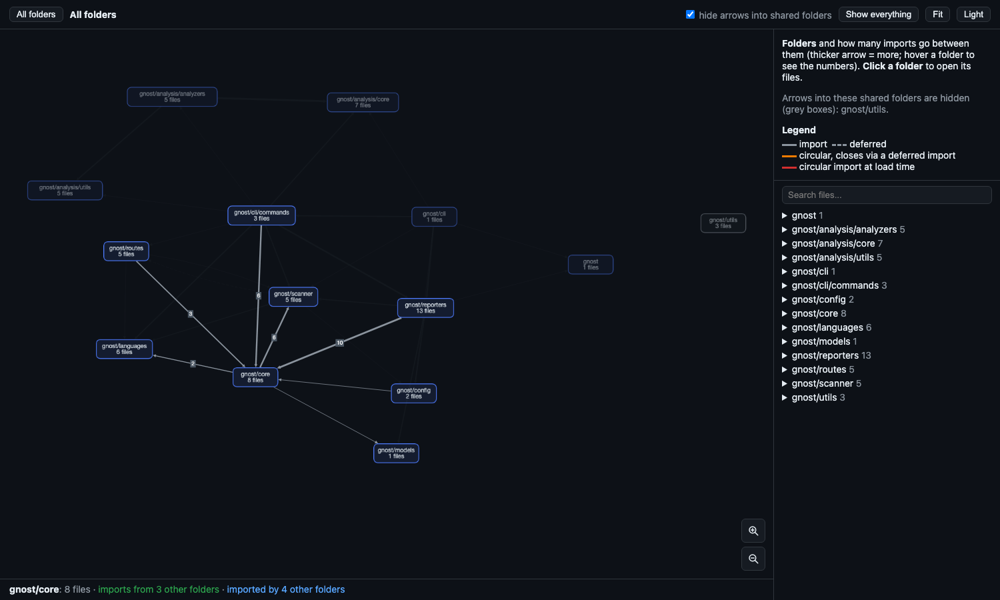

Onboard
=======

``gnost onboard`` generates onboarding artifacts that help you quickly understand a repository.

Onboard a repository by address
-------------------------------

You do not need a local copy. Give ``gnost onboard`` an ``https://`` or ssh address and it clones the
repository into a temporary folder, writes the guide into ``.gnost/<repo-name>/`` in the **current folder**, and deletes the clone:

.. code-block:: bash

   gnost onboard https://github.com/spring-projects/spring-petclinic
   gnost onboard git@github.com:owner/repo.git --ref v1.2.0

Nothing in the repository is run (hooks, submodules and symlinks are off, and the analyzers ignore the
repository's own configuration). Details and limits: :ref:`remote-repositories`. The same works for
``gnost analyze`` and ``gnost changes``.

What it generates
-----------------

Everything goes into one folder in your project, ``.gnost/`` (a ``README.md`` inside
explains it to anyone who finds it). It is safe to commit; the ``.html`` pages are
ignored by the folder's own ``.gitignore`` because they are large and can be rebuilt.
Use ``output_dir`` in ``.gnost.toml`` to choose another folder.

- ``.gnost/ONBOARD.md``: the guide
- A "Function-level Flow" section (Python): what each entry point and route calls
- A "Routes" table: each HTTP endpoint and the function that handles it
- A "Circular Dependencies" section in ``ONBOARD.md`` (see below)
- ``.gnost/insights.json``: the same facts as data (see "Insights JSON")
- ``.gnost/flow.html``: the interactive flow explorer, one page that works offline
  (``gnost open flow`` opens it)
- Mermaid diagrams under ``.gnost/flow``:

  - ``FLOW-full.mmd`` and ``FLOW-full.md``
  - ``flow-complete.mmd``: every file and every import, ungrouped (for tools and AI; too large to read on big projects)
  - ``FLOW-overview.mmd``
  - ``entry-paths.md``
  - ``folder-paths.md``
  - ``function-flow.md`` (Python call trees, one diagram per entry point)

Change hotspots
---------------

When the project is a git repository, ``ONBOARD.md`` also lists the files that **change most often**
(a "Change Hotspots" table) and ``insights.json`` has the same data under ``change_history``. A file
that changes often and is touched by many people is where merge conflicts and regressions tend to start.

For each file it shows the number of commits in the last year, how many different people made them,
how many of those were in the last 90 days, the lines added and removed, and the date of the last change.
Files are ranked by a score from 0 to 100: half from the number of commits, 30% from recent commits and
20% from the number of authors, each compared with the other files (so one huge file does not hide the
rest). Ties are broken by commits, then by path, so the same history always gives the same table.

What is counted: only commits in the window (365 days, at most 5,000 commits), merge commits are skipped,
renamed files keep their history, ``.mailmap`` is honoured, bots such as Dependabot are not counted as
people, and commits that touch more than 150 files (a mass reformat) are ignored. All of this can be
changed in the ``[history]`` section of ``.gnost.toml`` (see :doc:`configuration`).

It needs ``git`` and the history of the repository. If there is none the section is left out and
``insights.json`` says why (``change_history.available`` is ``false`` with a ``reason``):

- A **shallow clone** (the default checkout in CI) has only one commit. Fetch the history: in GitHub
  Actions use ``actions/checkout`` with ``fetch-depth: 0``.
- A folder that is not a git repository has nothing to report, and nothing is printed.
- If git is not installed, the message says so.

Risky and changing
------------------

Next to the change hotspots, ``ONBOARD.md`` lists the files that are **both fragile to change and changing
often**, a "Risky and Changing" table (and ``risk`` in ``insights.json``). These are the files to read
carefully, cover with tests and review closely, because a mistake there is likely and costly.

Each row shows the risk (0 to 100) and the two scores it comes from, so the number can always be
explained: the **caution score** (how fragile the file is: size, complexity, how many files depend on it,
circular imports; see :doc:`configuration`) and the **change activity** (the hotspot score above), plus a
plain-words reason such as "large file, complex code". The risk is the caution score scaled by the change
activity: ``risk = caution x (1 - w + w x change / 100)`` with ``w = 1`` by default. A fragile file that
nobody touches, or a busy file that is simple, is not listed.

It needs the same git history as the hotspots. Without it the section is left out. Settings are in the
``[risk]`` section of ``.gnost.toml``: ``threshold`` (lowest risk listed, default 20), ``limit`` (default 10)
and ``churn_weight`` (``w`` above, 0 to 1; 0 ignores change activity).

Command reference
-----------------

.. code-block:: bash

   gnost onboard [path]

Options
~~~~~~~

- ``--mermaid``: generate only the Mermaid diagram (``.gnost/flow/FLOW-full.mmd``).
- ``--no-html``: do not write the explorer page ``.gnost/flow.html``.
- ``--progress``: show progress indicators.
- ``--inject``: inject onboarding link into repository README.
- ``--layered``: generate layered flow (Entry -> Core -> Leaf).
- ``--depth N``: limit execution depth.
- ``--json FILE``: write the insights JSON to ``FILE`` instead of ``.gnost/insights.json`` (which is always written).
- ``--insights-only``: write only the insights JSON; skip ``ONBOARD.md``, the diagrams and the page.
- ``--max-edges N``: the largest diagram drawn file by file (default 80). Bigger ones are grouped by folder.
- ``--collapse [LEVEL]``: always group diagrams by folder, ``LEVEL`` folders deep (default 1: top-level folders).

Examples
~~~~~~~~

.. code-block:: bash

   gnost onboard .
   gnost onboard . --mermaid
   gnost onboard . --layered --depth 3
   gnost onboard . --json
   gnost onboard . --insights-only

Routes
------

GNOST lists the HTTP endpoints it can find and the code behind them, with URL prefixes
combined across files (``app.include_router(chat.router, prefix="/chat")``,
``app.use('/api', usersRouter)``, Django ``include()``).

========================  =====================================================
Framework                 What is read
========================  =====================================================
Flask                     ``@app.route``, ``@bp.get``, ``Blueprint(url_prefix=)``
FastAPI / Starlette       ``@app.get``, ``APIRouter(prefix=)``, ``include_router``
Django                    ``urlpatterns``, ``include()``, DRF ``router.register``
Express / Fastify / Hono  ``app.get('/x', handler)``, ``app.use('/api', router)``
NestJS                    ``@Controller('x')`` with ``@Get()``, ``@Post()`` ...
Spring MVC / Boot         ``@RestController`` with ``@GetMapping``, ``@RequestMapping``
========================  =====================================================

Limits: paths built at runtime appear as ``<dynamic>``; frameworks not listed are not
detected; file-based routers (Next.js, SvelteKit) are not read yet.

Function-level flow
-------------------

For Python projects GNOST also follows calls function by function, starting from the
program's main entry points and from each route. It resolves calls to functions in the
same file, names imported with ``from x import f``, ``module.f()``, classes (to their
``__init__`` or ``Class.method()``), ``self.method()`` (including base classes in the
same file) and Celery-style ``task.delay()`` / ``task.apply_async()``.

Calls through other objects, such as ``self.client.send()`` or ``request.json()``, are
not followed, because without type information there is no way to know what they point
at. Routes whose handler is defined in another file than the URL pattern (Django
``urls.py``) are not traced. The full call trees are in the insights JSON under
``flows``.

Reading the diagrams
--------------------

Large projects cannot be drawn file by file: GitHub refuses Mermaid diagrams over about
50,000 characters or 500 edges, and they would be unreadable anyway. When a diagram is
too big GNOST groups files by folder (using the deepest folder level that fits), labels
each arrow with the number of imports it stands for, and, in ``FLOW-full.md``, adds a
detailed diagram for each of the biggest folders. A note under the diagram says what
was done.

- thick red arrow: an import-time circular dependency
- orange arrow: a cycle that only closes through a deferred import (dotted when the
  import itself is deferred)
- dotted arrow: an import that does not run when the module loads

Circular dependencies
---------------------

GNOST finds groups of files that depend on each other and reports one concrete loop
for each (``a.py -> b.py -> a.py``). Every cycle is classified:

- **import-time**: the files import each other while the modules load, so the loop can
  fail at startup.
- **deferred**: every loop goes through an import inside a function, an import under
  ``TYPE_CHECKING``, a dynamic ``import()`` or a type-only import. These are usually
  deliberate ways of avoiding an import-time cycle.

Only import-time cycles appear under "Caution Areas".

Moved in 0.6.0
--------------

Before 0.6.0 the files were ``ONBOARD.md`` at the project root and ``docs/flow``, ``docs/insights`` and
``docs/analysis``. GNOST never moves or deletes them for you. ``gnost open`` still finds the old
files when ``.gnost/`` does not exist yet, and says so; run ``gnost onboard .`` to create the new
folder, then delete the old files when you like. If you publish the Markdown with GitHub Pages
(Jekyll), folders that start with a dot are skipped, so add ``include: [".gnost"]`` to ``_config.yml``.

Insights JSON
-------------

``.gnost/insights.json`` exports the same data as ``ONBOARD.md`` in a
versioned format for scripts and CI: entry points, layers, first files to read,
hotspots, caution areas, cycles, the dependency graph and summary counts.

- Paths are relative to the scanned directory and use forward slashes, so files from
  different machines can be compared.
- Output is deterministic: running twice on the same code gives identical files.
- The format is described by ``schema_version`` and a JSON Schema shipped with the
  package (``gnost/schemas/insights.schema.json``). Adding a field bumps the minor
  version, so ignore fields you do not know; removing or renaming one bumps the major
  version.

Viewing diagrams
----------------

.. image:: ../assets/viewer_demo.gif
   :alt: The flow explorer: folder overview, open a folder, open a file, hover for details
   :width: 100%

The example is GNOST analysing its own source code.

``gnost open flow`` (or ``gnost open .gnost/flow/flow-complete.mmd``, or the shorter
``gnost show FILE``) opens a ``.mmd``, ``.md`` or ``.html`` file in your browser. A ``.mmd`` diagram always opens as the interactive
explorer, whatever its size (``--view mermaid`` draws one flat Mermaid picture instead):

- It starts with a **folder overview**: outlined boxes for folders, arrows sized by the
  number of imports between them. Shared folders that most others import are
  greyed out and their arrows hidden (untick the box to show them).
- **Click a folder** to open its files together with the files in other folders
  they touch, arranged in a ring: the folder in the middle and one box per
  other folder around it (left, top, bottom, then right), so arrows fan out
  without crossing other boxes. There is one arrow per box, ending at the box border (the number is how many imports it stands for); hover a file to see its own arrows. Green arrows go out of the folder, blue arrows come in.
- **Click a file** (in the graph or in the file list on the right) to see just
  what it imports and what imports it. "Show everything" draws the whole graph.
- Circular imports stay red (at load time) or orange (closed by a deferred import).

Use
``--view mermaid`` or ``--view graph`` to force one, ``--no-open`` to only write
the HTML, and ``-o FILE`` to choose where it is saved. The page opens in a dark theme (a button switches to light, and the choice is
remembered), and hovering anything fades everything not connected to it, and a line at the bottom describes it. The magnifier ``+`` / ``-`` buttons (or the mouse wheel) zoom, and ``Fit`` resets the view. The arrow button under them saves what is drawn as a PNG image. The page loads its
libraries from a CDN, so it needs an internet connection.

Folder overview, hovering a folder (the line at the bottom describes it):

A file in the middle, with the files it imports and the files that import it
around it; hovering a file shows its counts:

.. image:: ../assets/viewer_file_hover.png
   :alt: One file with its connections and the hover line at the bottom
   :width: 100%

A folder opened, with the folders it touches around it:

.. image:: ../assets/viewer_folder_open.png
   :alt: A folder opened with its neighbours around it
   :width: 100%
