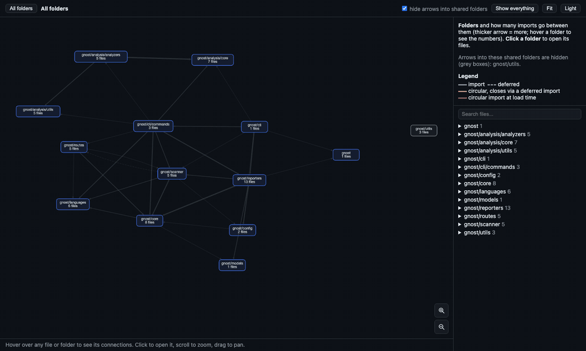
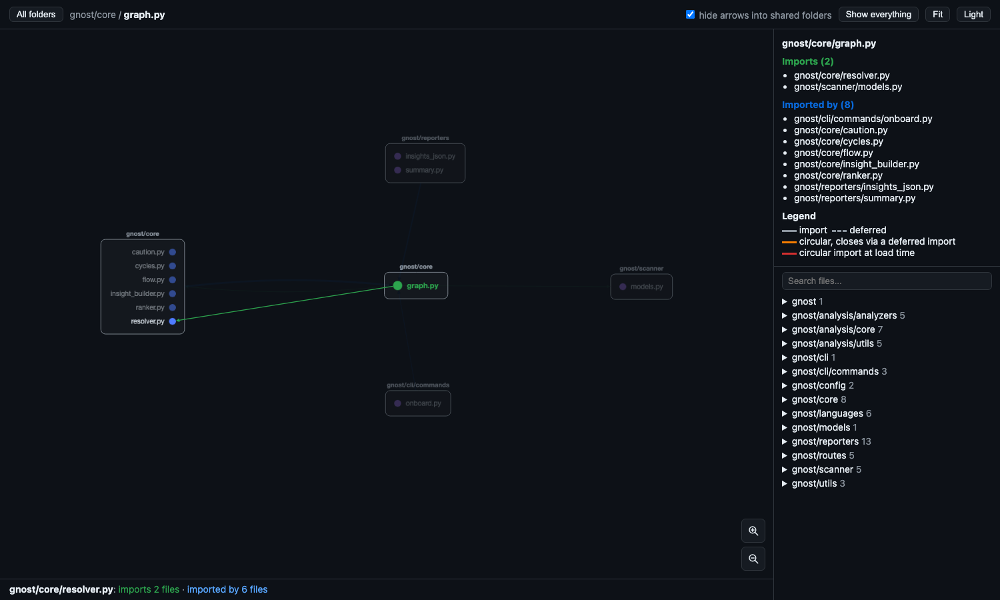
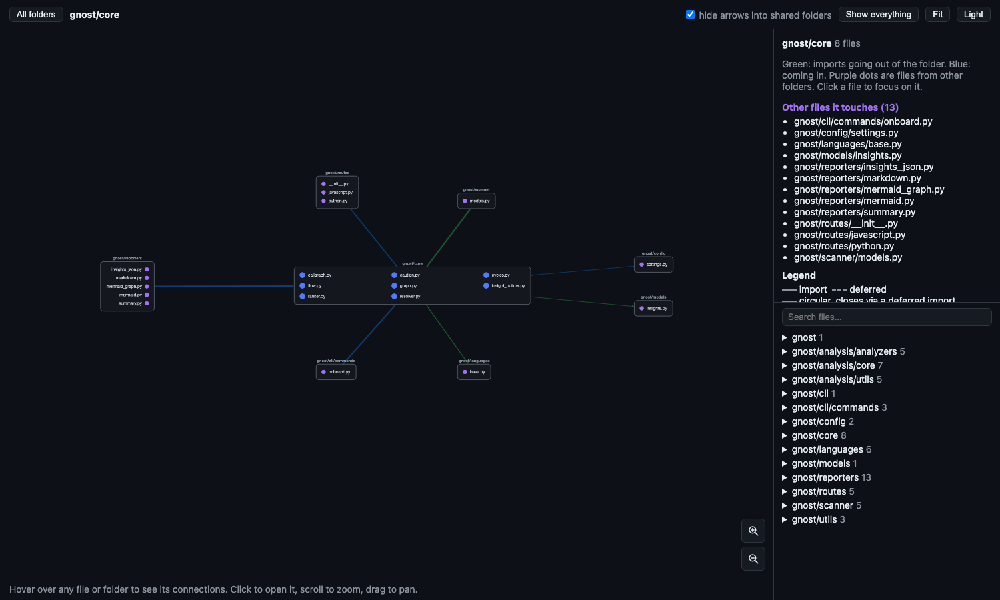

Onboard
=======

``gnost onboard`` generates onboarding artifacts that help you quickly understand a repository.

What it generates
-----------------

- ``ONBOARD.md`` at repository root
- A "Function-level Flow" section (Python): what each entry point and route calls
- A "Routes" table: each HTTP endpoint and the function that handles it
- A "Circular Dependencies" section in ``ONBOARD.md`` (see below)
- Optionally, a machine-readable ``docs/insights/gnost_insights.json`` (``--json``)
- Mermaid diagrams under ``docs/flow``:

  - ``FLOW-full.mmd`` and ``FLOW-full.md``
  - ``flow-complete.mmd``: every file and every import, ungrouped (for tools and AI; too large to read on big projects)
  - ``FLOW-overview.mmd``
  - ``entry-paths.md``
  - ``folder-paths.md``
  - ``function-flow.md`` (Python call trees, one diagram per entry point)

Command reference
-----------------

.. code-block:: bash

   gnost onboard [path]

Options
~~~~~~~

- ``--mermaid``: generate only Mermaid flow output.
- ``--progress``: show progress indicators.
- ``--inject``: inject onboarding link into repository README.
- ``--layered``: generate layered flow (Entry -> Core -> Leaf).
- ``--depth N``: limit execution depth.
- ``--json [FILE]``: also write the insights as JSON (default ``docs/insights/gnost_insights.json``).
- ``--insights-only``: write only the insights JSON; skip ``ONBOARD.md`` and the diagrams.
- ``--max-edges N``: the largest diagram drawn file by file (default 80). Bigger ones are grouped by folder.
- ``--collapse [LEVEL]``: always group diagrams by folder, ``LEVEL`` folders deep (default 1: top-level folders).

Examples
~~~~~~~~

.. code-block:: bash

   gnost onboard .
   gnost onboard . --mermaid
   gnost onboard . --layered --depth 3
   gnost onboard . --json
   gnost onboard . --insights-only

Routes
------

GNOST lists the HTTP endpoints it can find and the code behind them, with URL prefixes
combined across files (``app.include_router(chat.router, prefix="/chat")``,
``app.use('/api', usersRouter)``, Django ``include()``).

========================  =====================================================
Framework                 What is read
========================  =====================================================
Flask                     ``@app.route``, ``@bp.get``, ``Blueprint(url_prefix=)``
FastAPI / Starlette       ``@app.get``, ``APIRouter(prefix=)``, ``include_router``
Django                    ``urlpatterns``, ``include()``, DRF ``router.register``
Express / Fastify / Hono  ``app.get('/x', handler)``, ``app.use('/api', router)``
NestJS                    ``@Controller('x')`` with ``@Get()``, ``@Post()`` ...
Spring MVC / Boot         ``@RestController`` with ``@GetMapping``, ``@RequestMapping``
========================  =====================================================

Limits: paths built at runtime appear as ``<dynamic>``; frameworks not listed are not
detected; file-based routers (Next.js, SvelteKit) are not read yet.

Function-level flow
-------------------

For Python projects GNOST also follows calls function by function, starting from the
program's main entry points and from each route. It resolves calls to functions in the
same file, names imported with ``from x import f``, ``module.f()``, classes (to their
``__init__`` or ``Class.method()``), ``self.method()`` (including base classes in the
same file) and Celery-style ``task.delay()`` / ``task.apply_async()``.

Calls through other objects, such as ``self.client.send()`` or ``request.json()``, are
not followed, because without type information there is no way to know what they point
at. Routes whose handler is defined in another file than the URL pattern (Django
``urls.py``) are not traced. The full call trees are in the insights JSON under
``flows``.

Reading the diagrams
--------------------

Large projects cannot be drawn file by file: GitHub refuses Mermaid diagrams over about
50,000 characters or 500 edges, and they would be unreadable anyway. When a diagram is
too big GNOST groups files by folder (using the deepest folder level that fits), labels
each arrow with the number of imports it stands for, and, in ``FLOW-full.md``, adds a
detailed diagram for each of the biggest folders. A note under the diagram says what
was done.

- thick red arrow: an import-time circular dependency
- orange arrow: a cycle that only closes through a deferred import (dotted when the
  import itself is deferred)
- dotted arrow: an import that does not run when the module loads

Circular dependencies
---------------------

GNOST finds groups of files that depend on each other and reports one concrete loop
for each (``a.py -> b.py -> a.py``). Every cycle is classified:

- **import-time**: the files import each other while the modules load, so the loop can
  fail at startup.
- **deferred**: every loop goes through an import inside a function, an import under
  ``TYPE_CHECKING``, a dynamic ``import()`` or a type-only import. These are usually
  deliberate ways of avoiding an import-time cycle.

Only import-time cycles appear under "Caution Areas".

Insights JSON
-------------

``--json`` and ``--insights-only`` export the same data as ``ONBOARD.md`` in a
versioned format for scripts and CI: entry points, layers, first files to read,
hotspots, caution areas, cycles, the dependency graph and summary counts.

- Paths are relative to the scanned directory and use forward slashes, so files from
  different machines can be compared.
- Output is deterministic: running twice on the same code gives identical files.
- The format is described by ``schema_version`` and a JSON Schema shipped with the
  package (``gnost/schemas/insights.schema.json``). Adding a field bumps the minor
  version, so ignore fields you do not know; removing or renaming one bumps the major
  version.

Viewing diagrams
----------------

The example is GNOST analysing its own source code.

``gnost open flow`` (or ``gnost open docs/flow/flow-complete.mmd``, or the shorter
``gnost show FILE``) opens a ``.mmd``, ``.md`` or ``.html`` file in your browser. Small diagrams are drawn with Mermaid (scroll to zoom, drag to
pan). Diagrams with more than about 150 arrows open as an interactive explorer
instead, so a big project never becomes one tangled picture:

- It starts with a **folder overview**: outlined boxes for folders, arrows sized by the
  number of imports between them. Shared folders that most others import are
  greyed out and their arrows hidden (untick the box to show them).
- **Click a folder** to open its files together with the files in other folders
  they touch, arranged in a ring: the folder in the middle and one box per
  other folder around it (left, top, bottom, then right), so arrows fan out
  without crossing other boxes. There is one arrow per box, ending at the box border (the number is how many imports it stands for); hover a file to see its own arrows. Green arrows go out of the folder, blue arrows come in.
- **Click a file** (in the graph or in the file list on the right) to see just
  what it imports and what imports it. "Show everything" draws the whole graph.
- Circular imports stay red (at load time) or orange (closed by a deferred import).

Use
``--view mermaid`` or ``--view graph`` to force one, ``--no-open`` to only write
the HTML, and ``-o FILE`` to choose where it is saved. The page opens in a dark theme (a button switches to light, and the choice is
remembered), and hovering anything fades everything not connected to it, and a line at the bottom describes it. The magnifier ``+`` / ``-`` buttons (or the mouse wheel) zoom, and ``Fit`` resets the view. The page loads its
libraries from a CDN, so it needs an internet connection.

Folder overview, hovering a folder (the line at the bottom describes it):

.. image:: ../assets/viewer_folders.png
   :alt: Folder overview with the hover line at the bottom
   :width: 100%

A file in the middle, with the files it imports and the files that import it
around it; hovering a file shows its counts:

A folder opened, with the folders it touches around it:

