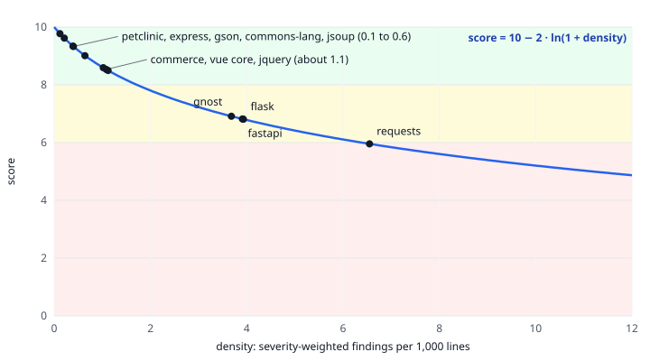

How the Score Works
===================

``gnost analyze`` gives every analyzer a score from 0 to 10 and the project a **final score** from 0 to 10.
Higher is better. Since 0.7.1 the score depends on **how many findings there are for the size of the code**
(the finding *density*), so a large clean project scores well and a small project full of problems does not.

.. code-block:: text

   ┏━━━━━━━━━━━━━━━━━┳━━━━━━━┳━━━━━━━━━━┳━━━━━━┳━━━━━━━━┳━━━━━┓
   ┃ Analyzer        ┃ Score ┃ Findings ┃ High ┃ Medium ┃ Low ┃
   ┡━━━━━━━━━━━━━━━━━╇━━━━━━━╇━━━━━━━━━━╇━━━━━━╇━━━━━━━━╇━━━━━┩
   │ maintainability │  9.80 │       10 │    1 │      2 │   7 │
   │ observability   │  9.85 │       28 │    0 │      0 │   1 │
   │ readability     │  9.96 │        8 │    0 │      0 │   0 │
   │ robustness      │ 10.00 │        0 │    0 │      0 │   0 │
   └─────────────────┴───────┴──────────┴──────┴────────┴─────┘
   final score:  9.62 / 10.00

Colours: **green** from 8, **yellow** from 6, **red** below 6.

The formula
-----------

**1. Every finding has a weight from its severity.**

.. list-table::
   :header-rows: 1

   * - Severity
     - Weight
   * - critical
     - 1.0
   * - high
     - 0.6
   * - medium
     - 0.3
   * - low
     - 0.1
   * - info
     - 0.05

**2. Count the analyzed lines.** These are the non-blank lines of the files ``analyze`` read: the files of the
languages it checks (see ``--language``), after ``exclude`` in ``.gnost.toml``, without generated folders
(``node_modules``, ``dist``, ``build``, ``target`` and others) and minified files. Test files are included,
because they are analyzed too. A project smaller than 1,000 lines counts as 1,000 lines, so a single finding in
a 20-line script does not sink its score.

**3. The density** is the total weight per 1,000 analyzed lines:

.. code-block:: text

   density = (sum of the weights of the findings) / (analyzed lines / 1,000)

**4. The score** comes from the density on a log curve, rounded to two decimals and never below 0:

.. code-block:: text

   score = 10 - 2 × ln(1 + density)

Each analyzer is scored the same way, with **its own** findings over **all** analyzed lines. The final score
uses all findings together. The analyzer scores therefore do not average or add up to the final score: an
analyzer with no findings scores 10, and the final score counts every analyzer's findings at once.

The curve
---------

.. list-table::
   :header-rows: 1

   * - Density (weight per 1,000 lines)
     - Score
     - Roughly what it looks like
   * - 0
     - 10.00
     - no findings
   * - 0.25
     - 9.55
     - one medium finding every 1,200 lines
   * - 0.5
     - 9.19
     - one medium finding every 600 lines
   * - 1
     - 8.61
     - one high finding every 600 lines, or ten low ones per 1,000 lines
   * - 2
     - 7.80
     -
   * - 4
     - 6.78
     -
   * - 6
     - 6.11
     -
   * - 10
     - 5.20
     - one high finding every 60 lines
   * - 20
     - 3.91
     -
   * - 50
     - 2.14
     -
   * - 148 or more
     - 0.00
     - the floor (0 from ``e⁵ − 1 ≈ 147.4``)

**Why a log curve.** The first problems in clean code cost the most, and each extra one costs a little less. This
spreads clean and average projects apart, where the difference matters. Very noisy projects are still
ordered, but they do not all fall to 0. Going from density 1 to 2 costs about 0.8 points. Going from 10 to 20 costs
about 1.3 points, even though that is ten times as many extra findings.

A worked example
----------------

express, analyzed with GNOST 0.7.1: 18,004 analyzed lines, 46 findings (1 high, 2 medium, 8 low, 35 info).

.. code-block:: text

   weight  = 1×0.6 + 2×0.3 + 8×0.1 + 35×0.05 = 3.75
   density = 3.75 / 18.004                     = 0.208
   score   = 10 - 2 × ln(1.208)                = 9.62

What counts and what does not
-----------------------------

* **Every reported finding counts**, after the confidence filter (findings an analyzer itself marks as low
  confidence are dropped before scoring).
* **Findings over** ``max_findings`` **still count.** ``--max-findings`` (default 1,000 per analyzer) limits how many
  findings are *listed*, not the score. The findings left out are counted per severity in the JSON
  (``analysis_metrics[].capped_by_severity``) and added to the weight. A noisy project cannot raise its score
  by lowering ``max_findings``.
* **A baseline does not change the score.** ``--baseline`` hides known findings from the report, but the score
  still covers everything, so ``--fail-under`` keeps its meaning. Use ``--fail-on-new`` to gate on new findings.
* **Choosing analyzers or languages changes the score.** ``--analyzer`` and ``--language`` decide which findings
  and which lines take part.

Where you see it
----------------

* **Terminal:** the table above and the ``final score`` line.
* **JSON** (``.gnost/analysis/analysis.json``): ``summary.final_score`` and ``summary.score``:

  .. code-block:: json

     "score": {
       "method": "density",
       "final_score": 9.62,
       "analyzed_lines": 18004,
       "density": 0.208,
       "analyzers": {"maintainability": 9.8, "observability": 9.85, "readability": 9.96, "robustness": 10.0}
     }

* **HTML report:** the final score, the analyzer table, and a line with the density and the number of lines.
* **GitHub Action:** the final score in the job summary. See :doc:`ci`.
* **README badge:** ``gnost analyze --badge``, see below.

A README badge
--------------

``gnost analyze . --badge`` writes the final score as a small badge, ``.gnost/badge.svg``, and prints the line to
put in your README:

.. code-block:: text

   Badge written to /path/to/project/.gnost/badge.svg; in the README: 

The badge is a self-contained SVG file (no web service, no tracking). It uses the terminal's colours: green from 8,
yellow from 6, red below. ``.gnost/`` is safe to commit, so commit the file once and add the line to the README;
GitHub shows it from the repository. Each time you run ``gnost analyze --badge`` and commit, the badge shows the
new score. A good moment is a release, or a scheduled CI job that commits it.

``--badge FILE`` writes it somewhere else. ``[analyze] badge = true`` in ``.gnost.toml`` writes it on every run,
and ``badge = "docs/score.svg"`` names the file (relative to the project root). Maven:
``-Dgnost.badge=true`` or ``-Dgnost.badge=docs/score.svg``.

Comparing scores
----------------

* **Compare within a language.** Python is checked by mypy, bandit, radon and ruff (including docstring rules).
  They report about four to six times more findings per line than GNOST's own JavaScript, TypeScript and Java
  rules. In the calibration below, well-known Python projects land around 6 to 7 and JS/Java projects
  around 8.5 to 9.8. A Python project at 7 is in good company.
* **Compare over time.** The most useful number is your own score this week against last week. Combine it with
  ``--baseline --fail-on-new`` so nothing new slips in.
* **Typical ranges** from the calibration in :doc:`calibration`: 9 and above for clean, well-kept libraries;
  8 to 9 for large or older code bases; 6 to 7 for Python projects with full mypy and docstring checks.

Setting a CI threshold
----------------------

Run ``gnost analyze .`` once, then set ``--fail-under`` (or ``[analyze] fail_under``) a little below the score
you see, and raise it as the code improves. See :doc:`ci`.

.. note::

   **Upgrading from 0.7.0 or older.** The numbers moved. JavaScript, TypeScript and Java projects usually go
   **up** by 0.5 to 1.2. Python projects usually go **down** by 0.8 to 1.3, because the old formula ignored how
   many findings there were. If your CI gates on ``fail_under``, run once and adjust the threshold.

The old formula (``score = "average"``)
---------------------------------------

Up to 0.7.0 an analyzer's score was the **average severity** of its findings, and the final score the average
severity weighted by each finding's confidence. Neither looked at how many findings there were or how large
the project was. Ten thousand info findings scored better than one critical finding, and a messy project
scored close to a clean one.

It was kept for one release and **removed in 0.8.0**. A ``.gnost.toml`` that still sets ``score = "average"``
gets a warning, and the density score is used.
