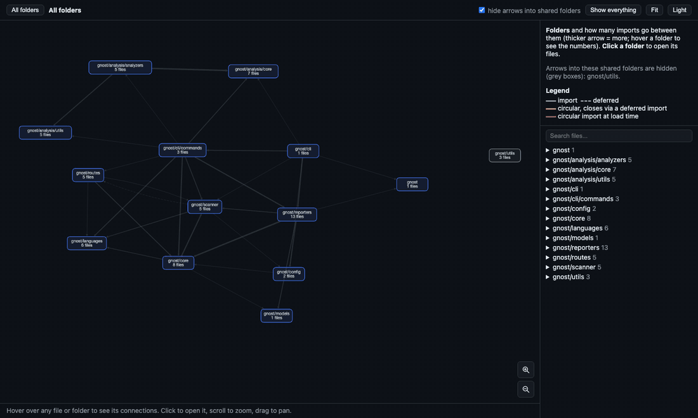

# gnost-cli

[](https://www.npmjs.com/package/gnost-cli)
[](https://github.com/mohdzain98/gnost/blob/main/LICENSE)

GNOST is a static analysis CLI that turns an unfamiliar codebase into an onboarding guide in minutes. This package is the npm build: it ships a standalone binary, so **you do not need Python** (or anything but Node 18+).

## What you get

- **Where execution starts:** entry points and HTTP routes (Flask, FastAPI, Django, Express, NestJS, Spring).
- **How it flows:** Mermaid diagrams of imports and calls, plus function-level flow for Python.
- **How to get it running:** install, run and test commands and the environment variable names, read from the project's own files (nothing guessed).
- **What matters most:** hotspot files and caution areas (risky files to read carefully).
- **Circular imports**, listed and drawn.
- **`ONBOARD.md`**: a written guide to the repository, and the same facts as JSON for tools and AI, all saved in a `.gnost/` folder.
- **Quality report** (`gnost analyze`) for maintainability, robustness, observability and readability. Python projects only for now.
- **Any repository by address:** `npx gnost-cli onboard https://github.com/owner/repo` clones it read only, writes the results to `.gnost/<repo-name>/` in your current folder and deletes the clone.
- **Languages:** Python, JavaScript, TypeScript and Java.

## Explore the flow in your browser

`gnost open flow` opens the diagrams as an interactive explorer: a folder overview first, click a folder to see its files, click a file to see what it imports and what imports it. It works offline.



## Use without installing

```bash
npx gnost-cli onboard .
npx gnost-cli onboard https://github.com/owner/repo   # any public repository, read only
```

A repository address is cloned into a temporary folder (nothing in it is run), the results are written to `.gnost/<repo-name>/` in your current folder, and the clone is deleted.

## Install globally

```bash
npm i -g gnost-cli
gnost onboard .
```

## Commands

```bash
gnost onboard .                 # writes the .gnost/ folder: guide, diagrams, JSON, explorer
gnost onboard . --layered --depth 3
gnost summary .                 # languages, files and lines of code
gnost stats .                   # detailed stats per language
gnost folders .                 # lines of code by folder
gnost files .                   # largest files
gnost analyze .                 # quality report
gnost open flow                 # interactive flow explorer in your browser
gnost version
```

With `npx`, put `gnost-cli` in front of the same arguments: `npx gnost-cli analyze .`.

Settings (excludes, weights, thresholds) go in an optional `.gnost.toml` at the repository root.

## Supported platforms

| Platform | Notes |
|---|---|
| macOS, Apple silicon (arm64) | |
| Linux, x86_64 | glibc 2.35 or newer (Ubuntu 22.04+, Debian 12+) |
| Windows, x86_64 | |

The right binary comes from an optional dependency, `@gnost-cli/<platform>`. Do not install with `--omit=optional` or `--no-optional`. The launcher checks the binary's SHA-256 before every run.

On another platform, use `pipx install gnost`, `uvx gnost onboard .` or the Docker image `ghcr.io/mohdzain98/gnost`.

## Links

- Documentation: https://gnost.readthedocs.io
- Source: https://github.com/mohdzain98/gnost
- Issues: https://github.com/mohdzain98/gnost/issues
- Changelog: https://github.com/mohdzain98/gnost/blob/main/CHANGELOG.md

MIT licensed.
