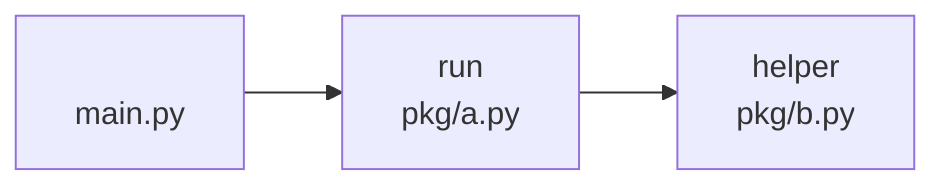

# Function-level Flow

What each entry point calls, function by function (Python only). Dotted arrows lead to a function already drawn elsewhere in the same diagram. Calls through other objects (`self.client.send()`) are not followed.

## `main.py` → `<main>`

`main.py:4` · 3 functions

