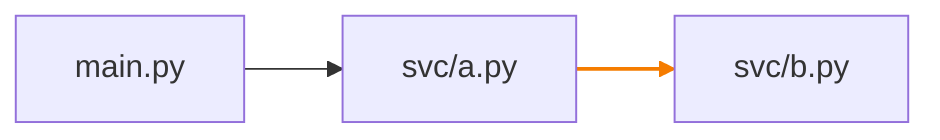

# Entry-based Execution Paths

These diagrams show individual execution paths starting from application entry points. Each path represents one possible flow through the system.

## Path 1 — `main.py`

**Execution chain:** main.py → svc/a.py → svc/b.py

---

Generated by [GNOST](https://gnost.readthedocs.io) <VERSION>. Try it on your own code: `npx gnost-cli onboard .`
