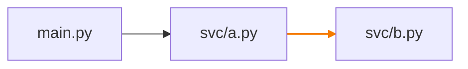

# Keyword-based Execution Paths

These diagrams show execution flows related to key features, auto-detected from the project structure.

## Feature: `svc`

### Representative Paths

#### Path Group 1

**Execution chain:** main.py → svc/a.py → svc/b.py

### Combined Flow (All `svc` Paths)

---

Generated by [GNOST](https://gnost.readthedocs.io) <VERSION>. Try it on your own code: `uvx gnost onboard .`
