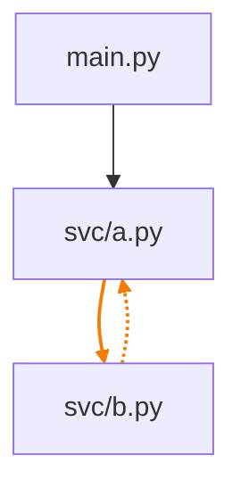

# deferred_cycle — Project Onboarding Guide

_Generated automatically by <a href='https://gnost.readthedocs.io'>GNOST</a>._

## Project Overview

- **Root:** `<ROOT>`
- **Languages:** python (6)
- **Framework:** Not detected

## Summary Table

| Language | Files | LOC |
|---|---:|---:|
| Python | 6 | 26 |

## Stats Table

| Language | Files | Code | Comments | Blanks | LOC |
|---|---:|---:|---:|---:|---:|
| Python | 6 | 17 | 0 | 9 | 26 |

## Entry Points

- `main.py` — __main__ guard

## Execution Flow (High Level)

- `main.py` → `svc/a.py` → `svc/b.py`

## Function-level Flow

What each entry point calls, function by function (Python only; calls through other objects such as `self.client.send()` are not followed). Full diagrams: [function-flow.md](docs/flow/function-flow.md).

### `main.py` → `<main>`

`main.py:4`

- `run` (`svc/a.py:4`)
  - `helper` (`svc/b.py:1`)

## Execution Flow (Overview)

> Orange arrows (dotted when the import itself is deferred): circular dependencies that only close through an import inside a function, a type-only import or a dynamic import.

> 📌 This diagram shows the high-level execution flow. For the complete flow, see [**flow/flow-full.md**](./docs/flow/FLOW-full.md) Raw Mermaid: [flow/flow-full.mmd](./docs/flow/FLOW-full.mmd)

## Recommended Reading Order

### Start Here

- `main.py`

### Core Logic

- `svc/a.py`
- `svc/b.py`

## 📘 First Files to Read
- **`main.py`**
  - Primary entry point into the application
- **`svc/a.py`**
  - Core logic file referenced by multiple execution paths
- **`svc/b.py`**
  - Core logic file referenced by multiple execution paths
- **`svc/c.py`**
  - Frequently involved in execution flow
- **`svc/d.py`**
  - Frequently involved in execution flow
- **`svc/__init__.py`**
  - Frequently involved in execution flow

## ⚠️ Caution Areas

## 🔁 Circular Dependencies

0 import-time, 2 deferred. Import-time cycles load as the modules start and can fail there; deferred ones go through an import inside a function, a type-only import or a dynamic `import()` and are usually intentional.

### Deferred

- `svc/a.py` → `svc/b.py` → `svc/a.py`
- `svc/c.py` → `svc/d.py` → `svc/c.py`
## Key Execution Paths

To understand specific scenarios, see the entry-based execution paths:

- 📍 [Entry-based Paths](docs/flow/entry-paths.md)

- 🧭 [folder-based Paths](docs/flow/folder-paths.md)

(Complete system flow: [flow/flow-full.md](docs/flow/FLOW-full.md))
