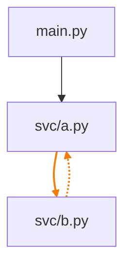

# Full Execution Flow

> Orange arrows (dotted when the import itself is deferred): circular dependencies that only close through an import inside a function, a type-only import or a dynamic import.

> ℹ️ This file renders the complete Mermaid diagram on GitHub.
> For raw Mermaid source, see [**FLOW-full.mmd**](./FLOW-full.mmd). Every file and import, ungrouped and nothing omitted: [**flow-complete.mmd**](./flow-complete.mmd)
