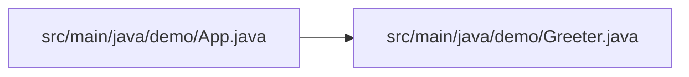

# Entry-based Execution Paths

These diagrams show individual execution paths starting from application entry points. Each path represents one possible flow through the system.

## Path 1 — `src/main/java/demo/App.java`

**Execution chain:** src/main/java/demo/App.java → src/main/java/demo/Greeter.java

---

Generated by [GNOST](https://gnost.readthedocs.io) <VERSION>. Try it on your own code: `mvn io.github.mohdzain98:gnost-maven-plugin:onboard`
