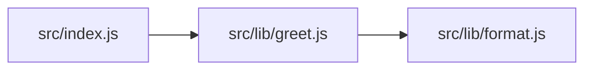
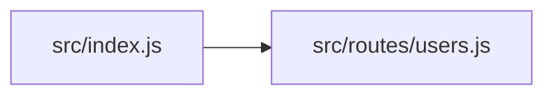

# Entry-based Execution Paths

These diagrams show individual execution paths starting from application entry points. Each path represents one possible flow through the system.

## Path 1 — `src/index.js`

**Execution chain:** src/index.js → src/lib/greet.js → src/lib/format.js

## Path 2 — `src/index.js`

**Execution chain:** src/index.js → src/routes/users.js

---

Generated by [GNOST](https://gnost.readthedocs.io) <VERSION>. Try it on your own code: `npx gnost-cli onboard .`
