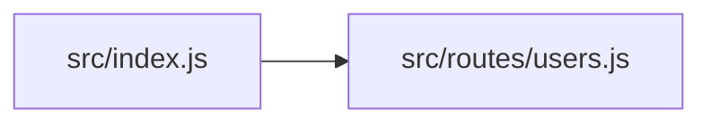

# Keyword-based Execution Paths

These diagrams show execution flows related to key features, auto-detected from the project structure.

## Feature: `user`

### Representative Paths

#### Path Group 1

**Execution chain:** src/index.js → src/routes/users.js

### Combined Flow (All `user` Paths)

---

Generated by [GNOST](https://gnost.readthedocs.io) <VERSION>. Try it on your own code: `npx gnost-cli onboard .`
