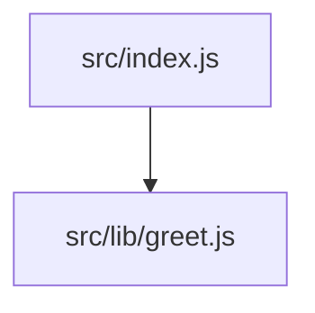

# js_app — Project Onboarding Guide

_Generated automatically by <a href='https://gnost.readthedocs.io'>GNOST</a>._

## Project Overview

- **Root:** `<ROOT>`
- **Languages:** javascript (4)
- **Framework:** Express

## Summary Table

| Language | Files | LOC |
|---|---:|---:|
| JavaScript.js | 4 | 24 |

## Stats Table

| Language | Files | Code | Comments | Blanks | LOC |
|---|---:|---:|---:|---:|---:|
| JavaScript.js | 4 | 21 | 0 | 3 | 24 |

## Entry Points

- `src/index.js` — Common JS entry filename
- `src/index.js` — Server listen() call

## Routes

3 endpoints found. Each row is a URL and the code that handles it.

| Method | Path | Handler | File |
|---|---|---|---|
| GET | `/` | `<inline>` | `src/index.js:5` |
| GET | `/api/users` | `list` | `src/routes/users.js:7` |
| POST | `/api/users/:id` | `<inline>` | `src/routes/users.js:8` |

## Execution Flow (High Level)

- `src/index.js` → `src/routes/users.js`
- `src/index.js` → `src/lib/greet.js` → `src/lib/format.js`

## Execution Flow (Overview)

> 📌 This diagram shows the high-level execution flow. For the complete flow, see [**flow/flow-full.md**](./docs/flow/FLOW-full.md) Raw Mermaid: [flow/flow-full.mmd](./docs/flow/FLOW-full.mmd)

## Recommended Reading Order

### Start Here

- `src/index.js`

### Core Logic

- `src/lib/greet.js`

### Supporting / Leaf Code

- `src/routes/users.js`
- `src/lib/format.js`

## 📘 First Files to Read
- **`src/index.js`**
  - Primary entry point into the application
- **`src/lib/greet.js`**
  - Core logic file referenced by multiple execution paths
- **`src/routes/users.js`**
  - Frequently involved in execution flow
- **`src/lib/format.js`**
  - Frequently involved in execution flow

## ⚠️ Caution Areas

## 🔁 Circular Dependencies

_No circular dependencies detected._
## Key Execution Paths

To understand specific scenarios, see the entry-based execution paths:

- 📍 [Entry-based Paths](docs/flow/entry-paths.md)

- 🧭 [folder-based Paths](docs/flow/folder-paths.md)

(Complete system flow: [flow/flow-full.md](docs/flow/FLOW-full.md))
