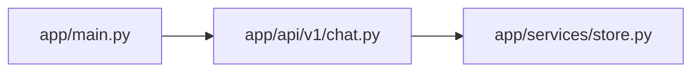
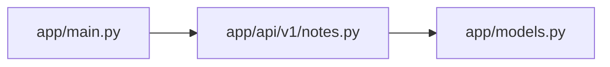
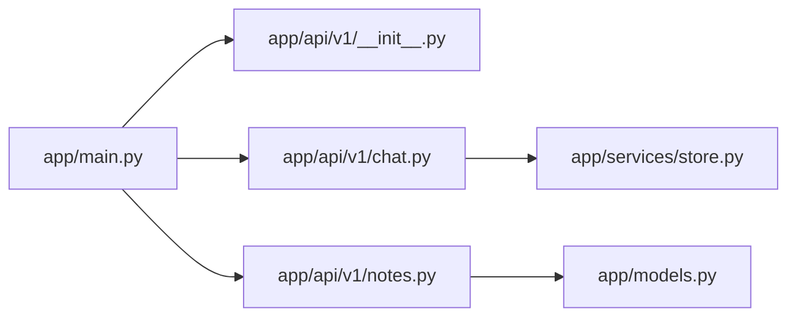
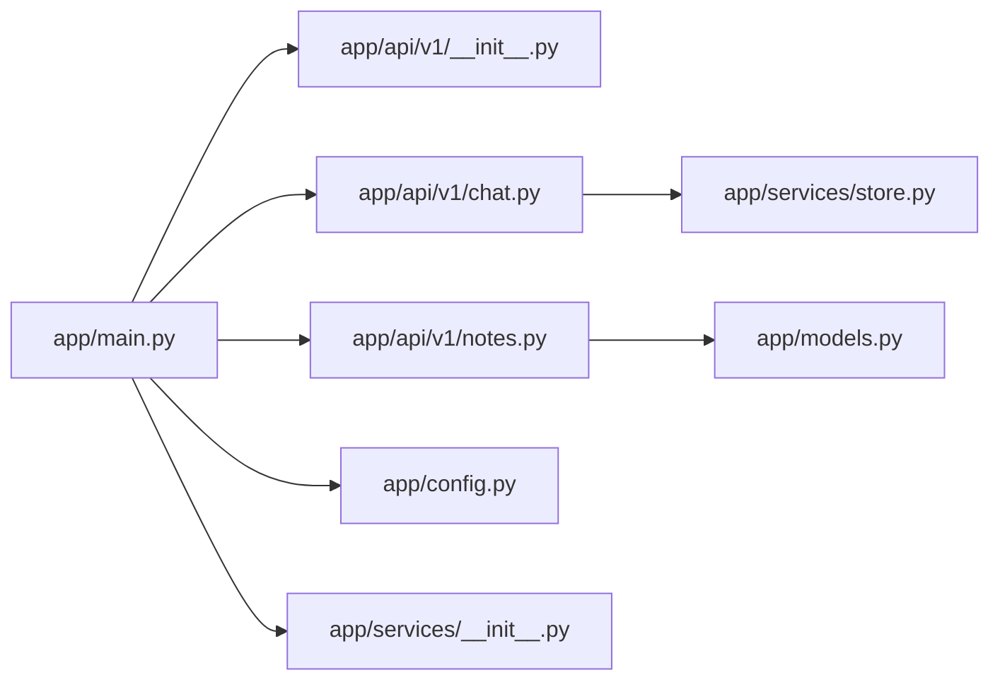
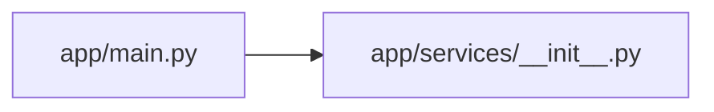
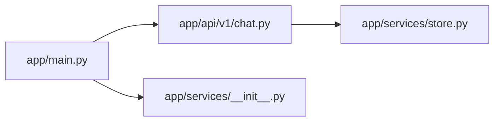

# Keyword-based Execution Paths

These diagrams show execution flows related to key features, auto-detected from the project structure.

## Feature: `api`

### Representative Paths

#### Path Group 1

**Execution chain:** app/main.py → app/api/v1/chat.py → app/services/store.py

#### Path Group 2

**Execution chain:** app/main.py → app/api/v1/notes.py → app/models.py

### Combined Flow (All `api` Paths)

## Feature: `app`

### Representative Paths

#### Path Group 1

**Execution chain:** app/main.py → app/api/v1/chat.py → app/services/store.py

#### Path Group 2

**Execution chain:** app/main.py → app/api/v1/notes.py → app/models.py

### Combined Flow (All `app` Paths)

## Feature: `services`

### Representative Paths

#### Path Group 1

**Execution chain:** app/main.py → app/api/v1/chat.py → app/services/store.py

#### Path Group 2

**Execution chain:** app/main.py → app/services/__init__.py

### Combined Flow (All `services` Paths)

---

Generated by [GNOST](https://gnost.readthedocs.io) <VERSION>. Try it on your own code: `uvx gnost onboard .`
