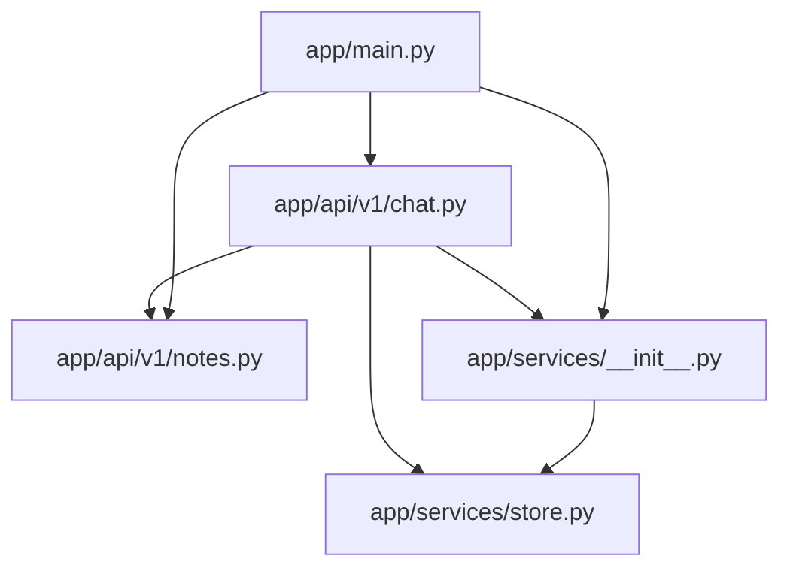

# package_app — Project Onboarding Guide

_Generated automatically by <a href='https://gnost.readthedocs.io'>GNOST</a>._

## Project Overview

- **Root:** `<ROOT>`
- **Languages:** python (11)
- **Framework:** FastAPI

## Summary Table

| Language | Files | LOC |
|---|---:|---:|
| JavaScript.js | 1 | 1 |
| Python | 12 | 71 |

## Stats Table

| Language | Files | Code | Comments | Blanks | LOC |
|---|---:|---:|---:|---:|---:|
| JavaScript.js | 1 | 1 | 0 | 0 | 1 |
| Python | 12 | 47 | 0 | 24 | 71 |

## Entry Points

- `app/main.py` — FastAPI app initialization
- `scripts/seed.py` — __main__ guard

## Routes

7 endpoints found. Each row is a URL and the code that handles it.

| Method | Path | Handler | File |
|---|---|---|---|
| PATCH | `/chat/api/v1/bulk` | `bulk` | `app/api/v1/chat.py:20` |
| PUT | `/chat/api/v1/bulk` | `bulk` | `app/api/v1/chat.py:20` |
| POST | `/chat/api/v1/messages` | `send` | `app/api/v1/chat.py:15` |
| GET | `/chat/api/v1/messages/{message_id}` | `read_message` | `app/api/v1/chat.py:10` |
| GET | `/health` | `health` | `app/main.py:13` |
| GET | `/notes` | `helper` | `app/api/v1/notes.py:10` |
| WS | `/ws/notes` | `stream` | `app/api/v1/notes.py:15` |

## Execution Flow (High Level)

- `app/main.py` → `app/api/v1/__init__.py`
- `app/main.py` → `app/config.py`
- `app/main.py` → `app/services/__init__.py`
- `app/main.py` → `app/api/v1/chat.py` → `app/services/store.py`
- `app/main.py` → `app/api/v1/notes.py` → `app/models.py`

## Function-level Flow

What each entry point calls, function by function (Python only; calls through other objects such as `self.client.send()` are not followed). Full diagrams: [function-flow.md](docs/flow/function-flow.md).

### `GET /chat/api/v1/messages/{message_id}` → `read_message`

`app/api/v1/chat.py:10`

- `save` (`app/services/store.py:4`)
- `helper` (`app/api/v1/notes.py:10`)

### `POST /chat/api/v1/messages` → `send`

`app/api/v1/chat.py:15`

- `save` (`app/services/store.py:4`)
- `helper` (`app/api/v1/notes.py:10`)

## Execution Flow (Overview)

> 📌 This diagram shows the high-level execution flow. For the complete flow, see [**flow/flow-full.md**](./docs/flow/FLOW-full.md) Raw Mermaid: [flow/flow-full.mmd](./docs/flow/FLOW-full.mmd)

## Recommended Reading Order

### Start Here

- `app/main.py`

### Core Logic

- `app/api/v1/chat.py`
- `app/api/v1/notes.py`
- `app/services/__init__.py`
- `app/services/store.py`

### Supporting / Leaf Code

- `app/api/v1/__init__.py`
- `app/config.py`
- `app/models.py`

## 📘 First Files to Read
- **`app/main.py`**
  - Primary entry point into the application
- **`scripts/seed.py`**
  - Primary entry point into the application
- **`app/api/v1/chat.py`**
  - Core logic file referenced by multiple execution paths
- **`app/api/v1/notes.py`**
  - Core logic file referenced by multiple execution paths
- **`app/services/__init__.py`**
  - Core logic file referenced by multiple execution paths
- **`app/api/v1/__init__.py`**
  - Frequently involved in execution flow
- **`app/config.py`**
  - Frequently involved in execution flow
- **`app/services/store.py`**
  - Core logic file referenced by multiple execution paths
- **`app/models.py`**
  - Frequently involved in execution flow
- **`app/__init__.py`**
  - Frequently involved in execution flow

## ⚠️ Caution Areas

## 🔁 Circular Dependencies

_No circular dependencies detected._
## Key Execution Paths

To understand specific scenarios, see the entry-based execution paths:

- 📍 [Entry-based Paths](docs/flow/entry-paths.md)

- 🧭 [folder-based Paths](docs/flow/folder-paths.md)

(Complete system flow: [flow/flow-full.md](docs/flow/FLOW-full.md))
