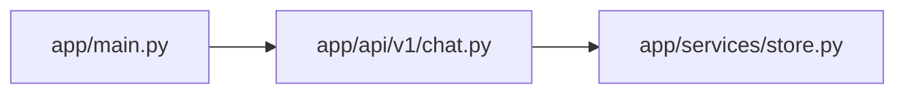
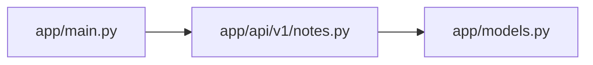
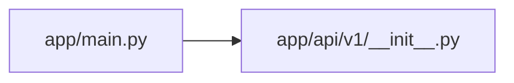

# Entry-based Execution Paths

These diagrams show individual execution paths starting from application entry points. Each path represents one possible flow through the system.

## Path 1 — `app/main.py`

**Execution chain:** app/main.py → app/api/v1/chat.py → app/services/store.py

## Path 2 — `app/main.py`

**Execution chain:** app/main.py → app/api/v1/notes.py → app/models.py

## Path 3 — `app/main.py`

**Execution chain:** app/main.py → app/api/v1/__init__.py
