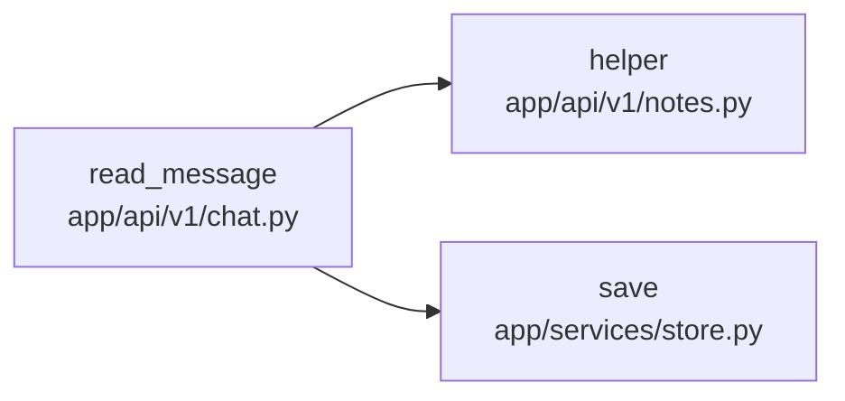
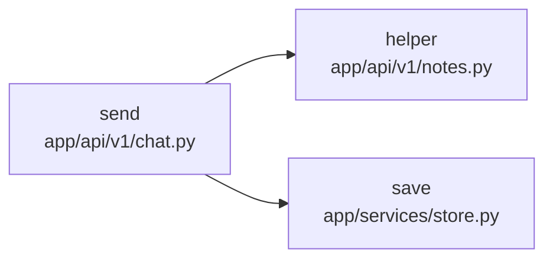

# Function-level Flow

What each entry point calls, function by function (Python only). Dotted arrows lead to a function already drawn elsewhere in the same diagram. Calls through other objects (`self.client.send()`) are not followed.

## `GET /chat/api/v1/messages/{message_id}` → `read_message`

`app/api/v1/chat.py:10` · 3 functions

## `POST /chat/api/v1/messages` → `send`

`app/api/v1/chat.py:15` · 3 functions

