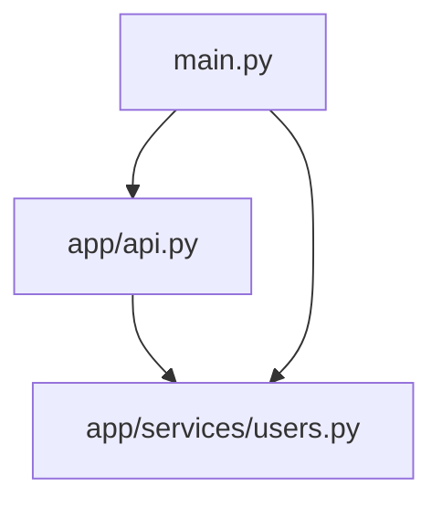

# python_app — Project Onboarding Guide

_Generated automatically by <a href='https://gnost.readthedocs.io'>GNOST</a>._

## Project Overview

- **Root:** `<ROOT>`
- **Languages:** python (6)
- **Framework:** FastAPI

## Summary Table

| Language | Files | LOC |
|---|---:|---:|
| Python | 6 | 35 |

## Stats Table

| Language | Files | Code | Comments | Blanks | LOC |
|---|---:|---:|---:|---:|---:|
| Python | 6 | 22 | 1 | 12 | 35 |

## Entry Points

- `app/api.py` — FastAPI app initialization
- `main.py` — __main__ guard

## Routes

1 endpoints found. Each row is a URL and the code that handles it.

| Method | Path | Handler | File |
|---|---|---|---|
| GET | `/users` | `users` | `app/api.py:10` |

## Execution Flow (High Level)

- `main.py` → `app/api.py`
- `main.py` → `app/services/users.py` → `app/services/db.py`

## Function-level Flow

What each entry point calls, function by function (Python only; calls through other objects such as `self.client.send()` are not followed). Full diagrams: [function-flow.md](flow/function-flow.md).

### `main.py` → `<main>`

`main.py:13`

- `main` (`main.py:7`)
  - `create_app` (`app/api.py:6`)
    - `list_users` (`app/services/users.py:5`)
      - _..._
  - `list_users` (`app/services/users.py:5`) _(shown above)_

## Execution Flow (Overview)

> 📌 This diagram shows the high-level execution flow. For the complete flow, see [**flow/flow-full.md**](./flow/FLOW-full.md) Raw Mermaid: [flow/flow-full.mmd](./flow/FLOW-full.mmd) Every file and import, ungrouped (for tools and AI): [flow/flow-complete.mmd](./flow/flow-complete.mmd) Interactive explorer: run `gnost open flow` (the page is `flow.html` in this folder; it is rebuilt, not committed)

## Recommended Reading Order

### Start Here

- `main.py`

### Core Logic

- `app/api.py`
- `app/services/users.py`

### Supporting / Leaf Code

- `app/services/db.py`

## 📘 First Files to Read
- **`main.py`**
  - Primary entry point into the application
- **`app/api.py`**
  - Primary entry point into the application
- **`app/services/users.py`**
  - Core logic file referenced by multiple execution paths
- **`app/services/db.py`**
  - Frequently involved in execution flow
- **`app/__init__.py`**
  - Frequently involved in execution flow
- **`app/services/__init__.py`**
  - Frequently involved in execution flow

## ⚠️ Caution Areas

## 🔁 Circular Dependencies

_No circular dependencies detected._
## Key Execution Paths

To understand specific scenarios, see the entry-based execution paths:

- 📍 [Entry-based Paths](flow/entry-paths.md)

- 🧭 [folder-based Paths](flow/folder-paths.md)

(Complete system flow: [flow/flow-full.md](flow/FLOW-full.md))

---

Generated by [GNOST](https://gnost.readthedocs.io) <VERSION>. Try it on your own code: `uvx gnost onboard .`
