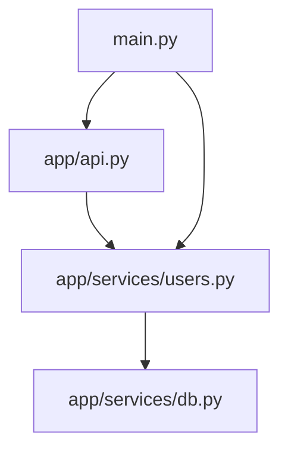

# Full Execution Flow

> ℹ️ This file renders the complete Mermaid diagram on GitHub.
> For raw Mermaid source, see [**FLOW-full.mmd**](./FLOW-full.mmd). Every file and import, ungrouped and nothing omitted: [**flow-complete.mmd**](./flow-complete.mmd)

---

Generated by [GNOST](https://gnost.readthedocs.io) <VERSION>. Try it on your own code: `npx gnost-cli onboard .`
