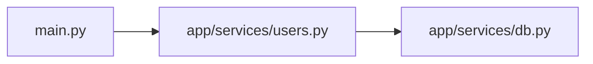
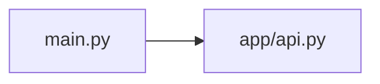

# Entry-based Execution Paths

These diagrams show individual execution paths starting from application entry points. Each path represents one possible flow through the system.

## Path 1 — `main.py`

**Execution chain:** main.py → app/services/users.py → app/services/db.py

## Path 2 — `main.py`

**Execution chain:** main.py → app/api.py

---

Generated by [GNOST](https://gnost.readthedocs.io) <VERSION>. Try it on your own code: `uvx gnost onboard .`
