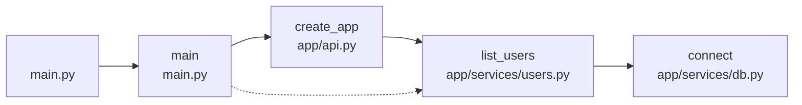

# Function-level Flow

What each entry point calls, function by function (Python only). Dotted arrows lead to a function already drawn elsewhere in the same diagram. Calls through other objects (`self.client.send()`) are not followed.

## `main.py` → `<main>`

`main.py:13` · 5 functions

---

Generated by [GNOST](https://gnost.readthedocs.io) <VERSION>. Try it on your own code: `uvx gnost onboard .`
