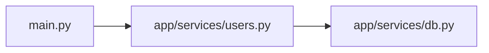
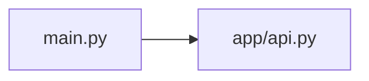
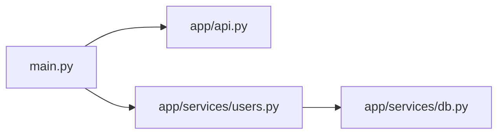

# Keyword-based Execution Paths

These diagrams show execution flows related to key features, auto-detected from the project structure.

## Feature: `app`

### Representative Paths

#### Path Group 1

**Execution chain:** main.py → app/services/users.py → app/services/db.py

#### Path Group 2

**Execution chain:** main.py → app/api.py

### Combined Flow (All `app` Paths)

## Feature: `services`

### Representative Paths

#### Path Group 1

**Execution chain:** main.py → app/services/users.py → app/services/db.py

### Combined Flow (All `services` Paths)

## Feature: `user`

### Representative Paths

#### Path Group 1

**Execution chain:** main.py → app/services/users.py → app/services/db.py

### Combined Flow (All `user` Paths)

