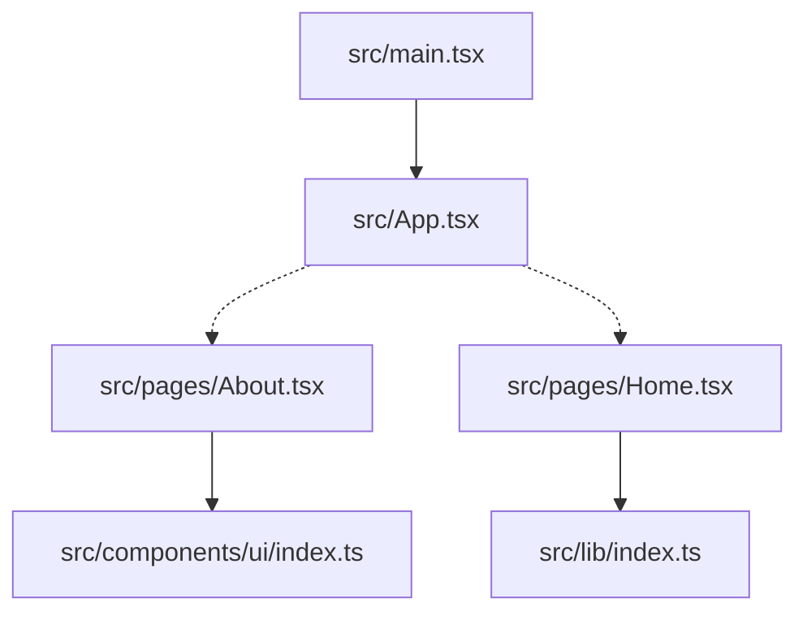

# react_app — Project Onboarding Guide

_Generated automatically by <a href='https://gnost.readthedocs.io'>GNOST</a>._

## Project Overview

- **Root:** `<ROOT>`
- **Languages:** typescript (9)
- **Framework:** React (Vite)

## Summary Table

| Language | Files | LOC |
|---|---:|---:|
| JavaScript.js | 1 | 1 |
| TypeScript.ts | 4 | 6 |
| TypeScript.tsx | 6 | 34 |

## Stats Table

| Language | Files | Code | Comments | Blanks | LOC |
|---|---:|---:|---:|---:|---:|
| JavaScript.js | 1 | 1 | 0 | 0 | 1 |
| TypeScript.ts | 4 | 5 | 0 | 1 | 6 |
| TypeScript.tsx | 6 | 29 | 0 | 5 | 34 |

## Entry Points

- `src/App.tsx` — Common JS entry filename
- `src/main.tsx` — Common JS entry filename

## Execution Flow (High Level)

- `src/main.tsx` → `src/App.tsx` → `src/components/ui/button.tsx`
- `src/main.tsx` → `src/App.tsx` → `src/hooks/useThing.ts`
- `src/main.tsx` → `src/App.tsx` → `src/pages/About.tsx` → `src/components/ui/index.ts`
- `src/main.tsx` → `src/App.tsx` → `src/pages/Home.tsx` → `src/lib/index.ts` → `src/lib/helper.ts`

## Execution Flow (Overview)

> Dotted arrows: imports that do not run when the module loads.

> 📌 This diagram shows the high-level execution flow. For the complete flow, see [**flow/flow-full.md**](./docs/flow/FLOW-full.md) Raw Mermaid: [flow/flow-full.mmd](./docs/flow/FLOW-full.mmd)

## Recommended Reading Order

### Start Here

- `src/main.tsx`

### Core Logic

- `src/App.tsx`
- `src/pages/About.tsx`
- `src/pages/Home.tsx`
- `src/components/ui/index.ts`
- `src/lib/index.ts`

### Supporting / Leaf Code

- `src/components/ui/button.tsx`
- `src/hooks/useThing.ts`
- `src/lib/helper.ts`

## 📘 First Files to Read
- **`src/main.tsx`**
  - Primary entry point into the application
- **`src/App.tsx`**
  - Primary entry point into the application
- **`src/pages/About.tsx`**
  - Core logic file referenced by multiple execution paths
- **`src/pages/Home.tsx`**
  - Core logic file referenced by multiple execution paths
- **`src/components/ui/button.tsx`**
  - Frequently involved in execution flow
- **`src/hooks/useThing.ts`**
  - Frequently involved in execution flow
- **`src/components/ui/index.ts`**
  - Core logic file referenced by multiple execution paths
- **`src/lib/index.ts`**
  - Core logic file referenced by multiple execution paths
- **`src/lib/helper.ts`**
  - Frequently involved in execution flow

## ⚠️ Caution Areas

## 🔁 Circular Dependencies

_No circular dependencies detected._
## Key Execution Paths

To understand specific scenarios, see the entry-based execution paths:

- 📍 [Entry-based Paths](docs/flow/entry-paths.md)

- 🧭 [folder-based Paths](docs/flow/folder-paths.md)

(Complete system flow: [flow/flow-full.md](docs/flow/FLOW-full.md))
