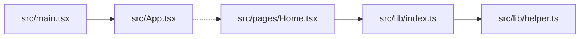
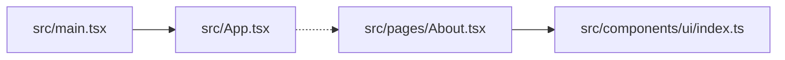
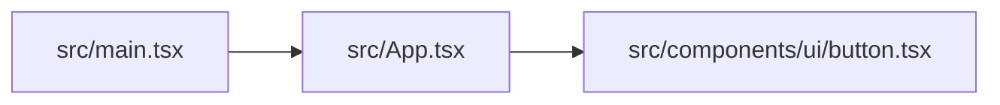

# Entry-based Execution Paths

These diagrams show individual execution paths starting from application entry points. Each path represents one possible flow through the system.

## Path 1 — `src/main.tsx`

**Execution chain:** src/main.tsx → src/App.tsx → src/pages/Home.tsx → src/lib/index.ts → src/lib/helper.ts

## Path 2 — `src/main.tsx`

**Execution chain:** src/main.tsx → src/App.tsx → src/pages/About.tsx → src/components/ui/index.ts

## Path 3 — `src/main.tsx`

**Execution chain:** src/main.tsx → src/App.tsx → src/components/ui/button.tsx
