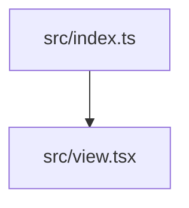

# ts_app — Project Onboarding Guide

_Generated automatically by <a href='https://gnost.readthedocs.io'>GNOST</a>._

## Project Overview

- **Root:** `<ROOT>`
- **Languages:** typescript (3)
- **Framework:** Not detected

## Summary Table

| Language | Files | LOC |
|---|---:|---:|
| TypeScript.ts | 2 | 4 |
| TypeScript.tsx | 1 | 2 |

## Stats Table

| Language | Files | Code | Comments | Blanks | LOC |
|---|---:|---:|---:|---:|---:|
| TypeScript.ts | 2 | 4 | 0 | 0 | 4 |
| TypeScript.tsx | 1 | 2 | 0 | 0 | 2 |

## Entry Points

- `src/index.ts` — Common JS entry filename

## Execution Flow (High Level)

- `src/index.ts` → `src/math.ts`
- `src/index.ts` → `src/view.tsx`

## Execution Flow (Overview)

> 📌 This diagram shows the high-level execution flow. For the complete flow, see [**flow/flow-full.md**](./docs/flow/FLOW-full.md) Raw Mermaid: [flow/flow-full.mmd](./docs/flow/FLOW-full.mmd)

## Recommended Reading Order

### Start Here

- `src/index.ts`

### Core Logic

- `src/view.tsx`

### Supporting / Leaf Code

- `src/math.ts`

## 📘 First Files to Read
- **`src/index.ts`**
  - Primary entry point into the application
- **`src/view.tsx`**
  - Core logic file referenced by multiple execution paths
- **`src/math.ts`**
  - Frequently involved in execution flow

## ⚠️ Caution Areas

## 🔁 Circular Dependencies

_No circular dependencies detected._
## Key Execution Paths

To understand specific scenarios, see the entry-based execution paths:

- 📍 [Entry-based Paths](docs/flow/entry-paths.md)

- 🧭 [folder-based Paths](docs/flow/folder-paths.md)

(Complete system flow: [flow/flow-full.md](docs/flow/FLOW-full.md))
