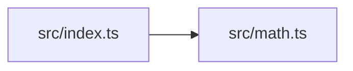
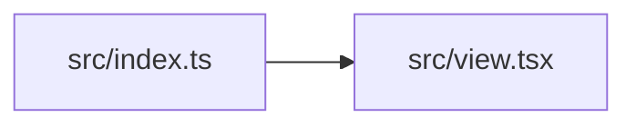

# Entry-based Execution Paths

These diagrams show individual execution paths starting from application entry points. Each path represents one possible flow through the system.

## Path 1 — `src/index.ts`

**Execution chain:** src/index.ts → src/math.ts

## Path 2 — `src/index.ts`

**Execution chain:** src/index.ts → src/view.tsx
